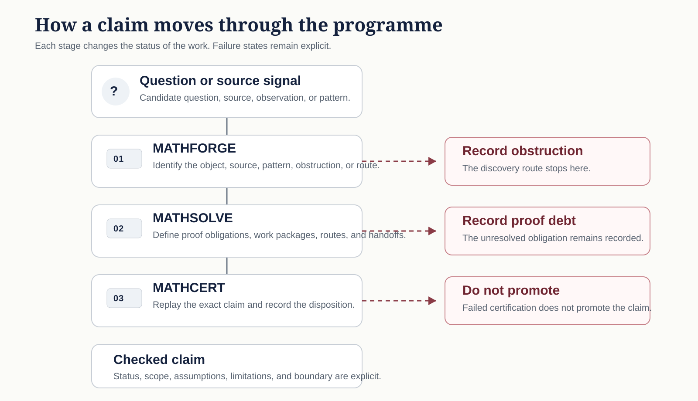

# How GCL Studies a Mathematical Question

A guide to the journey from a difficult question to a possible proof: finding the right formulation, investigating it, testing the reasoning and recording what the evidence really shows.

## A proof begins with a clear question

Mathematical discoveries rarely arrive as finished proofs. A question may first appear in an old paper, a numerical experiment or a conversation between researchers. Before attempting to solve it, we need to understand exactly what it asks and which assumptions it makes.

GCL organizes this process so that useful findings, failed approaches and unresolved difficulties are recorded rather than lost. Not every investigation ends in a proof. Discovering that a proposed argument does not work can be an important result in its own right.

The diagram illustrates the research process; its arrows are not mathematical implications or guarantees of success.

## Three parts of the work

| Stage | What happens | What readers should expect |
| --- | --- | --- |
| **Understand the problem (MATHFORGE)** | Find reliable sources, define the objects, check examples and identify possible approaches. | A clear statement of the question and a defensible starting point, not a new theorem. |
| **Develop the argument (MATHSOLVE)** | Prove smaller claims, test ideas, look for counterexamples and identify the exact step that still needs justification. | Partial results and carefully stated remaining difficulties, not necessarily a complete proof. |
| **Check the claim (MATHCERT)** | Examine the proposed proof or certificate, compare it with the intended theorem and establish exactly what has passed the required checks. | A conclusion limited to the statement and assumptions actually checked. |

These names are GCL's way of organizing research, not new kinds of mathematics. The Mathematics Programme website brings the accounts together and preserves the links to the detailed records.

## How progress can unfold

Consider an unsolved question about whether every object of a certain kind has a particular property.

First, we reconstruct the original question. We may discover that two sources use slightly different definitions; that difference must be resolved before claiming a proof.

Next, we explore small examples and attempt general arguments. A computer may check thousands of finite cases, but those cases alone do not establish a statement about infinitely many objects.

Suppose a promising argument works only if an additional assumption is true. We can publish that restricted finding and identify the missing assumption. The broader theorem remains open until the missing step is proved or another valid argument is found.

Finally, if a complete proof or independently checkable certificate is available, it can be reviewed against the exact statement it is meant to establish. The [Research and Results](SHOWCASE.md) page shows examples of work that has reached a stated publication or checking milestone.

## What different kinds of evidence tell us

Evidence is valuable when its limits are clear.

- **Examples and experiments** help discover patterns, but a pattern may fail outside the cases examined.
- **Exact calculations** can settle a specified finite question. They do not automatically settle a claim about all cases.
- **A checked certificate** verifies the precise result represented by that certificate, within its conditions.
- **A computer-checked formal proof** establishes the statement encoded for the checker, subject to its assumptions and trusted foundations.
- **A mathematical proof** establishes its stated conclusion when the reasoning and hypotheses are sound.
- **A counterexample** can refute a general claim by showing one case in which it fails.

A formal proof and the ordinary-language claim it is supposed to support must still mean the same thing. For example, proving a theorem for a restricted class of objects does not prove it for every object of that type.

## When an investigation does not succeed

A research effort may find that a source is incomplete, a necessary lemma cannot be proved, an example contradicts a conjecture or a verification step fails. We record these findings rather than silently upgrading an incomplete argument into a result.

The useful question is then: **what exactly remains missing?** Sometimes the next step is a new proof. Sometimes it is a better definition, an additional source or a clearer account of why a particular approach cannot work.

This approach also prevents a completed administrative task from being mistaken for a solved mathematical problem.

## Where to go next

If you want to see **what is being investigated**, read [Current Work](CURRENT_WORK.md). For **published explanations and checked results**, begin with [Research and Results](SHOWCASE.md). To explore the enduring mathematical questions behind the research, visit the [Mathematical Estate](domains/index.md).

Readers interested in reviewing a particular argument can use the [Reader Guide](GRAND_CHALLENGE_READER_GUIDE.md), which explains how to examine sources, assumptions, proofs and remaining uncertainties in more detail.
