---
hide:
  - navigation
---

# Auditing the 2026 Riemann Hypothesis claim: what the mathematics actually says

A public, reproducible account of the mathematical mechanisms we have reconstructed, the assumptions that make them work, and the reconstructed character inequality and the remaining proof obligations.

!!! warning "Research status · 27 November 2026"
    **Result:** independent conventional-mathematics reconstructions of *conditional* group-cohomology and local-Selmer transfer statements, with exact finite computational checks. The admitted evidence includes the denominator and conductor-change reconstruction and the new torsion-layer, counting and reciprocity reconstruction. The conditional character inequality `ML.vChar` has now been independently reconstructed, including the auxiliary-system construction, exact Bernoulli comparison, primitive ramification and exceptional vanishing. The finite-Galois character transport, aggregate good-prime bound and separate bad-prime Stickelberger estimate have also been reconstructed under their stated classical inputs. The composite-field degree restriction and combined conditional odd-prime bound are now reconstructed, as is their deterministic conversion to a downstream exponential budget under the required numerical hypotheses. The simultaneous-window selection has also been reconstructed conditional on the source's arithmetic tower estimates and Lemma K. The actual arithmetic tower descent, determinant centers and linear growth estimates have now also been reconstructed conditional on the generator bound and limiting Poitou–Tate identity. The finite-to-limit Poitou–Tate length identities have also been reconstructed under the stated finite-level classical hypotheses. The uniform arithmetic rank bound and quadratic transfer have now been reconstructed under the source's classical inputs, completing the conditional simultaneous-window spine through Lemma K. The parallel finite-module reduction behind Lemma K has been reconstructed under KBridge and the homology torsion input. The exact headline dependency has also been corrected: it uses the alternative finite class-counting route, whose conditional numerical assembly and final local contribution have now been reconstructed. The odd homology weight elimination and conditional rank argument have also been reconstructed, followed by the actual Hecke spectral contraction under its explicit classical arithmetic and measure-theoretic inputs. The Hecke detection theorem has also been reconstructed under the actual finite-generation and stability inputs, with a conventional split-extension proof of the affine vanishing. The compact-local evaluation bridge has now been reconstructed, joining the two conditional decay estimates on the same cycle evaluations. The source height and smooth partition of unity have now been conventionally reconstructed, with the dimension-independent height exponent one. The finite height-moment theorem is now conventionally reconstructed with the source's dimension threshold; the actual representing-form construction remains open. The counting and reciprocity arguments retain their stated classical-duality inputs.

    **Not established:** a new proof of the Riemann Hypothesis (RH) or Dirichlet Generalized Riemann Hypothesis (GRH); mathematical correctness of every definition in the submitted Lean source; complete independent Lean kernel replay; exact formal correspondence of all foundational hypotheses and downstream mathematical bridges; MATHCERT certification.

    **Evidence classes:** source audit, conventional conditional mathematical proof, exact finite verification, and regression tests. Repository merge, finite computations, and public exposition are **not** proof certification.

    **Authority:** [RH-001 live programme tracker](https://github.com/grandchallenge/MATH-PROGRAMME/issues/163) · [RH-A26 audit tracker](https://github.com/grandchallenge/MATHFORGE/issues/577) · [original claim verification guide](riemann_hypothesis_2026_lean_announcement.md) · [MATHFORGE protected audit PRs](#the-evidence-a-reader-can-open).

## 1. The question

The Riemann Hypothesis concerns the hidden regularity of prime numbers. It asserts that every *nontrivial* zero of the analytically continued Riemann zeta function has real part one-half:

$$
\zeta(s)=0,\quad 0<\Re(s)<1
\quad\Longrightarrow\quad
\Re(s)=\frac12.
$$

In November 2026, an external submission by Alpöge and Claude claimed a formal Lean proof of RH and certain generalized statements. Our task is to establish **what the actual formal source says**, **which mathematical bridges can be reconstructed independently**, and **which evidence would warrant accepting the whole claim**. See the separate [source-critical announcement guide](riemann_hypothesis_2026_lean_announcement.md) for the submission, external replay reports, original sources, and historical context.

### Why anyone studies this question

Counting primes is easy for a small range: list the numbers, eliminate those that are not prime, and count what remains. Predicting the count across arbitrarily large ranges is much harder. The striking fact is that a smooth mathematical function predicts this irregular staircase remarkably well. RH would give strong control over the error in suitable prime-counting estimates.

*Figure A. What RH says.* The horizontal position of a zero is its real part. The five dots show known zeros; their vertical positions are calculated from known zero heights. RH says **every** nontrivial zero is on the middle line, including those beyond the plotted range. The figure does not show that there are no other zeros elsewhere.

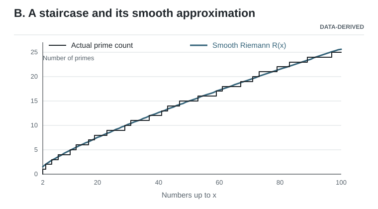

*Figure B. Why the zeros matter.* The black staircase counts actual primes; it rises by one each time another prime appears. The blue curve is a smooth approximation called Riemann's prime-counting approximation, sampled at integer arguments. Their closeness illustrates the kind of regularity number theory seeks to explain. It does not prove an error bound or RH.

### How to read this investigation

The authors' claimed proof is not a calculation of more zeta zeros. It proceeds through a long sequence of arithmetic statements. Our investigation works backward from the final claim, identifying the statements it needs and testing whether their hypotheses really justify the next step. The mathematical tools introduced below are examples of that work.

The underlying problem is infinite. Testing many primes, evaluating many zeta zeros, or compiling many files can inform an investigation; none of those facts alone proves the intended mathematical statement.

**A useful distinction:** the arithmetic object called `Sha` in this source is a specifically defined kernel of first-cohomology restriction maps with selected local conditions. It must not silently be identified with every classical use of the notation “Tate–Shafarevich group”. Its meaning comes from the *definition in the source*.

## 2. The obstruction: a change of viewpoint can discard information

Much of the proposed argument replaces a difficult arithmetic object by another description in which its structure is easier to study. The first question is whether that replacement preserves the information one needs.

For example, let $C_3$ be a cyclic group of order three, acting trivially on the field $\mathbb F_3$. A first-cohomology class here is essentially an additive homomorphism from $C_3$ to $\mathbb F_3$. There are three:

$$
H^1(C_3,\mathbb F_3)\cong\mathbb F_3.
$$

But the trivial subgroup has no nonzero first-cohomology classes:

$$
H^1(\{1\},\mathbb F_3)=0.
$$

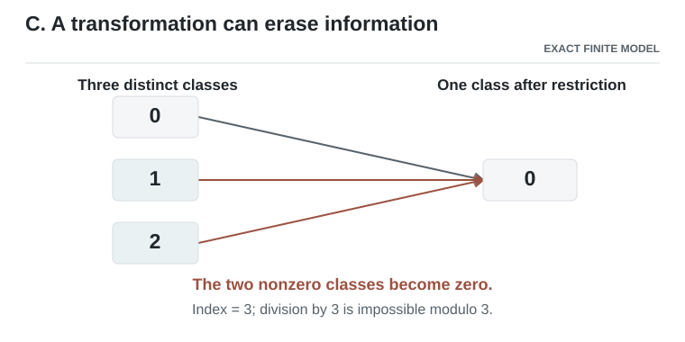

*Figure C. A concrete information-loss test.* Imagine three genuinely distinct answers to a mathematical question. After restricting the question to a smaller setting, all three answers look the same. In this exact example, the two nonzero classes become zero, and the zero class stays zero. The labels are literal class representatives; their placement is only for readability.

Why does the collapse occur? The subgroup index is three, and three is zero in the coefficient field. Averaging by dividing by three is impossible. We need to know when a proof's change of viewpoint preserves the distinctions that matter.

This is not a counterexample to RH. It is a precise counterexample to a *careless version of a technique* that the submitted proof must use correctly.

### A closer look: what is a cohomology class?

For this example, think of a group as a set of operations that can be composed, and a cocycle as a consistent rule recording how those operations change a quantity. Two such rules are treated as equivalent if they differ only by a change of reference value. A cohomology class records the distinction that survives those changes of reference. In the example above the action is trivial, so this reduces to the very concrete question of which additive values the generator may take.

### Worked example A · exact loss of information

The exact calculation enumerates all cyclic one-cocycles and their coboundaries:

| Group and coefficients | Action | Number of distinct $H^1$ classes | Meaning |
| --- | --- | ---: | --- |
| $C_3$ on $\mathbb F_3$ | trivial | 3 | index divisible by characteristic; information survives in the large group |
| $C_2$ on $\mathbb F_3$ | trivial | 1 | prime-to-index case; no nonzero class |
| $C_4$ on $\mathbb F_5$ | multiplication by 2 | 1 | nontrivial scalar action; cocycles are all coboundaries |
| $C_2$ on $\mathbb F_2$ | trivial | 2 | another excluded-index case |

For a generator acting by a scalar $a$ on $\mathbb F_p$, the calculation is entirely explicit:

$$
Z^1=\{z:(1+a+\cdots+a^{m-1})z=0\},
\qquad
B^1=\{(a-1)b:b\in\mathbb F_p\}.
$$

Here $a^m=1$ in $\mathbb F_p$. The first set contains possible cocycles; the second contains those representing the zero cohomology class. The quotient $Z^1/B^1$ is what the test computes.

## 3. A rule for when information is preserved

Let $U'$ be a normal subgroup of $U$ with finite index $m$. Suppose $m$ is invertible in the coefficient ring and the usual continuous cohomology hypotheses hold.

Then restriction identifies the first cohomology of $U$ with the invariant part, under $U/U'$, of the first cohomology of $U'$:

$$
H^1(U,M)\;\cong\;H^1(U',M)^{U/U'}.
$$

The reason is an averaging argument. When division by $m$ is available, the finite quotient's higher cohomology vanishes, making restriction reversible onto the invariant classes.

But arithmetic imposes **additional local tests**. At each prescribed local subgroup $D$, an allowed class must become zero after restricting to $U\cap D$. Denote the set of such classes by $S(U)$.

The same argument extends to these *local-kernel* classes:

$$
S(U)\;\cong\;S(U')^{U/U'}.
$$

Crucially, the local index

$$
[U\cap D:U'\cap D]
$$

divides $m$. The ability to divide by the global index therefore applies to every local comparison. Without that divisibility argument, the local conclusion would not follow from the global one.

**What we learned:** it is not enough for a transformation to preserve the ambient cohomology. It must preserve the exact restrictions that define the arithmetic object.

## 4. The second transformation: forgetting ramification without forgetting the mathematics

A Galois group encodes ways of permuting algebraic numbers while preserving the base field. Some of these symmetries are grouped into *inertia groups* associated with primes. At a prime, inertia records how a field extension is ramified.

To see how one can deliberately forget certain distinctions without losing a particular answer, start with six permutations of three objects. We can group them into two types: those that are even and those that are odd. Any function taking the same value on all permutations of each type can be described by only two values.

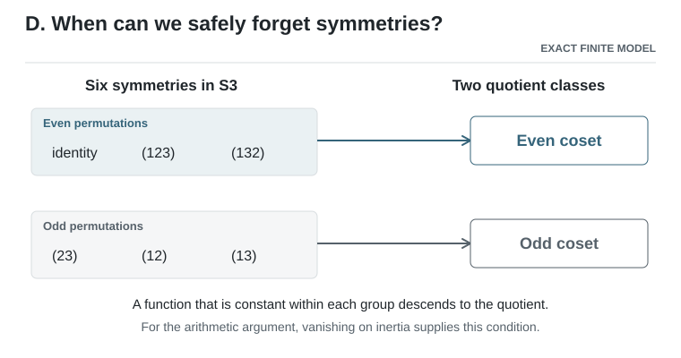

*Figure D. A small model of a quotient.* The six permutations and their grouping into two cosets are exact; box sizes and arrow placement carry no mathematical scale. If a function cannot distinguish the three members of each group, the two-class description contains all the information that function uses. This is a finite analogy to the Galois quotient, not a picture of the actual infinite Galois group.

In the arithmetic argument we need more than an arbitrary function: we need a continuous cocycle, a function satisfying a special compatibility rule under composition. Fix a finite set of primes $S$. Let $G$ be the relevant absolute Galois group, and let $N$ be the **closed normal subgroup generated by all inertia groups outside $S$**. The quotient $G/N$ deliberately forgets those ramification symmetries. The point of the proof is to establish that the cocycle truly cannot distinguish elements within a coset, not to assume that the discarded information is irrelevant.

The source's `InfUnram` mechanism states that, if the coefficient representation already factors through $G/N$, a continuous class in $H^1(G,M)$ comes from the quotient exactly when it restricts to zero on all inertia groups outside $S$.

The central argument is short enough to understand:

1. Because the representation factors through $G/N$, elements of $N$ act trivially on the coefficients.
2. If a cocycle's class is zero on a specified inertia group, its restricted cocycle is a coboundary; here such a coboundary is literally zero because that inertia group acts trivially.
3. The cocycle-zero elements inside $N$ form a **closed normal subgroup**. They contain all the specified inertia groups, and thus contain the closed normal subgroup generated by them: all of $N$.
4. The cocycle is constant on cosets of $N$, so it descends to a continuous cocycle on $G/N$. Conversely, any inflated quotient cocycle vanishes on $N$.

This proves the mathematical descent principle **under its stated continuity, Hausdorffness, normal-closure, and representation hypotheses**. Removing those assumptions would change the statement.

The associated `shaInfl` comparison makes an additional step: local vanishing on one chosen decomposition group over a prime must represent the same condition at **all** places over that prime. This uses the standard Galois-theoretic transitivity of places and the conjugation behavior of cocycles. The original source contains explicit constructions for these comparisons.

### Worked example B · the local condition is not decorative

We tested local restriction kernels in exact finite cyclic groups, including both prime-to-index and excluded-index cases. The separate MATHFORGE fixture passed **7,448** prime-to-index comparisons and recorded **1,306** excluded-index failures.

A stronger noncommutative test used $G=S_3$, its normal subgroup $N=A_3$, and quotient $G/N=C_2$, with six possible local subgroups and finite-field coefficients. All **72** tested local-Selmer comparisons matched. In one nontrivial coefficient setting, dropping the inertia condition outside $S$ admitted **two additional cohomology classes** that could not have come from quotient inflation.

Separate exact programs perform the full noncommutative enumeration and representative cyclic local-kernel calculations. Neither bounded test replaces the general argument or independently checks the original Lean kernel.

## 5. Where these results belong in the submitted proof

These objects are not isolated puzzles. They form a *dependency structure* whose links need individual verification. The following map is a reading guide to the audit as recorded on this page, not the entire original proof or a measurement of percentage complete.

*Figure E. Earlier audit snapshot, 24 November 2026.* We have reconstructed rules for moving information between mathematical descriptions. The diagram records the earlier boundary; sections 8 and 9 explain the subsequent auxiliary-system and Bernoulli valuation advances. Section 10 records the subsequent complete conditional character inequality; source replay and downstream proof obligations remain open. The arrows give a reading order, not a complete theorem-dependency graph. Neither a successful transfer nor this map establishes RH.

For readers who want to see the precise source statements, the following table identifies the named components:

| Source component | Role | Current audit boundary |
| --- | --- | --- |
| `InfUnram` | Recover classes on the unramified quotient from specified inertia-vanishing conditions | Conditional mathematical argument independently reconstructed; full source replay open |
| `shaInfl` | Match quotient-local `Sha1` with full-group `ShaAbs` | Conditional mathematical argument reconstructed, assuming standard Galois place-transitivity foundations |
| `shaModel`, `shaLenEq` | Connect the original arithmetic `Sha` module and its Galois eigenspaces to the transported Selmer model | Genuine source-level constructions located and dependency-traced; exact implementation not independently verified |
| `eigV`, `selUnit` | Transfer eigenspace lengths across a finite-index subgroup under an invertibility condition | Abstract and local-kernel mechanisms independently reconstructed |
| `shaToShT` | Pass from uniformly bounded torsion layers to the full group | Independent mathematical proof under the source unit and ramification hypotheses |
| `ML.recip`, `ML.count` | Derive local cancellation and count by a finite valuation budget | Reconstructed using classical duality and the auxiliary-system contract; construction of the latter now independently reconstructed |
| `NuSysEx` | Construct the compatible auxiliary arithmetic system | Independently reconstructed using stated classical number-theoretic results |
| `zEval` | Connect the auxiliary sum to normalized generalized Bernoulli values | Exact valuation equality and both divisibilities reconstructed on the nonexceptional branch |
| `primRam`, `exc` | Establish primitive ramification and exceptional vanishing | Reconstructed using stated classical cyclotomic and local-field facts |
| **`ML.vChar`** | Relate generalized Bernoulli quantities to the lengths of these arithmetic eigenspaces | **Full conditional inequality reconstructed**; source `Rec` and the stated classical foundations retained |

The word **conditional** matters. In the source, the valuation theorem begins with a hypothesis `Rec → ...`. To obtain an unconditional consequence one must establish that hypothesis, discharge all other assumptions, and verify that the formal statements describe the claimed classical problem.

We have reconstructed important pieces of the *transfer machinery*. We have **not** turned a conditional source theorem into an unconditional RH proof.

## 6. Why Bernoulli numbers appear

Ordinary Bernoulli numbers arise in formulas linking sums of powers, special values of the zeta function, and other arithmetic identities. *Generalized* Bernoulli numbers incorporate a Dirichlet character: a multiplicative rule that assigns numbers to residue classes.

For conductor $N$, a character $\chi$, and positive integer $k$, the source uses a normalization of the form

$$
B_{k,\chi}
=N^{k-1}\sum_{a=1}^{N}
\chi(a)B_k\!\left(\frac aN\right),
$$

where $B_k(x)$ is the Bernoulli polynomial of order $k$. This is an **exact algebraic expression**, not an approximation to a zeta zero.

### Worked example C · exact Bernoulli arithmetic

The following examples use exact fractions rather than decimal approximations:

| Character and index | Generalized Bernoulli value | Sufficient denominator multiplier | Exact product |
| --- | ---: | ---: | ---: |
| Odd primitive character modulo $4$, $k=1$ | $-1/2$ | $8$ | $-4$ |
| Quadratic even character modulo $5$, $k=2$ | $4/5$ | $30$ | $24$ |

The source defines the conservative bound

$$
d(N,k)=N\prod_{p\le k+1,\;p\text{ prime}}p.
$$

The two computations demonstrate *how* a denominator multiplier can turn a rational generalized Bernoulli value into an integer. They do **not** establish the source's general integrality lemma, its valuation estimates at the prime $p$, or the desired inequality on genuine cohomology groups.

A divisibility measurement asks how many times a prime divides a number. For example, 24 is divisible by 2 three times, but 25 is not divisible by 2 at all. The source uses a more general version of this measurement, a valuation, and compares it with the length of an arithmetic module. That length measures its algebraic complexity in a precise sense; it is not the physical size of an object.

The character inequality `ML.vChar` requires a quantitative comparison between the divisibility of such arithmetic values and a cohomological length. The routine conductor reduction and denominator divisibility lemmas support this step, but they are not the step itself.

### What changes when we use a larger modulus?

A periodic arithmetic rule can be described using a longer period than it really needs. The shortest modulus supporting the character is its *conductor*. For example, a character with conductor 5 can also be represented modulo 10, by pulling back its values on invertible residues and assigning zero on the nonunits.

But there are two different calculations one might perform. The primitive Bernoulli value uses the original conductor. The ordinary generalized sum at the larger modulus includes the additional nonunit exclusions. They need not agree.

| Calculation | Exact value |
| --- | ---: |
| Primitive Bernoulli value at conductor 5, order 2 | 4/5 |
| Same primitive value represented at modulus 10 | 4/5 |
| Ordinary generalized sum at modulus 10 | 12/5 |
| Primitive value multiplied by the denominator bound at level 5 | 24 |
| Primitive value multiplied by the denominator bound at level 10 | 48 |

The last number doubles for a simple reason: the source's denominator multiplier doubles, while its primitive value stays fixed. Computing the ordinary sum instead would produce 144, an incorrect substitute for the quantity required by the proof.

Our independent reconstruction explains why the multiplier clears denominators in general, using the classical von Staudt–Clausen theorem for Bernoulli numbers. It also establishes the exact cost of raising the modulus: when the larger modulus is a multiple of the conductor, the scaled primitive quantity is multiplied by their ratio. At a prime not dividing that ratio, the divisibility measurement does not change.

For example, 24 and 48 are each divisible by 3 once. The extra factor of 2 makes no difference at prime 3. This is a precise way to prevent a change of mathematical description from silently increasing the arithmetic bound.

**Evidence:** the independent [arithmetic audit PR #604](https://github.com/grandchallenge/MATHFORGE/pull/604) records the argument and exact tests: 5,100 coefficient calculations, 192 conductor cases, and 576 nonzero valuation comparisons. The proof uses standard classical Bernoulli and finite-character results; the examples are supporting checks, not a proof of the cohomology inequality. The primitive-character estimate requires a genuine compatible auxiliary system and its connection to the Bernoulli value. The following section explains the independently reconstructed counting and reciprocity mechanisms.

## 7. How a bound on finite pieces controls the whole group

A torsion element is one that becomes zero when multiplied by some nonzero integer. In this investigation we work with successive powers of a prime, and more generally of a uniformizer in the coefficient ring. Each layer contains the elements killed at that level.

Imagine that a mathematical structure has an unknown size. Every part of it can eventually be captured in a growing sequence of layers. If **each layer has the same upper bound**, the whole structure must obey that bound. Otherwise we could choose finitely many elements witnessing a violation and find one layer containing all of them.

There is an important distinction: each layer being finite is not enough. The sequence of cyclic groups of orders $3,9,27,81,\ldots$ can be nested in an infinite group. Their lengths are $1,2,3,4,\ldots$; there is no common upper bound.

The original arithmetic proof has an extra difficulty. A cohomology class is represented by a cocycle, and the local restrictions must survive when we put it into a torsion layer. We reconstructed the required normalization: a certain invertible difference makes one representative unique; compactness then bounds its values, and the ramification hypotheses give a common bound on its local witnesses.

This proves the source's full-group transfer under its actual hypotheses. It does not assume in advance that the full group is finite.

### Counting by eliminating possibilities

The next argument compares two quantities: the length of the module of still-allowed cocycles and the divisibility of a number associated with an auxiliary arithmetic system. Each chosen auxiliary prime imposes another local test. If any nonzero cocycle remains, a carefully chosen prime detects one.

The proof measures its progress with an integer budget:

The remaining module length plus the divisibility measurement is at most the fixed budget. In symbols, $\ell(S_L)+j(L)\le J$.

Here $L$ is a list of auxiliary primes, $S_L$ is the module satisfying the resulting local tests, $j(L)$ is a divisibility measurement of an annihilator, and $J$ is a fixed upper bound. At every nonzero stage the next prime strictly increases $j$, while the length lost from $S_L$ is no greater than the increase in $j$. After finitely many steps there must be no nonzero cocycles left. Running that comparison backward bounds the starting length.

For an illustration, suppose $J=5$ and the starting divisibility measurement is 2. The remaining length can be at most 3. A step increasing the measurement by one can remove at most one unit of length. It cannot keep increasing beyond 5. These numbers illustrate the logic, not measured values of the actual arithmetic module.

**Why reciprocity is needed:** local data at distinct primes are not independent. The proof pairs two arithmetic cocycles, obtaining a degree-two class whose local contributions must cancel globally. If every contribution except one is zero, the remaining contribution is zero too. The local duality property then converts that vanishing into the product-zero relation needed in the counting step.

We independently reconstructed the pairing argument from the stated classical global and local duality properties, the auxiliary-prime selection using Chebotarev, and the counting inequality using the actual auxiliary-system contract. The construction of the compatible auxiliary system has since been independently reconstructed, as explained in the next section. The Bernoulli divisibility witnesses and exceptional case have since been reconstructed, as explained in sections 9 and 10.

The [technical audit PR #605](https://github.com/grandchallenge/MATHFORGE/pull/605) supplies the mathematical arguments and exact finite checks, with the imported theorems identified. Those checks exercise the algebra, not the global arithmetic duality theorem.

## 8. Building arithmetic objects that agree at different primes

The counting argument above needs a family of compatible arithmetic objects. We have now independently reconstructed its construction from classical number theory, rather than assuming the family exists.

The starting point is a *Jacobi sum*. To form one, assign a root of unity to every nonzero residue modulo a prime, using a rule that respects multiplication. Multiply the value at each residue by a suitable power of the value at its complement, then add these products over the residue field. The result is an exact algebraic number. Products and ratios of these sums have prime-ideal factorizations that can be controlled by integer arithmetic.

### A worked example of compatibility

A small calculation illustrates the arithmetic behind that control. Use level 3 and an auxiliary prime 7, giving the larger level 21. With the integer parameter 2, the source's exponent at a residue is the difference between two rounded-down fractions: twice the residue divided by the level, minus twice the opposite residue divided by the level.

At level 3, the residue 1 has exponent −1. At level 21, its invertible lifts are as follows.

| Residue at level 21 | Exponent |
| ---: | ---: |
| 1 | −1 |
| 4 | −1 |
| 10 | −1 |
| 13 | 1 |
| 16 | 1 |
| 19 | 1 |
| **Sum** | **0** |

The other lift, 7, is excluded because it is not invertible modulo 21. The six retained exponents cancel exactly. This is not a coincidence: the general floor-distribution identity says that their sum equals the difference of two level-3 exponents. Here both are −1 because 7 acts as 1 modulo 3. The calculation shows one small part of how a prime-ideal factorization at a larger level relates to the smaller one; it is not itself a construction of the entire auxiliary system.

### From exact arithmetic to the counting argument

The construction proceeds through three mathematical stages.

1. **Build the starting elements.** The Jacobi sums determine the needed prime-ideal factors. A classical ideal-class argument extends the construction from suitable split primes to the particular ideals required by the proof.
2. **Make the elements agree across levels.** The norm and congruence relations initially hold up to roots of unity, which are numbers whose positive integer powers equal 1. A carefully chosen transformation removes these factors, producing exact relations and leaving the arithmetic values that the proof needs.
3. **Extract compatible classes.** A derivative construction and an extraction of roots give the arithmetic cocycles used in the counting argument. We established the required vanishing away from the specified primes, the exact relation between consecutive levels, and the correct initial value.

The central achievement is not another finite computation. It is the conventional mathematical reconstruction of the auxiliary system for every admissible finite prime list, using stated classical cyclotomic, class-field and local-field theorems. Its transitions multiply by a unit, so the information used to detect a surviving cocycle is not lost.

The [technical audit PR #606](https://github.com/grandchallenge/MATHFORGE/pull/606) records the construction and the precise imported foundations. Supporting tests checked 49,560 exponent-distribution identities, 3,256 finite-field Jacobi reductions, and further derivative and character-sum identities. These are checks on the arithmetic ingredients, not a verification of the complete submitted formal proof.

The precise divisibility comparison with the generalized Bernoulli value has now been reconstructed, as explained in the next section. The character-ramification bridge and exceptional case have since been reconstructed. We have also not independently replayed the original Lean proof or verified the exact correspondence of all its foundational imports.

## 9. Connecting the auxiliary system to Bernoulli values

The previous sections explain how to construct a system of arithmetic objects and use it to bound the length of a cohomology group. One connection was still missing: the number governing that bound had to be related to the generalized Bernoulli value appearing in the submitted proof.

We have independently reconstructed that connection, under the original nonexceptional character hypothesis. The argument compares the auxiliary integer-weighted sum with a Bernoulli polynomial expression, retaining the denominator that is necessary to control the error.

### Why divisibility can be stable even when numbers differ

Suppose we are measuring divisibility by 3. The numbers 24 and 51 differ by 27. Both are divisible by 3 exactly once. Adding a multiple of 27 cannot change that first nonzero level of divisibility.

More generally, if two nonzero quantities agree to a precision exceeding the divisibility measurement of one of them, their measurements agree exactly. This is the decisive property of the prime-adic valuation. It replaces a familiar real-number error estimate with a different kind of precision: agreement modulo increasingly high powers of a prime.

### The genuine arithmetic comparison

The source uses a finite weighted sum at a modulus that grows by powers of a prime. Its weights approximate the prescribed character values at that precision. A Bernoulli polynomial expansion gives a congruence linking that sum to the normalized generalized Bernoulli value. The proof explicitly clears denominators before estimating the error.

The nonexceptional hypothesis supplies a multiplier that is invertible at the chosen prime. This ensures that the comparison does not silently erase the divisibility information. Once the modulus is large enough, the error lies beyond the first nonzero valuation of the target, so the auxiliary value and normalized Bernoulli value have exactly the same valuation.

For the quadratic character of conductor 5, the generalized Bernoulli value at order 2 is $4/5$, and the normalized value is $2/5$. At prime 3, the following exact integer sums occur:

| Auxiliary modulus | Integer-weighted sum | Divisibility by 3 |
| ---: | ---: | ---: |
| 15 | 8 | 0 |
| 45 | 8 | 0 |
| 135 | 8 | 0 |
| 405 | 8 | 0 |

These are finite representative sums, not explicit computations of absolute Galois automorphisms. The general proof establishes that the actual auxiliary value agrees with the representative sum at the required precision. Both have valuation zero at prime 3 in this example. The conservative denominator-cleared Bernoulli quantity is 24, with valuation one. The new argument accounts for that extra factor rather than treating it as an unknown loss.

A second example shows that the equality is not limited to units: for the quadratic character of conductor 8 at order 4, the normalized value is −11, with valuation one at prime 11. The high-precision finite representatives have that same valuation.

**The exceptional condition is necessary.** For the trivial character at order 2 and prime 3, the normalized value is $1/12$. Its valuation is negative, whereas the auxiliary sum is integral. The invertible multiplier required by the proof does not exist in this case. The nonexceptional comparison cannot be extended to it by the same argument.

The [technical audit PR #607](https://github.com/grandchallenge/MATHFORGE/pull/607) reconstructs both divisibility witnesses for every nonzero input and proves the exact valuation identity. It also identifies the precise precision threshold and the loss from the conservative denominator multiplier. The exact regression checked 18,261 pointwise identities, including 6,342 requiring the denominator, 173 level-change identities, 146 weighted congruences, 315 stable representative valuations and 528 divisibility comparisons. These are checks on the arithmetic, not a replacement for the general argument.

Section 10 explains the subsequent reconstruction of character ramification and exceptional vanishing, completing the conditional primitive estimate. The foundational correspondence and original Lean replay remain open.

## 10. Completing the character inequality: two routes to the bound

The last part of this arithmetic argument divides into two cases. We have now independently reconstructed both, using the stated classical arithmetic foundations, and assembled the full conditional character inequality.

In the ordinary case, a suitable arithmetic multiplier is invertible at the prime under consideration. The preceding auxiliary-system construction, counting argument and Bernoulli comparison then give a bound on the length of the cohomology group. A primitive character cannot discard a prime that actually divides its conductor: otherwise it would be describable at a smaller modulus. When its order is prime to the measuring prime, its nonidentity values differ from 1 by a unit. This supplies the precise ramification condition needed to transfer the bound to the full group.

In the exceptional case, the multiplier is not invertible. Instead of using that comparison anyway, the proof establishes that the cohomology group itself is zero.

### Why a rational power can resolve an exceptional case

Consider the rational number −8/125. Its prime exponents are 3 at the prime 2 and −3 at the prime 5, with zero at every other prime. Every exponent is divisible by 3, so the number is exactly the cube of −2/5.

This observation is general: if every prime exponent of a nonzero rational number is divisible by an odd prime, the rational number is a power of that order. The sign causes no additional obstruction for odd powers.

The exceptional-case proof translates a residual cohomology class into an algebraic root of a rational number. Its vanishing on inertia means that at each rational prime the root lies in an unramified local extension, where its normalized valuation is integral. Consequently the rational number has a prime exponent divisible by the chosen odd prime at every place. It must already have the required rational root.

The class therefore represents a coboundary, a change of reference rather than new arithmetic information. Normalization makes this coboundary zero. Repeating this reasoning through the torsion layers proves that the full locally constrained cohomology group vanishes.

### What has actually been established

| Branch | Result of the reconstruction |
| --- | --- |
| Nonexceptional | The cohomology length is bounded by the valuation of the generalized Bernoulli value divided by its order. |
| Exceptional | The entire relevant cohomology group vanishes. |
| Character represented at a larger modulus | The underlying Galois character is unchanged, and the source's denominator-cleared quantity is multiplied by the ratio of moduli. |

Combining these cases gives the exact conditional statement `ML.vChar` in the submitted source. The nonexceptional estimate is actually sharper than its conservative denominator-cleared bound. This sharper estimate must not be applied in the exceptional case, where the normalized Bernoulli value can have negative valuation.

The [technical reconstruction PR #608](https://github.com/grandchallenge/MATHFORGE/pull/608) records the primitive ramification proof, exceptional Kummer argument and assembled inequality. Supporting exact computations enumerate 490 characters at levels up to 40, check 348 primitive ramification kernels, 3,357 unramified kernels, 28 exceptional and 3,158 nonexceptional comparisons, and 3,750 signed rational-power examples. These are finite controls, not a computation of the full cohomology groups.

This is a substantive advance in understanding the submitted arithmetic argument, not a proof of RH. The inequality explicitly retains the source reciprocity hypothesis, which has been reconstructed from specified classical duality properties. The exact formal correspondence of those foundations, the subsequent use of the inequality in the larger proof and independent replay of the original Lean declarations remain to be established.

## 11. How separate character bounds become one shared arithmetic budget

The preceding character inequality bounds one part of a larger arithmetic object. To apply it to the number field itself, we must first separate the object into character components, and then bring their bounds back together. This is a change of mathematical viewpoint that needs the same care as the earlier restriction arguments.

The field's finite group of symmetries acts on the arithmetic cohomology group. Characters describe the possible scalar responses to those symmetries. At an odd prime that does not divide the field degree, the group order is invertible in the coefficient ring. Averaging with the character weights therefore gives projections onto separate components. Their sum is the identity, so no information is lost. Complex conjugation selects precisely half the characters of a CM field for either prescribed sign. The relevant sign here is determined by the order of the Bernoulli value; it is not always minus one.

The reconstructed character inequality controls each of these components. Their lengths can be added, with the precise correction for the coefficient ring's valuation normalization.

### One integer, many local bounds

There is a further simplification. The denominator-cleared Bernoulli values for the full selected character set are algebraic integers. Although individual values may be complex, the collection is preserved by algebraic conjugation. Their product is consequently a rational algebraic integer, hence an ordinary integer. It is nonzero by the previously reconstructed Bernoulli nonvanishing argument.

For example, take the field generated by a fifth root of unity, with Bernoulli order 3. Two character values contribute the following denominator-cleared numbers.

| Contribution | Exact value |
| --- | ---: |
| First character | 72 + 36i |
| Conjugate character | 72 − 36i |
| Product | 6480 |
| Prime factorization | 2⁴ × 3⁴ × 5 |

The prime factorization of 6480 bounds the total divisibility available across the selected characters. At prime 5, for example, the product contains just one factor of 5. The corresponding arithmetic length is therefore at most 1. At a good prime not dividing 6480, that length must be zero. These are consequences of the conditional theorem, not computations of the actual cohomology groups.

In general the product of all selected character contributions serves as a common budget. The sum of the local lengths weighted by the logarithms of their primes is bounded by the logarithm of the absolute value of that one integer. A classical bound on Bernoulli polynomials controls its ordinary size. We have reconstructed this argument with the exact constant in the submitted source and obtained a factor-of-two improvement by using the precise parity count.

The [technical reconstruction PR #609](https://github.com/grandchallenge/MATHFORGE/pull/609) records the field-action transport, the sign and coefficient-ring identifications, and the good-prime aggregate bound. Exact finite controls checked 1,056 projection products, 68 sign decompositions, 36 parity-selected integer products and 360 local valuation sums. The proof uses the stated classical Galois, local-field and reciprocity inputs.

**Why this does not finish the proof:** the projection argument requires division by the group order. It cannot be carried over automatically to primes dividing the field degree, or to the prime 2. The submitted proof has a separate bound for those cases, reconstructed in the following section.

## 12. Controlling the primes where character projections fail

At a prime dividing the field degree, the previous averaging argument cannot be used: the order of the symmetry group is no longer invertible. This is a mathematical obstruction, not merely a computational inconvenience. The submitted proof has a separate route that we have now independently reconstructed under its stated classical foundations.

The alternative is to construct an arithmetic annihilator. An annihilator is a scalar or operator that sends every element of a given module to zero. In this setting, its existence establishes a limit on the number of successive torsion layers that the module can possess.

### Depth and width

Imagine four successive layers of arithmetic information, of lengths 5, 4, 3 and 2. Each successive layer injects into the first. If we only know that the first has length at most 5 and that there are at most 4 layers, the total length is at most 20. The actual illustrative total is 14. The same reasoning works for the true arithmetic module without assuming its finiteness beforehand.

There are three steps in the genuine proof.

| Step | What it establishes |
| --- | --- |
| `killPow` | A single power of the prime annihilates the specified sign component; this bounds the number of layers. |
| `gen` | The first layer of the ambient cohomology group injects, through radical extraction, into a finite group controlled by units and the ideal class group of a cyclotomic extension. |
| `lenPow` | Every subsequent layer injects into the first, so the two bounds multiply. |

### Why a determinant replaces division by the group order

The proof starts with the classical Stickelberger annihilation theorem, which concerns ideal classes in cyclotomic fields. It transports the annihilation relation through the class field correspondence and compares the resulting finite-level expressions with a single prime-adically integral operator. The Bernoulli distribution and congruence identities make that operator independent of the level used in the approximation.

Complex conjugation pairs group elements. Imposing the prescribed sign identifies one member of each pair with either the other member or its negative. The resulting module has one basis element per pair, even when division by 2 or by the full group order is impossible.

Multiplication by the annihilating operator on this signed quotient has an integral matrix. Its determinant is a scalar that also annihilates the original sign component. Over the complex numbers, the determinant is a product of character evaluations involving ordinary generalized Bernoulli values, which are nonzero at the matching parity and order. Here the complex character calculation establishes nonvanishing and an upper bound on size; it does not assert a decomposition of the original arithmetic module at a bad prime.

The ordinary size of the determinant bounds how many factors of the measuring prime it can contain. Together with a finite-index correction and the first-layer estimate, this bounds the full cohomology length.

### The quantitative result

For a CM field of degree $d$ contained in a cyclotomic field of modulus $N$, the reconstructed annihilating-power estimate has constant 5, rather than the source proof's constant 30. The first-layer estimate retains the source constant 8. Multiplying gives a uniform constant 40 in the source's `StickBound` inequality, compared with 240 obtainable from the submitted intermediate estimates.

The improvement uses the exact half-rank of the signed determinant and a direct bound on the factorial and denominator factors. It is not an assertion that 40 is optimal. The proof requires the source's procyclic cyclotomic-image condition, which is automatic at odd primes; at prime 2 the additional condition must hold.

The [technical reconstruction PR #610](https://github.com/grandchallenge/MATHFORGE/pull/610) records the full conventional argument. Exact computational controls passed 1,212 twisted congruences, 1,572 distribution identities, 126 signed determinants, 180 bad-prime comparisons, 2,500 length bounds and 1,200 constant inequalities. These are finite checks, not a direct computation of the full arithmetic cohomology.

The classical Stickelberger theorem, Hilbert class field reciprocity, S-unit theorem, conductor-discriminant formula and Minkowski theorem are explicit inputs, as is compatibility of the source's arithmetic Galois data. Their exact formal correspondence and original Lean replay remain open. The following section checks which primes divide the composite-field degree and assembles both estimates.

## 13. Combining the two prime estimates without losing uniformity

We have now checked how the submitted proof combines its separate good-prime and bad-prime bounds. It matters which field is being measured. The composite field used by the proof is generally much smaller than the cyclotomic field in which it is represented.

### The extra field symmetries do not introduce odd bad primes

A number field's degree counts its independent coordinates over the rational numbers. For the abelian fields here, it also counts the distinct field automorphisms. The actual composite-field definition describes these automorphisms through four tests: a condition at a power of two, a condition inherited from the original abelian field, and two tests taking values plus or minus one.

The first test permits only a power-of-two number of distinct responses. The last two are binary. Only the original abelian field can supply an odd prime factor of the number of responses. The original responses are still all represented in the composite field, so its odd prime divisors are exactly those of the original degree. This follows from the genuine fixing-subgroup criterion, not an assumption that the four tests are independent.

| Exact example | Degree | Prime factorization |
| --- | ---: | --- |
| Original abelian field | 3 | 3 |
| Actual composite field | 48 | 2⁴ × 3 |
| Cyclotomic ambient field | 10,560 | 2⁶ × 3 × 5 × 11 |

In this example the starting modulus is 7, with the subgroup consisting of the residues 1 and −1. The auxiliary primes are 11 and 23, and the power-of-two modulus is 16. The actual bad-prime set contains only 3, not 5 or 11. The exact subgroup enumeration checks this example as well as overlapping moduli, where naive multiplication of the degrees would give the wrong answer.

### A shared budget for all odd primes and all required orders

Every odd prime belongs to exactly one of two categories. If it does not divide the field degree, the character argument of section 11 applies. If it does, the integral annihilator of section 12 applies. Both estimates first establish that the relevant length is finite.

We can therefore add their bounds, for any finite collection of odd primes and for all integer orders in the required range. The good-prime part is controlled by the size of a common integer for each order. The bad-prime part is controlled by the fixed finite list of odd divisors of the original field degree. The resulting bound is uniform even when the two auxiliary primes vary.

This is the exact mathematical role of the theorem named `thmBcFree_of` in the submitted source. It concerns only the sign component designated by the source as minus; the other sign component and the prime 2 need separate treatment.

The [technical reconstruction PR #612](https://github.com/grandchallenge/MATHFORGE/pull/612) gives the precise degree divisibility and the complete finite-set inequality with the original good-prime term and the previously reconstructed bad-prime constant 40. Exact controls checked 55 fixing-group cases, 57,216 unit actions, 5,460 Bernoulli size inequalities, 273 sums over orders and 360 polynomial domination inequalities.

### Why the bound has the right growth rate

The next part of the proof uses a scale parameter tending to infinity. It needs to show that its arithmetic error budget grows more slowly than an exponential threshold. Our reconstruction checks the relevant deterministic comparison, not the existence of the necessary window.

The field degree is no larger than its least cyclotomic modulus. Multiplying that modulus by the height cutoff and calling the product the scale, the combined odd-prime bound is at most a fixed constant times the fourth power of the scale. The constant depends on the original field's degree, not on the varying auxiliary primes.

The source's conductor and height assumptions bound the logarithm of that scale. This yields a controlled exponential bound for the minus contribution. If the separate other-sign and prime-2 estimates hold on the required interval, the three budgets together are eventually below the submitted threshold. The reason is that exponentials with strictly smaller powers of the same large variable are eventually dominated by the exponential with the larger power.

The exact inequalities and their assumptions are retained in the technical proof. We have not established the required simultaneous interval of validity by this calculation. Establishing a bound under its window assumptions and establishing that such a window exists are different mathematical tasks. The following section reconstructs the selection procedure under its precise arithmetic inputs.

## 14. Finding one interval where the arithmetic estimates agree

The submitted proof needs several bounds to hold simultaneously on a whole interval of scales. Establishing that each bound holds somewhere, or at a separate collection of scales, would not suffice. We have now reconstructed the interval-selection argument, conditional on its precise arithmetic inputs.

### Why there are exceptional orders

The source's arithmetic tower estimate describes a finite collection of centers in a prime-adic number field. An integer order can be unusually close to a center, making the usual length estimate ineffective. Here closeness means agreement modulo high powers of the prime, not closeness on the ordinary number line.

Among integers from 1 to a fixed cutoff, at most one can lie sufficiently close to any one center. Indeed, if two did, the difference between them would have to be divisible by a prime power larger than the entire integer range. The difference must then be zero. Consequently a bound on the number of centers gives a bound on the number of exceptional orders. This uses a strict distance threshold; replacing it with a non-strict one can invalidate the argument.

The source does not assume these exceptional orders are harmless. It supplies a second estimate, using a fixed-degree reference layer of the arithmetic tower. That estimate is effective when an exceptional order is sufficiently small relative to the current scale.

### Choosing the interval

At any scale, an exceptional order must either exceed the calculation's cutoff or be small enough for the second estimate. An order lying between those two thresholds is inconvenient. On taking logarithms, each inconvenient order forbids a definite interval of scales.

The submitted selection argument starts with the full logarithmic search range. If an exceptional threshold is too high to accommodate safely near the top of that range, the argument lowers the upper endpoint enough to exclude it, and removes that threshold from the remaining list. Each such reduction removes at least one threshold. With only finitely many thresholds, the process terminates, leaving an interval on which all the implications hold.

For illustration, use base-two logarithms and three exceptional orders: 2 raised to 80, 2 raised to 20, and 4. Let the maximum permitted order at scale $x$ be $x^2$, and let the second estimate apply to orders at most $x$.

| Step | Upper end of logarithmic search range |
| --- | ---: |
| Start | 128 |
| Exclude the first large exceptional order | 32 |
| Exclude the second large exceptional order | 8 |
| Retain the interval from 4 to 8 | 8 |

Returning to the ordinary scale gives the entire interval from 16 to 256. Throughout that interval the first two exceptional orders exceed the cutoff, and 4 is small enough for the alternative estimate. This is a worked example of the mechanism, not an exceptional set computed for one of the submitted proof's number fields.

The proof combines the exceptional sets for the prime 2 and all the specified auxiliary odd primes **before** choosing the interval. The size of their union is bounded by the sum of the individual size bounds. This is what makes the selection simultaneous.

### What this verifies, and what it does not

On the selected interval, every required order is either governed by the ordinary tower estimate or by the smaller-order estimate at a fixed reference layer. The latter uses the source's Lemma K, a quantitative bound on a second cohomology group. The exponents in the estimates are arranged so that summing over all required orders stays below the target exponential budget. We have reconstructed that quantitative comparison with the original constants.

The [technical reconstruction PR #613](https://github.com/grandchallenge/MATHFORGE/pull/613) verifies this interval and arithmetic-budget argument under the actual stated tower and Lemma K inputs. Exact finite controls checked 5,240 whole-interval implications, 10,944 strict-neighborhood cases and 259 logarithmic and exponent comparisons. These checks verify finite cases of the selection mechanism, not the existence of the source's arithmetic centers.

The remaining issue is precisely where those centers and their uniform number come from. The source uses the Ferrero–Washington theorem, arithmetic tower descent, a twisted linear operator and a separate argument controlling the two varying auxiliary primes. In particular, a rank bound for each fixed field does not automatically supply a bound uniform across a family of varying fields. The following section reconstructs the actual tower length estimates under their precise inputs; the varying-field rank passage and Lemma K require further independent scrutiny. The other-sign estimate remains separate.

This is the difference between verifying the selection procedure and verifying that the arithmetic supplies every input to that procedure. Both are needed for the larger proof.

## 15. Where the exceptional arithmetic centers come from

The preceding section explains how a finite list of exceptional orders permits the selection of a common interval. We have now reconstructed the mechanism that gives the list its finite size, subject to the precise generation and duality assumptions used by the submitted proof.

### One operator for an entire tower

A cyclotomic tower is a nested sequence of number fields obtained by adjoining roots of unity of successively higher prime-power orders. Rather than construct a new unrelated cohomology group at every level, the source identifies its locally constrained classes with certain invariant homomorphisms on the common cyclotomic kernel. The homomorphisms vanish on the required inertia groups and on the decomposition groups over the measuring prime.

Taking the dual transforms invariants into a quotient by the image of a linear operator minus the identity. The operator is twisted by the arithmetic order and raised to a power determined by the tower level. The dual action uses the inverse Galois generator; the change from the negative twist on the homomorphisms to the positive twist on their dual is essential. This verifies the actual locally constrained module, not an analogy based on a different vector space.

### Why there are only finitely many centers

Suppose the dual module is generated by a fixed number of elements. It need not be free: a matrix on a free module of that rank can lift the operator on the original module. Its determinant bounds the length of the original quotient.

The determinant factors into one factor for each eigenvalue, counted with multiplicity. As the arithmetic order changes, a factor can become very small in the prime-adic metric, and its valuation can become large. A compactness argument associates one prime-adic center with each factor, giving a distance bound that holds for every integer order. The center is a point of the prime-adic integers, even if the eigenvalue belongs to a larger field. It need not be an exact zero of the factor.

For a simple illustration, take prime 3 and a scalar operator whose twisted value at order $e$ is 4 raised to the power $e-2$. At level $m$, the operator-minus-identity is 4 raised to the power $(e-2)3^m$, minus 1. The center is the integer 2. Moving the order from 2 to another integer whose difference from 2 is divisible by a higher power of 3 increases the valuation, which increases the quotient length. At the exact center the illustrative quotient has infinite length; away from it the length is finite. This example is a scalar model of the calculation, not a computed number-field cohomology group.

The general proof does not assume that the module decomposes into independent eigenvectors. It uses the matrix only to obtain a determinant bound. The number of centers is therefore at most the number of generators, rather than the size of the tower.

### Growth between levels

Modulo the measuring prime, the cyclotomic generator acts unipotently: subtracting the identity produces a nilpotent operator. The source obtains this property from the continuous action on the actual discrete arithmetic characters. A sufficiently high prime power of the operator is then congruent to the identity modulo the square of the prime.

The geometric-sum factor linking consecutive tower levels has a quotient of length no greater than the number of generators. This proves the source's linear growth bound beyond its fixed reference level, even for modules with torsion. Thus the proof can treat ordinary orders using the determinant and treat exceptional orders by returning to a fixed-degree reference field.

The [technical reconstruction PR #614](https://github.com/grandchallenge/MATHFORGE/pull/614) establishes the descent, duality of invariant kernels and quotients, unipotence, growth and determinant-center arguments under the stated arithmetic inputs. Exact finite controls checked 3,300 valuation identities, 387 ball-intersection cases and 4,617 mixed-module quotient and determinant comparisons. The excluded prime-2 distance condition and a singular matrix lift were also tested.

### Remaining arithmetic dependencies

The number of generators must still be proved uniformly bounded for the actual family of varying base fields. A fixed-field rank bound alone is insufficient. The source uses the Ferrero–Washington theorem and additional ramification arguments for the varying fields.

In addition, the reference-layer comparison uses the limiting Poitou–Tate identity that equates the length of the first locally trivial cohomology group with the length of the corresponding locally trivial submodule of the second group. This identity implies the required inequality by submodule inclusion. The following section reconstructs its precise passage from finite-level duality and local finiteness to the source's limiting groups.

We have thus explained and reconstructed the mechanism that produces the centers and their two associated length bounds, conditional on the source's generator and limiting duality inputs. We have not assumed that those inputs follow automatically, or that the full simultaneous arithmetic window is already verified without them.

## 16. Why finite-level duality controls the full arithmetic groups

The tower argument requires a comparison between two different cohomology groups. One has prime-adic integral coefficients; the other has torsion coefficients. Poitou–Tate duality, one of the classical inputs in the submitted proof, supplies a comparison for finite coefficients. The source must show that this comparison survives when the coefficient precision grows without bound.

We have now reconstructed that passage under the precise finite-level duality and finiteness hypotheses.

### Two ways of increasing precision

The integral coefficients are reduced modulo successively larger powers of the measuring prime. The complementary torsion coefficients are included in successively larger torsion groups. These operations run in opposite directions. The source's cyclotomic twists are also complementary: the integral twist has order $e+1$, while the torsion twist has order $-e$.

Finite-level duality gives equality of the sizes of the two locally trivial groups. The argument does not simply take a limit of those equalities. It must first ensure that the groups being counted are genuine approximations of the intended full groups.

On the integral side, a cocycle can be lifted to higher precision because the relevant third cohomology group with residual coefficients vanishes. Conversely, a cocycle that is a coboundary at every finite precision is a genuine integral coboundary: the finite first cohomology groups allow compatible choices of primitives. Together these results identify the finite reductions of the full second cohomology group and establish finite generation.

### A trap in comparing kernels

Even when every finite reduction is correct, taking a kernel need not commute with reduction.

Consider multiplication by 3 on the 3-adic integers. Its integral kernel is zero. But modulo 9, the residues 0, 3 and 6 all map to zero. Modulo 27, the residues 0, 9 and 18 all map to zero. The finite kernels are nontrivial at every precision, although none of these nonzero residues gives a genuine nonzero element of the integral kernel.

| Precision | Kernel of multiplication by 3 |
| --- | --- |
| Modulo 9 | 0, 3, 6 |
| Modulo 27 | 0, 9, 18 |
| Integral 3-adic coefficients | Only 0 |

The source therefore checks a specific compatibility condition for its actual localization map. At nonzero arithmetic order, the local second cohomology groups have finite length and are annihilated by one sufficiently large prime power. Beyond that precision, the condition holds. At order zero, a different argument uses the finite-level cokernel sizes to establish that the integral cokernel is torsion-free. This also establishes the required compatibility. The zero-order case cannot simply be inferred from the nonzero case.

On the torsion side, each actual locally trivial class has a cocycle and finitely many local coboundary witnesses. They all lie in some finite torsion layer. The source also proves that, at sufficiently large precision, distinct finite-level classes cannot become identified merely by enlarging the coefficient module.

### The resulting length identity

The two finite counts now describe the right objects. On one side, the finite quotients of the integral locally trivial group recover its length. On the other, an increasing sequence of finite subgroups exhausts the torsion locally trivial group. Taking the supremum of the lengths gives the equality required by the source, including the possibility that both lengths are infinite.

This verifies the conditional limiting identity named `PTShaAt`, together with the local second-cohomology length identity and the global localization cokernel identity. The locally trivial second cohomology group is a submodule of the entire second cohomology group. Its length therefore supplies the inequality needed in the reference-layer argument of section 15.

The [technical reconstruction PR #615](https://github.com/grandchallenge/MATHFORGE/pull/615) records the full continuous-cochain and module argument. Exact controls checked 828 kernel and cokernel comparisons, 591 stabilized cases, 135 cases where spurious finite kernels occur, 7,110 complementary-twist and coefficient-inclusion identities and 144 zero-twist cardinal-growth comparisons. The finite controls illustrate the algebra; they do not compute the cohomology of an actual number field.

The classical finite-level Poitou–Tate theorem, local finiteness, local Tate duality and the identification of the source decomposition groups with local Galois groups remain explicit inputs. This is a length argument, not a new construction of compatible limiting perfect pairings. Original formal correspondence and Lean replay remain separate obligations.

The following section reconstructs the uniform bound on the number of generators for the actual family of base fields.

## 17. Why the arithmetic rank stays bounded as the auxiliary primes vary

The earlier tower argument produces at most one exceptional center per generator of an arithmetic module. This gives a useful common interval only if the number of generators is bounded independently of the auxiliary primes.

The classical Ferrero–Washington input supplies a uniform bound for the class-group ranks along the cyclotomic tower of a fixed abelian field. It does not, simply by being applied to different fields, give a bound uniform over those fields. The submitted proof handles this distinction explicitly.

### Start with one fixed field

Begin with the original abelian field, of degree $D$, and adjoin a fourth root of unity. The field is fixed before choosing the auxiliary primes. The finite class-group rank bound gives an upper bound $g$ for the number of independent binary characters of the infinite cyclotomic kernel that are unramified everywhere.

Why does the passage to the infinite kernel preserve the bound? A continuous character into a finite group extends to some sufficiently deep finite cyclotomic level. Compactness and the finite number of relevant local conjugacy families ensure the required inertia conditions are preserved. Any finite collection of such characters appears together at a sufficiently deep level. If there were more independent characters than the finite-level bound allows, that would contradict the bound at that level.

### Let the two primes introduce controlled ramification

The auxiliary primes are required to be congruent to 3 modulo 8 and 7 modulo 16, respectively. These are not arbitrary choices. In the cyclotomic tower at prime 2, their Frobenius actions have tightly controlled indices. The congruences imply that the square of the first prime differs from 1 by exactly three factors of 2; the square of the second differs from 1 by exactly four factors of 2.

The resulting bounds on the numbers of orbits of places are $2D$ and $4D$. At an odd prime, a binary character on inertia is determined by at most one tame-generator value. Wild inertia cannot supply an additional binary character, since its finite quotients have odd prime-power order. Therefore allowing ramification at the first prime can add at most $2D$ independent binary parameters, and the second at most $4D$.

The calculation is carried out on the same fixed subgroup before adjoining the quadratic fields.

| Step | Upper bound on binary character dimension |
| --- | ---: |
| Fixed-field bound | g |
| Permit ramification at the first prime | g + 2D |
| Permit ramification at the second prime | g + 6D |
| First quadratic extension | 2(g + 6D) |
| Second quadratic extension | 4(g + 6D) |

### Why a quadratic extension can at most double the bound

At prime 2, one cannot split a vector space into plus and minus components by dividing by 2. The source instead uses the operator formed by subtracting the identity from an involution. Its square is zero in characteristic two. The image of this operator lies in its kernel, so the dimension of the whole space is at most twice the dimension of the invariant subspace.

One must also check which invariant characters extend across the quadratic extension. An invariant character extends exactly when it vanishes on the square of a coset representative outside the subgroup. That condition has codimension at most one; the binary character detecting the two cosets supplies the matching dimension in the larger group. Hence the invariant subspace is no larger than the old character space. This proves the doubling bound without using a false semisimplicity assumption.

The two extensions give exactly the source's generator bound, four times the sum of the fixed-field rank and six times the original field degree. The dual arithmetic module can be generated by that many elements because its first torsion layer has the corresponding dimension bound. The argument uses divisibility of the torsion coefficient group to extend coordinate maps and then dualizes. It does not assume the module is free.

### Transfer to the field the proof actually uses

The actual composite field differs from a layer over this constructed base by an extension of degree at most two: the cyclotomic fixing condition allows either plus one or minus one instead of just plus one. Restriction of the first locally trivial cohomology to the larger field can have a kernel at prime 2, but its length is at most one. The source therefore retains an explicit extra unit of length in the comparison. It does not pretend that restriction is injective.

The [technical reconstruction PR #619](https://github.com/grandchallenge/MATHFORGE/pull/619) verifies these arguments, preserving the source constants. Exact finite controls checked 456 dyadic Frobenius indices, 27 characteristic-two involutions, 35 character-extension cases and 20 composite-field index comparisons. These are controls for the algebraic and cyclotomic calculations, not computations of the actual infinite class-group towers.

Combined with the previous tower and interval arguments, this reconstructs the source's simultaneous-window theorem under its stated finite-level duality, local finiteness, Ferrero–Washington and Lemma K inputs. The classical tame-inertia, local-place and class-field identifications remain explicit. The following sections distinguish the parallel reduction from the active class-counting route and reconstruct their conditional quantitative estimates; the active counting and homology inputs, opposite-sign and joint height/count arguments remain open.

## 18. How Lemma K compares cohomology with arithmetic group homology

The common-window argument requires a quantitative bound on the entire second Galois cohomology group, not just its locally trivial subgroup. The source calls this Lemma K. There are two routes in the source. One uses a comparison module with a direct map into arithmetic group homology. The route actually invoked by the headline proof instead counts finite cyclotomic-layer classes through homology evaluations and then uses Poitou–Tate duality to control the whole group.

The parallel comparison route has three separate tasks: construct the comparison module, bound the amount of information lost by its maps, and bound the torsion of the arithmetic matrix group's homology. We have now reconstructed the middle task and the conversion of its estimate into the required exponential budget.

### Measuring information that is lost in the comparison

The source postulates, in its precise intermediate statement called KBridge, a finite prime-adic module with two maps. One is a surjection onto the second Galois cohomology group. The other takes values in arithmetic group homology after extending the coefficients to the prime-adic integers. The kernel of the second map must be annihilated by a specified prime power, with exponent $e(2e+5)$ for arithmetic order $e$.

Consider the image of that kernel in the cohomology group. Its depth is bounded by the annihilating power, and its width is bounded by the cohomology group modulo the prime. The quotient by this image is itself a quotient of the image in arithmetic group homology. Counting the two pieces proves that the cohomology size is no greater than the residual cohomology size raised to the prescribed exponent, multiplied by the size of the homology torsion.

Why only torsion? Every element in the image of a finite module has finite order. Extending coefficients to the prime-adic integers does not create finite-order elements from the torsion-free quotient of an abelian group. The finite image is therefore accounted for by the original torsion subgroup. This argument does not require the full arithmetic homology group to be finite.

For example, take the product of two cyclic groups of order 9 as the comparison and target modules, with the identity as the surjection. Reduce both coordinates modulo 3 for the homology map. The kernel is killed by 3, the residual group has 9 elements, and the homology image has 9 elements. The bound is exactly 81, the size of the target. In contrast, the zero map from a cyclic group of order 27 does not have a kernel killed by 3. Dropping the annihilation condition would incorrectly bound 27 by 3.

### Controlling the residual contribution

The previously reconstructed finite-level cohomology reduction and Poitou–Tate argument identify the residual group. The field contains the relevant roots of unity, so the residual cyclotomic action is trivial. Class-field reciprocity bounds the locally trivial residual characters by the class number; each prime above the measuring prime contributes at most one residual dimension. There are no more such places than the field degree.

The resulting bound on the residual cardinality is the class number multiplied by the measuring prime raised to the field degree. Classical ideal counting bounds the class number in terms of the discriminant, and the root-of-unity condition bounds the measuring prime by one more than the field degree. Combining these with the kernel estimate produces the exact source's quantitative reduction. We have also verified the source's subsequent elementary exponential comparison, retaining its constants.

### The parallel route and its limitation

The actual KBridge construction is not established by this calculation. Its contract includes the existence of a finite comparison module, which already implies finiteness of the target cohomology group. A rational K-theory comparison alone would not prove that contract. The source's K-theoretic inputs include plus construction, homological stability, finite generation, Borel rank, the Hurewicz map and Dwyer–Friedlander comparison. The exact supplying theorem and its prime-power kernel estimate require independent verification.

Both routes use the source's actual torsion bound for the homology of integral matrix groups. Its proof uses a geometric tuple complex, orbit and stabilizer estimates, and a homological torsion inequality. Those geometric and homological arguments have not yet been independently reconstructed.

The [technical reconstruction PR #620](https://github.com/grandchallenge/MATHFORGE/pull/620) records the exact conditional reduction and the numerical conversion. Finite controls checked 32,536 admissible module comparisons, rejected 44,252 cases failing the kernel condition, and checked 2,500 exponent inequalities. They are finite algebraic controls, not computations of the full number-field cohomology or arithmetic homology.

During this audit the authenticated source workstation was unavailable. Source access was recovered using a pinned public mirror whose declared archive digest matches the original intake; the exact file identities are recorded in the technical dossier. The full original archive was not independently rehashed during this recovery.

## 19. The route actually invoked by the headline proof

An important source distinction emerged when we traced the final theorem's exact dependency chain. The parallel comparison-module reduction in section 18 is a genuine mathematical argument, but it is not the supplying theorem used by the headline. The active route invokes the source's alternative class-counting construction, rather than assuming KBridge. We have corrected the dependency map accordingly.

### Counting over a growing cyclotomic layer

The active argument counts equivariant classes in a finite layer after adjoining roots of unity. The number of potential homology evaluations contains a factor growing with the order of those roots. A second inequality in the source contains exactly the same positive factor on the other side. Cancelling it leaves a bound that depends only on the reference field, the arithmetic order and two fixed-degree homology torsion groups, not on the level of the cyclotomic tower.

This cancellation has now been reconstructed under the source's exact finite counting hypotheses. It is an important distinction: it would be meaningless merely to bound the number of classes by something growing without limit as the layer grows. The required finite counting and detection constructions themselves remain to be verified.

### From locally trivial classes to the entire cohomology group

The limiting Poitou–Tate length identities in section 16 express the length of the second cohomology group in terms of the locally trivial first cohomology and the local contributions. The latter can be bounded explicitly. For each local field the cyclotomic image has index no greater than the number field degree. Raising one plus the square of the measuring prime to that index gives an element of the image. The exact prime-adic valuation of its arithmetic power minus one bounds the invariant torsion group.

This gives a uniform bound for the local contributions. Adding them to the conditional bound on the locally trivial classes proves the source's actual final step. In particular it does not assume finiteness of the whole group before obtaining a finite upper bound on its length.

The source next enlarges the field by a controlled cyclotomic extension. Its degree and discriminant inequalities permit the bound to be transferred back to the original field. We have reconstructed the numerical comparison, not yet the arithmetic construction of that extension. All original exponent choices have been retained.

### The remaining load-bearing inputs

The active route requires a rank estimate called BOdd: the rank of the image of an iterated difference operator on odd-degree arithmetic group homology is at most the number of complex places. This is a particular homology-image bound, not an assertion about the rank of the whole homology group. The finite class constructions, their detection by residue-field evaluations, their transfer to actual locally trivial cohomology, the cyclotomic extension and the shared geometric homology torsion bound also require independent scrutiny.

The [active-route technical reconstruction PR #621](https://github.com/grandchallenge/MATHFORGE/pull/621) records the corrected dependency chain and the conditional counting assembly and final local estimates. Exact controls checked 1,600 valuation identities, 2,500 descent/local/exponent cases, and 495 polynomial inequalities. No inference that an unresolved KBridge hypothesis invalidates the headline is warranted: the active path does not invoke it. The mathematical obligations of that active path remain open.

## 20. Selecting the odd homology information that matters

The active counting route needs to control the rank of a particular image of arithmetic group homology. It does not require a bound on the rank of the entire homology group. The submitted proof constructs the relevant image by a sequence of difference operations on block matrices.

### Separating different scaling behaviors

Consider two ways to place a matrix into a larger matrix group. The first pads the original matrix with an identity block. The second makes several identical copies on the diagonal. A homology measurement of weight $j$ is unchanged by the first operation and multiplied by the number of copies raised to power $j$ by the second.

The source subtracts an appropriately weighted padding operation from each replication operation. At the first step the weight-two measurement vanishes. At the second step the weight-three measurement vanishes. Continue until every weight from two through the homology degree has disappeared.

For a concrete example, use three copies and homology degree three. The first difference multiplies a measurement of weight $j$ by $3^j-9$, and the second multiplies it by $3^j-27$.

| Weight | First factor | Second factor | Combined factor |
| --- | ---: | ---: | ---: |
| 1 | -6 | -24 | 144 |
| 2 | 0 | -18 | 0 |
| 3 | 18 | 0 | 0 |

The weight-one contribution survives, while the other two vanish exactly. No diagonalization of the homology group is required. The source works with measurements and chain maps and preserves the integral homology class throughout the calculation.

### Why there is at most one weight-one measurement per complex place

At each complex place, invariant alternating forms are constructed from contractions of Hermitian matrices. Each cycle of a permutation in the contraction produces a trace of a matrix product. Replicating the matrices in identical blocks multiplies each trace by the number of copies; a pattern with several cycles therefore has a higher weight.

A one-cycle pattern uses just one complex place. Reversing the order of Hermitian matrices conjugates the complex trace. Alternation changes by the sign of the reversal permutation. In odd degree these two observations imply that either the real or the imaginary alternating trace vanishes. This leaves at most one canonical weight-one measurement for each complex place. It does not assert that every such measurement is nonzero or independent.

The reconstruction uses classical invariant tensor theory explicitly and checks the source's actual trace and block identities. The source's detailed invariant-form extension and integration arguments remain separate verification tasks.

### Why this is not yet a complete rank proof

The weight-one measurements must detect all the transformed homology that survives. If an undetected nonzero class remained, merely counting the available measurements would not bound the rank.

The source handles this by first passing to a sufficiently large matrix group in the homological stability range. If a transformed cycle is not a boundary, a real cocycle separates it from the boundaries. An analytic surjectivity theorem must then realize that cocycle's evaluations by an invariant differential form. The weight decomposition makes its higher-weight evaluations vanish on the transformed cycles. If its weight-one evaluations vanish as well, the form cannot detect the cycle, a contradiction.

This proves the rank bound conditional on the analytic detection theorem, the stated stabilization, and the invariant-form and evaluation inputs. The rank argument works even when the ambient integral homology has torsion; real coefficients detect its free rank, not its torsion size.

The analytic theorem is substantive. The submitted proof constructs smooth forms with controlled height growth, subtracts their invariant means, uses a Hecke spectral contraction with factor three fifths, and bounds cycle evaluations by the resulting decreasing norms. Another Hecke argument must show that such decreasing evaluations force the original evaluations to vanish. We have traced and reconstructed that conditional assembly, not yet its analytic premises.

The [technical reconstruction PR #622](https://github.com/grandchallenge/MATHFORGE/pull/622) records the exact active rank reduction and its remaining dependencies. Exact controls checked 648 weight factors, 33 block-contraction identities and 24 Hermitian trace-parity cases, with a negative control illustrating why detection is necessary.

The workstation connection and original source tree are restored. All fourteen publisher archive parts and the assembled archive match the recorded SHA-256 identities; the original manuscript also matches. All 64 recorded source blobs in technical PRs 620, 621 and 622 match the restored original archive bytes. The subsequent spectral contraction audit uses the restored original source directly. Original Lean kernel replay remains open; source-byte verification is not kernel verification.

## 21. Why the Hecke averages contract

The analytic detection step of the preceding section needs a quantitative statement about averaging a mean-zero function over arithmetic matrix transformations. The source proves this estimate by examining three related subgroups, rather than assuming a spectral gap for the entire arithmetic quotient.

### A finite geometry behind the averaging

Let the chosen prime element of the ring of integers have residue field of size at least 25. The three subgroups arise by conjugating the integral determinant-one matrix group by diagonal matrices with zero, one or two coordinates scaled by that prime. Their adjacent intersections become stabilizers of a line or a hyperplane after reduction modulo the prime.

The determinant-one group over the residue field can take any ordered pair of distinct lines to any other such pair. Consequently the stabilizer of one line has only two kinds of relative positions: the original line and every other line. The same property holds for hyperplanes.

For a mean-zero function constant on the cosets of such a stabilizer, its correlation with its translate has only two possible values. On the stabilizer it is the squared norm of the function. Outside it, the correlation is constant and nonpositive, because summing every translate gives zero. Averaging over a second subgroup therefore bounds the squared norm of the projected function by its original squared norm divided by a subgroup index.

The actual arithmetic subgroups have the required index at least 25: distinct residues give distinct cosets through elementary matrix transformations. Taking square roots gives the pairwise correlation bound of one fifth.

### From pairwise correlation to a uniform contraction

The proof represents functions invariant under the three pairwise intersections as three closed subspaces of a Hilbert space. Each orthogonal projection preserves the components invariant under its subgroup and discards the rest.

The sum of the three complementary projections is a positive operator. The pairwise correlation inequalities give it a uniform lower bound of three fifths on the orthogonal complement of the common invariant subspace. This implies that the correlation between two of the relevant intersection spaces is at most two fifths.

The common invariant subspace consists of constants. This is an arithmetic as well as an analytic statement: the first two conjugated subgroups generate all elementary transformations with coefficients in the ring obtained by inverting the prime. That ring is dense in the product of the complex embeddings. The density proof uses the growth of a number-field norm and Minkowski's convex body theorem; it does not assume the prime is large in every individual embedding. Invariance under the generated dense subgroup forces measurable functions to be constant almost everywhere.

A mean-zero function is perpendicular to the constants. Its Hecke average is an orthogonal projection between the relevant intersection spaces, once the integrals are moved to a common finite-index domain. Hence the two-fifths correlation bound is a two-fifths norm contraction. The source uses the slightly weaker three-fifths contraction in its subsequent argument. We have retained that choice.

| Step | Bound |
| --- | ---: |
| Residue-field index | At least 25 |
| Pairwise correlation | At most 1/5 |
| Combined projection norm | At most 2/5 |
| Norm bound used by the source | At most 3/5 |

The passage to the actual general linear Hecke average is also part of the verification. A determinant-unit diagonal matrix commutes with the scaling matrix, so every relevant general linear coset has a determinant-one representative. Normalizing the scaling matrix at each complex place by a scalar makes it determinant one without altering the value of a scalar-invariant function. This identifies the actual finite Hecke average with the projection just analyzed, preserving its mean-zero and square-integrability conditions.

The [technical reconstruction PR #623](https://github.com/grandchallenge/MATHFORGE/pull/623) records the finite-group correlation proof, arithmetic subgroup geometry, density, Hilbert-space inequality and measure-theoretic transfer. Exact controls include 381,045 distinct projective-plane pairs, 50 centered function tests, 5,139 Hilbert-space configurations satisfying the correlation hypotheses, 10,486 configurations excluded by those hypotheses, and 636 elementary-matrix comparisons. These test the algebraic mechanisms, not the spectrum of an actual infinite arithmetic quotient.

### What the contraction does not establish

Iterating the average makes the norm of a mean-zero function decay geometrically. It does not follow merely from that decay that its original cohomology class vanishes. The source requires another theorem, called SHecke, to establish that implication, and a compact-local evaluation bound, called SLoc, to relate the norm to cycle evaluations. These are the next distinct obligations. The form construction, height moments and homological stability also remain explicit.

## 22. Why a nonzero cohomology evaluation cannot decay too quickly

The preceding contraction acts on analytic functions. To turn it into a cohomology theorem, the source must establish that a nonzero cohomology evaluation cannot decay at that same rate. It does so by comparing Hecke averaging in two matrix groups, one embedded into the other by adding an identity block.

### The arithmetic significance of the affine block

The relevant cosets in the large group correspond to projective lines over a finite residue field. Some are contained in the coordinates of the smaller group. The rest have a nonzero coordinate in the added block.

For a coset of the latter kind, the source uses an inverse modulo the prime to construct a matrix that changes just one column. Its determinant is the inverse of the prime. Multiplication by the original Hecke scaling matrix then restores an integral matrix with unit determinant in the ring of integers. Conjugating a stabilized group element by this column-changing matrix gives an upper-triangular block matrix whose diagonal consists of the original group element and an identity block.

Why does the off-diagonal block not change real homology in the relevant degrees? The source selects a unit of the number field whose products of embedding moduli, up to the required degree, are never one. The logarithms of unit moduli form a lattice in a hyperplane. When the degree is less than the number of complex places, the excluded products correspond to finitely many proper hyperplanes, so a suitable unit exists.

The off-diagonal additive matrix group is a finite-rank free abelian group. Its positive-degree cohomology is generated by exterior products of linear characters. Multiplication by the chosen unit acts on those products with eigenvalues different from one. Yet the corresponding central element of the diagonal group must act trivially on the diagonal group's cohomology. This forces the off-diagonal contributions to vanish in the relevant degrees.

Our independent conventional reconstruction uses the classical cohomological spectral sequence for the split group extension. The source implements the same mechanism using an explicit filtered cochain argument; that implementation has not been independently replayed. The strict degree restriction is essential to the unit-selection argument, not a dispensable technicality.

### Preserving evaluations through the coset sum

An individual complementary coset need not preserve every cycle evaluation of the small group. The source proves preservation on cycles in its stabilizer. To pass to the entire small group, it constructs primitives on the stabilizers and transports them around each finite orbit. Summing the transported primitives gives an invariant primitive, so its coboundary evaluates to zero on all cycles.

Thus the sum over the complementary cosets preserves the original evaluation. The remaining cosets contribute exactly the smaller Hecke average. This establishes an identity on cycle evaluations, not a pointwise equality of the original cochain functions.

### The contradiction between two rates

Fix a finite set of cycles spanning the homology of the smaller matrix group. Their evaluations form a finite vector. The smaller Hecke average defines a linear correction on this vector, because a cocycle with zero evaluation on all cycles retains zero evaluations after Hecke averaging. Every linear operator on a finite-dimensional space has a finite norm bound.

Let $a$ be the ratio of the smaller Hecke coset count to the larger one, and let $M$ bound the small-group correction. For the vector $x_j$ of evaluations after $j$ Hecke iterations, the exact transfer identity gives

$$
x_{j+1}=(1-a)x_j+a y_j,
\qquad \|y_j\|\leq M\|x_j\|.
$$

The source increases the matrix dimension until the ratio is small enough that $a(1+M)\leq 1/5$. The reverse triangle inequality then gives

$$
\|x_{j+1}\|\geq \frac45\|x_j\|.
$$

In other words, a nonzero initial evaluation vector cannot decay faster than four fifths per iteration. If the analytic argument gives a bound of the form $C(3/5)^j$ for the same vector, the two bounds imply

$$
\|x_0\|\leq C(3/4)^j.
$$

As the number of iterations tends to infinity, the right-hand side tends to zero. The original evaluation vector must therefore vanish. Homological stability then transfers the conclusion to all cycles in the larger group.

The [technical reconstruction PR #624](https://github.com/grandchallenge/MATHFORGE/pull/624) establishes this detection argument conditional on the actual finite-generation and stability inputs. Exact controls checked 295 affine matrix cases and integral stabilizers, excluded 137 unsuitable pivots, verified 18 projective coset partitions and checked 1,381 admitted recurrence cases, with 12,083 cases excluded by the required hypotheses. These are finite controls, not a computation of the full arithmetic homology. The source's finite generation depends on its geometric tuple resolution and orbit and stabilizer estimates, which remain to be audited, as does its actual homological stability proof.

The remaining direct analytic bridge is SLoc: the bound that connects the integral norm of a form to its evaluation on an actual cycle. Without it, the two rates concern different quantities and cannot yet be combined. The height, smooth form and invariant mean constructions remain separate obligations.

## 23. How an integral norm controls evaluation on a cycle

The two decay rates established in the preceding sections concern different quantities. The analytic contraction bounds a bulk integral norm of a differential form. The cohomological detection theorem bounds the evolution of its evaluations on cycles. The source's SLoc theorem is the bridge between them.

A general square-integrable function can be arbitrarily large near a lower-dimensional surface while having a small integral norm. Therefore it would be invalid to bound a simplex integral simply by the bulk norm. The source avoids that error by averaging the simplices in a way that preserves their evaluation on a full cycle.

### Averaging without changing the cohomological information

Choose a small closed ball about the identity in the space of positive definite Hermitian matrices. It lies entirely in the positive cone and has finite positive volume. Independently sample one point from this ball for every vertex of a simplex, then apply the prescribed group transformation to each point.

These perturbed simplices need not have the same integral individually. The source instead forms an averaged cocycle. Deleting one vertex from a product probability distribution leaves exactly the required product distribution on the remaining vertices. Thus the alternating coboundary still vanishes after averaging. The bar-prism identity says that the evaluations of this averaged cocycle on a cycle are the same whether the basepoint flags select the original vertices or the randomly perturbed ones.

This is an exact equality of cycle evaluations, not an approximation that improves as the ball shrinks.

### Why averaging creates an ambient integral

A point in a simplex of degree $q$ is a convex combination of its $q+1$ vertices. At least one of its barycentric weights is at least $1/(q+1)$. Hold the other sampled vertices fixed and vary this particular vertex. The resulting affine transformation of the ambient vector space is invertible, with a Jacobian bounded away from zero independently of the point's barycentric coordinates.

For a real ambient dimension $d$ and an invertible vertex transformation $A_i$, the inverse Jacobian is bounded by

$$
|\det(\tau_i A_i)|^{-1}\leq (q+1)^d|\det A_i|^{-1}.
$$

This remains true at the boundary of the simplex, where some other weights may vanish. Integration over the remaining vertices and then over the simplex gives a uniform bound by an integral of the form norm over a compact region of the ambient space. The tangent-vector factors are bounded because all sampled vertices range over fixed compact sets.

For a simple illustration, the average of two independent uniform points in the unit interval has a triangular probability density on that interval, bounded by two. A fixed point can sample an arbitrarily narrow spike in a function, whereas integration against this bounded density is controlled by the function's ordinary integral. The submitted proof uses the higher-dimensional affine Jacobian argument, not an assumption that this one-dimensional example covers all forms.

### Moving the integral to the arithmetic fundamental domain

The source next thickens the compact region using a compact identity neighborhood in the determinant-one matrix group. Each point of the positive cone can be represented by an inverse matrix congruence of the identity. On a compact region the representing matrices and their determinant-normalized versions can be chosen with uniformly bounded entries.

The scalar-invariance condition ensures that determinant normalization does not change the moving-frame form. The moving frame converts the varying tangent-vector coordinates to a single vector space at the identity. Its norm controls the original form on the compact region, with a finite factor depending only on that region and the form degree. Changing variables and averaging over the compact identity neighborhood moves the integral to a compact subset of the determinant-one group. This uses both the left and right Haar invariance supplied by the source.

Finally, the embedded integral determinant-one group is discrete. Only finitely many of its elements can occur in the compact product of the chosen group region and its inverse. Consequently every point of the arithmetic fundamental domain can be counted only a bounded number of times when its translates are unfolded into that region. This bounds the compact-region integral by a finite multiple of the integral over the fundamental domain, even though the domain itself need not be compact.

Cauchy–Schwarz converts the final integral into the desired square-integral norm, using the finite volume of the domain. Summing over the finitely many simplices in the cycle yields

$$
|\langle\omega,z\rangle|
\leq C_z
\left(\int_D\|\mathrm{fr}\omega(x)\|^2\,d\mu(x)\right)^{1/2}.
$$

The constant depends on the cycle, the group and the domain, but not on the form. This independence is precisely what is needed for repeated Hecke averaging.

The [technical reconstruction PR #625](https://github.com/grandchallenge/MATHFORGE/pull/625) records the actual probability averaging, simplex Jacobian estimate, compact unfolding and lattice overlap argument. Exact finite controls checked 8,580 barycentric determinant comparisons, 10,000 mixed-flag cocycle identities, 2,880 overlap cases, 2,145 interval density bounds and 770 scalar-frame identities. These verify the finite mechanisms, not the full infinite-dimensional or number-field analytic theorem by computation.

### What this closes, and what remains

The two rates can now be applied to the same cycle evaluations, provided the form construction supplies the actual continuity, cocycle, invariance, square-integrability and zero-mean conditions. The Hecke contraction bounds the analytic norm by successive powers of three fifths. The local evaluation bound transfers that estimate to the cohomological evaluation vector. The conditional Hecke detection theorem gives the incompatible lower rate of four fifths for any nonzero initial vector.

This reconstructs the direct analytic bridge. It does not yet produce a representing form for an arbitrary group cocycle. The source must still construct its smooth partition of unity, control its height and height moments, produce the Whitney form, perform scalar averaging and construct the invariant mean form. The finite-generation geometry and homological stability inputs also remain open. Only after the exact supplying arguments have been verified can the whole analytic surjectivity theorem be regarded as reconstructed.

## 24. Constructing a smooth partition with controlled arithmetic growth

The preceding three analytic estimates now have to be applied to an actual differential form representing the cocycle that we started with. An arbitrary representative need not be square-integrable. The source addresses this by constructing a partition of unity whose derivatives grow at most as the first power of an arithmetic height. This growth control is a substantive part of the proof, not merely a technical choice of coordinates.

### A lattice can become thin in two different ways

At each infinite place, a positive definite Hermitian matrix specifies a quadratic metric on the embedded arithmetic lattice. Let $\lambda(h)$ denote its shortest nonzero squared lattice length. The source also considers the metric with blocks $(h_w^{-1})^T$, and writes its minimum as $\lambda_D(h)$.

The transpose is significant: the pairing in the arithmetic dual calculation is bilinear over the number field, rather than the usual real Euclidean pairing. The actual metric dual of the embedded integral lattice involves the trace pairing and the discriminant. Those factors must be retained when the source uses lattice transference.

The height is the reciprocal product of these two minima. Scaling all the original metric blocks by a common positive number multiplies the primal minimum by that number and divides the dual minimum by it. The product is unchanged.

For example, take a two-dimensional lattice metric with diagonal entries $t$ and $1/t$, with $t\geq 1$, over the Gaussian integers. Both squared minima are $1/t$, so the height is $t^2$. The determinant remains one throughout. Consequently the determinant alone would not detect this degeneration, whereas the height grows with it.

The original source proves that the height is positive, continuous, bounded below by a positive constant and invariant under integral changes of basis. Right translation by any matrix in a fixed compact set changes it by at most a fixed multiplicative factor. The conventional reconstruction uses the exact inverse and transpose actions and a lattice volume estimate; it does not differentiate the shortest-vector minimum, which need not be smooth.

### Replacing a discontinuous choice of shortest vector by a smooth minimum

The shortest squared length is continuous, but a particular shortest vector can change abruptly as the metric varies. The source avoids choosing such a vector globally.

For a scale $s>0$, sum a smooth cutoff of the ratios of all squared lattice lengths to $s$. The cutoff equals one below ratio one and zero at and above ratio four. Each sum is locally finite, because only finitely many lattice points can lie inside a bounded metric ball. It includes the zero vector, which ensures a positive denominator in subsequent constructions.

At scales $4^j$, form a smooth indicator $X_j$ that detects whether a nonzero vector has entered the cutoff region. If the shortest length lies between $4^m$ and $4^{m+1}$, only two consecutive scale differences contribute to the source's smooth minimum. It is exactly

$$
\nu(h)=4^mX_m(h)+4^{m+1}(1-X_m(h)).
$$

It therefore lies between one quarter and four times the true minimum. A lattice counting bound controls the number of vectors contributing when the metric is perturbed by a small relative amount. In particular, the smooth minimum changes by at most a constant times that relative perturbation times the smooth minimum itself. The number of active scales in this comparison is bounded independently of the degenerating metric.

Applied to the dual metric, this gives the source's smooth positive arithmetic-invariant function $\mu(h)$ comparable to the dual minimum.

### Moving every metric into a thick region

The source constructs a smooth map of positive metrics by starting with $\mu(h)h$ and adding positive semidefinite rank-one corrections built from the lattice vectors at geometric scales. At scale $s$, the correction is a weighted sum of outer products of the vectors $h_wv_w$, divided by the positive cutoff sum and by $s^2$.

Why does the correction prevent a short vector from remaining short? For a fixed nonzero integral vector $u$, choose a scale between four and sixteen times its squared length. The cutoff then includes both every sufficiently short vector $v$ and its translate $v+u$. Their real pairings with $u$ differ by the squared length of $u$. At least one of these pairings must be substantial.

For a concrete scalar example, if two numbers differ by 10, their squared values sum to at least 50. The smallest sum occurs at minus five and plus five. The source uses exactly this elementary inequality inside a lattice count and a normalized sum of squares. It supplies a positive lower bound on the primal minimum of the corrected metric, unless the initial scaled term already does so.

The dual lower bound requires another argument. Lattice transference gives a covering estimate: every point of the ambient metric space is close to an integral lattice vector, with squared error bounded by a constant divided by the dual minimum. The conventional reconstruction obtains this from shortest-vector projection and rounding, and then transports it through the trace pairing. The square of the discriminant enters the comparison of the two dual norms.

For a nonzero dual vector, consider a shortest integral vector with which it has nonzero arithmetic pairing. That pairing has modulus at least one at some infinite place, by the integer field norm. Transference bounds the required primal length. The source combines this lower pairing bound with a geometric sum bounding the rank-one corrections in the corresponding direction. Cauchy–Schwarz for the corrected metric then gives a positive lower bound on its dual minimum.

Thus the corrected metric has both minima bounded away from zero, with constants that may depend on the number field and the matrix dimension, but not on the original metric.

The source further proves that metrics satisfying both lower bounds have compact representatives modulo integral changes of basis. The covering estimate supplies a basis of short vectors over the number field. Their determinant norm is bounded by Hadamard's inequality and the lower bound on the primal minimum. There are only finitely many row lattices of that bounded index. In each representative basis, the metric entries are bounded above and the determinant estimate prevents an eigenvalue from tending to zero. This produces a compact set of representatives inside the positive cone, rather than merely a bounded set that could touch its boundary.

### Why the derivative exponent is exactly one

The retraction is arithmetic-equivariant and smooth. Its scale corrections also admit a relative perturbation estimate. A change of size $\delta$ in the input metric produces a change bounded, relative to the corrected metric, by

$$
C\delta\left(1+\frac{1}{\lambda(h)\lambda_D(h)}\right).
$$

This is the key growth estimate. The small-scale contributions are bounded by a geometric sum starting at a constant multiple of the primal minimum. Division by the initial positive scaled metric introduces the dual minimum. The ratio of the two smoothed dual minima before and after perturbation stays bounded, so the terms involving the change of the upper cutoff do not create an unbounded number of active scales.

The source normalizes the common positive scale by a product of determinants. This normalization is smooth, preserves the height and has a bounded relative perturbation constant. It then composes the normalization and retraction with a smooth compactly supported bump on the thick region. The bump is divided by a smooth positive normalization of the sum of its arithmetic translates. Every corrected metric has a representative in the thick region, so the sum of the translated partition functions is exactly one.

Discreteness gives both local finiteness of this sum and the stronger finite-overlap property of the supports required by the source. The partition is bounded, smooth and unchanged by common positive rescaling.

Finally, the relative metric perturbation estimate is differentiated along the actual moving-frame directions. The source obtains

$$
\|D\phi_{Q_x}\circ A_x\|\leq C_{L,N}h(x).
$$

The positive lower bound on height absorbs the additive one in the preceding estimate. The exponent of height is one for every positive matrix dimension. Only the constant depends on dimension. This quantifier is essential: choosing a different power after choosing the dimension would not supply the subsequent moment argument.

The [technical reconstruction PR #626](https://github.com/grandchallenge/MATHFORGE/pull/626) records the source height and partition constructions, with explicit classical lattice, trace, spectral and smooth bump inputs. The conventional argument uses some alternative estimates for the source's intermediate existential constants, while retaining its actual constructions, hypotheses and exponent. It is not original formal replay. Exact controls checked 270 height and distortion cases, 13,872 scale interpolation cases, 324 normalization comparisons, 10,440 primal pairing comparisons and 24 dual-bound controls. These tests check the component arithmetic, not the existence of a smooth arithmetic partition by computation.

### The remaining integrability obligation

A bound by the first power of height is not itself an integrability theorem. Even a finite-volume arithmetic domain can have infinite moments of an unbounded function. The next source theorem, SMom, must show that every fixed height moment becomes finite in all sufficiently large matrix dimensions. Its reduction cone, rational translates, actual Haar density and dimension-dependent tail exponents need verification. Only then can the representing-form construction use the height and partition estimates to obtain square-integrability.

## 25. Why every fixed height moment becomes finite in large dimension

The partition construction has a dimension-independent growth exponent. But the differential forms constructed from it may still grow as a power of height when their arithmetic geometry becomes thin. The next theorem, SMom, must prove that this growth is integrable. The source establishes a concrete sufficient threshold: for a nonnegative integer moment order $A$, every matrix dimension $N\geq A+2$ admits a finite-volume arithmetic fundamental domain with finite integral of the height power of order $A$.

### Reducing an unbounded geometry to diagonal coordinates

The source first makes a rational change of basis in the adelic group, which describes the number field at its infinite and finite places together. The reduced basis is built by choosing a rational row of least adelic height and applying the same construction to the remaining block. The minimum exists because a bounded-height family of rational lines has finitely many representatives up to rational scaling. This follows using the product formula, discreteness of rational vectors, and compact representatives of idele classes in a bounded positive interval of modules.

A two-row approximation supplies the crucial inequality between adjacent diagonal entries. The source uses a pigeonhole argument in the coefficient box of an integral basis: more candidate integral multiples than small subboxes force two multiples to have close fractional coordinates. Their difference gives a nonzero rational row of controlled norm. Applied to the last two rows of a triangular matrix, the approximation bounds their diagonal ratio because the last row was chosen to have minimal height.

The source reduces the remaining upper triangular entries into compact additive adele representatives, and the norm-one parts of the diagonal into compact idele representatives. These standard compactness inputs are explicit in the reconstruction. A finite cover by cosets of the open group of integral finite matrices then supplies a finite set of rational translates for the infinite-place geometry. Finally, the unit group modulo its powers of order $N$ is finite; using these residues converts the integral change of basis to one of determinant one.

The resulting reduction region consists of products

$$
x=c_j p D(s)k,
\qquad
D(s)=\mathrm{diag}(e^{s_1},\ldots,e^{s_N}),
$$

at each infinite place. Here $c_j$ ranges over a finite set of rational matrices normalized locally to determinant one, $p$ ranges over a compact triangular set, and $k$ is unitary of determinant one. The same real vector $s$ is used at all infinite places. Its coordinates sum to zero and satisfy $s_{i+1}\leq s_i+T$ for a fixed constant $T$. In particular, they may decrease arbitrarily, but their consecutive increases are bounded.

Define the total consecutive variation

$$
W(s)=\sum_{i=1}^{N-1}|s_i-s_{i+1}|.
$$

The height estimate follows from the triangular shape. For a nonzero rational column vector, its last nonzero coordinate survives multiplication by an invertible upper triangular matrix with the appropriate diagonal factor; for a lower triangular matrix use the first nonzero coordinate instead. The rational translates permit denominators to be cleared simultaneously across all embeddings. The integer norm of the resulting nonzero integral coordinate supplies a positive lower bound, independent of the vector.

Applied to the inverse matrix and its transpose, these observations bound the two squared minima below by constants times $e^{-2\max_i s_i}$ and $e^{2\min_i s_i}$ respectively. The height is their reciprocal product, so the source obtains

$$
h(x)\leq C_j e^{2W(s)}.
$$

The constants may depend on the rational translate, field and dimension, but not on the unbounded diagonal coordinates.

### Packing supplies the Haar-volume estimate

It is not enough to show that height grows at a known exponential rate. The proof must establish how much volume is available in the regions where it grows.

Define the sum of all pairwise ordered differences,

$$
\Phi(s)=\sum_{i<j}(s_i-s_j).
$$

The source partitions the diagonal coordinate region into integer unit boxes. Consider one such box $X_m$, with each coordinate between $m_i$ and $m_i+1$, and choose a point $s$ in its allowed diagonal parameters. At one complex place, form upper unitriangular Gaussian integer matrices by independently choosing the real and imaginary parts of each strict upper entry from the integers between zero and the ceiling of $e^{s_i-s_j}$ minus one. There are at least $e^{2\Phi(s)}$ distinct matrices.

Translate the reduction box by each of these matrices in that one factor of the ambient group. These need not be arithmetic lattice translations. Haar measure is invariant under *all* ambient left translations, which is exactly what this argument requires.

After multiplication by $D(-s)$, every translated box is contained in the same bounded matrix region. Indeed, the upper triangular entries cancel the potentially unbounded diagonal ratios, leaving only the bounded upward-step condition and the variation within the unit box.

The translates are not necessarily disjoint. However, if two overlap, their relative triangular matrix can be expressed using two compact triangular factors, a unitary matrix and two diagonal vectors from the same unit box. The unitary matrix must itself be triangular, hence diagonal. This removes the uncontrolled off-diagonal terms. The relative matrix therefore has uniformly bounded entries. Since these entries are Gaussian integers, there are only finitely many possibilities. Fixing any one translate containing a given point bounds the number of all the others uniformly.

Integrating the indicators of the translated boxes now gives the actual estimate

$$
\mu(X_m)\leq C e^{-2\Phi(s)}.
$$

Here the compact envelope has fixed finite Haar volume and the overlap multiplicity is bounded independently of the chosen diagonal box. No formula for Haar density in diagonal coordinates is assumed.

### Why dimension is the decisive parameter

For adjacent differences $d_i=s_i-s_{i+1}$, every difference $s_i-s_j$ is the sum of the intervening adjacent differences. The adjacent difference at index $i$ consequently appears in exactly $i(N-i)$ ordered pairs. Thus

$$
\Phi(s)=\sum_{i=1}^{N-1}i(N-i)d_i.
$$

In a decreasing sequence all $d_i$ are nonnegative, and the smallest coefficient is $N-1$. Therefore the total pairwise separation is at least $(N-1)$ times the consecutive variation. Allowing bounded upward steps changes this estimate only by a fixed additive amount. The source's actual summability argument yields constants $c$ and $\epsilon>0$ such that

$$
2A W(s)-2\Phi(s)\leq c-\epsilon\sum_i|s_i|
$$

whenever $A<N-1$.

The left side is the logarithm of the bound on the height power multiplied by the volume of its diagonal box. The right side decreases linearly with distance from the bounded region. Summing the box estimates reduces to a product of convergent two-sided geometric series. This proves finiteness of the moment.

For intuition, concentrate all the decreasing variation in the first gap and leave the other coordinates equal. Then $\Phi=(N-1)W$. At $A=N-1$ the two exponents exactly cancel. Below that value there is strict decay. This example identifies the boundary of the source's estimate, not a proof that the actual height moment diverges at equality.

The finite reduction cover transfers the estimate to the actual arithmetic fundamental domain, using invariance of height and left Haar measure. Taking moment order zero in the same argument establishes finite volume. The source does not need to assume finite volume in order to establish the moment theorem. The resulting domain also has right Haar invariance, as required by the preceding analytic arguments.

The [technical reconstruction PR #627](https://github.com/grandchallenge/MATHFORGE/pull/627) records the source's reduction, rational transport, triangular height estimates, Gaussian integer packing and geometric summation, with classical adelic, lattice and measure-theoretic inputs identified. Exact finite controls checked 37,320 cone and root-weight comparisons, 490 packing-count comparisons, 7,371 determinant normalization cases, 1,296 primal and dual coordinate cases and 728 threshold and endpoint comparisons. The packing-count tests use rational base-two scales; they check the integer counting mechanism, not numerical Haar volume. This is a conventional reconstruction, not original formal replay.

### What has become possible

The height and partition estimates now have the integrability theorem they need. For each fixed moment order, increasing the matrix dimension eventually makes the source's estimate summable. The next step is to construct the actual Whitney differential form from the original group cocycle, establish its closedness and exact cycle evaluation, and verify its precise height growth before using this integrability result. The later scalar averaging and invariant mean must still be reconstructed.

## 26. Turning an arithmetic cocycle into a differential form without losing its periods

The preceding height, partition and moment arguments become useful only if the analytical object represents the original arithmetic data. The source's theorem SWhit supplies that construction. It starts with an invariant homogeneous group cocycle of degree $p=k+1$, not necessarily alternating, and produces a smooth closed differential form of degree $p$. Its integrals on every arithmetic cycle equal the original cocycle evaluations.

### One operation at a time

Let $U$ be the open convex cone of positive definite Hermitian matrix tuples, and let $A(\gamma)$ denote the linear action of the integral matrix group on the ambient Hermitian space. From the source's partition function define

$$
\psi_\gamma(h)=\phi(A(\gamma^{-1})h).
$$

These functions sum to one. Moreover, around every point there is a single finite family containing all locally nonzero functions. This permits differentiation of their weighted sums.

For a group cochain $\beta$ with differential-form values, the source introduces the contraction

$$
(K\beta)(g_0,\ldots,g_{r-1})
=\sum_\gamma\psi_\gamma\beta(\gamma,g_0,\ldots,g_{r-1}).
$$

It inserts an extra group argument, weighted by the local partition, thereby lowering the group degree by one. The alternating deletion operator $\delta$ is the group coboundary. Applying it before and after the contraction gives

$$
\delta K+K\delta=1.
$$

The first deletion face removes the inserted argument and contributes the original cochain multiplied by the sum of the partition functions, which is one. Every other deletion face cancels against its counterpart in the other term.

Starting with the original cocycle $c$ as a constant differential form of degree zero, the source recursively defines

$$
\eta_0=c,\qquad \eta_{j+1}=dK\eta_j.
$$

Here $d$ is exterior differentiation. Each step exchanges one unit of group degree for one unit of differential-form degree. Invariance of the original cocycle is retained by reindexing the weighted sum. Closedness follows from the fact that applying the exterior derivative twice gives zero. The group cocycle condition also persists, because the exterior derivative commutes with the finite alternating group coboundary.

After $p$ steps the remaining group degree is zero. The cocycle condition in group degree zero says that the resulting differential form has the same value for every choice of its remaining group argument. Thus the source obtains an actual differential form on the cone, rather than a family indexed by an unresolved group label.

### Exact recovery on cycles: the signed comparison

Producing a closed form is not sufficient. We have to verify that it represents the arithmetic cocycle we began with.

For an ordered group tuple $(g_0,\ldots,g_p)$, the source evaluates the intermediate form of degree $j$ on the affine simplex whose last $j+1$ vertices are the corresponding orbit points of the identity metric. Call that integral $W_j$. In degree zero, integration is evaluation, so $W_0=c$. At the top degree, $W_p$ is the integral of the constructed differential form over the full orbit simplex.

The source also defines an auxiliary cochain $B_j$ by integrating $K\eta_j$ over the appropriate trailing simplex on one fewer group argument. The exact identity is

$$
\delta B_j=W_j+(-1)^{p-j-1}W_{j+1}.
$$

The early deletion faces contribute the group coboundary of the contracted form. The later faces contribute the oriented boundary of an affine simplex. Stokes' theorem turns their sum into the integral of its exterior derivative. The source proves the simplex Stokes identity using coordinate slices, the fundamental theorem of calculus, and alternating multilinearity on the face opposite the initial vertex. It works even when the simplex is degenerate.

Successively substituting the comparison identities gives an invariant cochain $b$ of degree $p-1$ and a sign $s\in\{1,-1\}$ with

$$
c=\delta b+sW_p.
$$

The sign recurrence in the source gives $s=(-1)^{p(p+1)/2}$. The reconstructed form is $\omega=s\eta_p$.

The extra term $\delta b$ is not claimed to vanish on every tuple. It vanishes when evaluated on a cycle: evaluation of a coboundary on a chain equals evaluation of the underlying cochain on the boundary of that chain. A cycle has zero boundary.

The source uses inhomogeneous group chains. Their ordered simplex vertices are the partial products starting at the identity. Deleting an internal vertex multiplies two adjacent group elements; deleting the first vertex corresponds to translating all the suffix vertices by the first group element. Invariance of $b$ supplies exactly the required first-face identity. This verifies the comparison even when the group is noncommutative.

Thus no arithmetic period is lost in the construction. This is an exact statement on every cycle, not an approximate reconstruction or a claim that individual simplex integrals are unchanged.

### Why an unbounded cocycle can still give controlled growth

The arithmetic group is infinite, and the original cocycle may take arbitrarily large values. A naive sum of all its values would not yield a useful analytical bound.

The source instead uses the stronger overlap property of the partition. Let $O$ be the finite set of relative group elements for which the closures of two translated supports can meet. At any point choose one active translate with label $\gamma_0$. Every other active label $\gamma$ has relative label $\gamma_0^{-1}\gamma$ in $O$. Consequently at most $|O|$ labels are active.

When every argument of the original cocycle is an active label, simultaneous translation by $\gamma_0^{-1}$ converts all the arguments into this one finite set. Invariance of the cocycle then bounds the relevant values uniformly. The cocycle itself does not have to be globally bounded.

Using closedness of the intermediate forms, the product rule reduces their recursive derivative to

$$
\eta_{j+1}
=\sum_\gamma d\psi_\gamma\wedge\eta_j(\gamma,\ldots).
$$

There are at most $|O|$ nonzero terms, and each wedge product with a one-form has at most $j+1$ alternating contributions. If every translated partition derivative in the chosen moving frame has norm at most $M$, induction bounds the norm of the intermediate form by $C_jM^j$, with $C_{j+1}=|O|(j+1)C_j$. One must use support closures here: the source excludes a derivative contribution only when the function is identically zero on a neighborhood, not merely because its value is zero at a point.

For the top form, independence of the last group argument allows it to be chosen among the active labels. The chain rule and arithmetic invariance of height then give the exact source estimate

$$
\|\mathrm{fr}\,\omega(x)\|\leq C h(x)^p.
$$

This is where the earlier partition estimate is consumed. The source's growth exponent for the partition is one, so the power in the resulting differential form depends only on its degree, not on the matrix dimension.

The form is also invariant under common-modulus scalar tuples: such a tuple acts on the positive cone by a common positive rescaling, and the partition is homogeneous under that rescaling. This is not yet invariance under independent changes of modulus at each infinite place.

### What the construction establishes, and what remains

Squaring the moving-frame norm requires a height moment of order $2p$. The preceding moment theorem supplies that integrability for $N\geq2p+2=2k+4$. Thus the source has constructed a smooth closed representative of the original arithmetic periods with the necessary square-integrability bound on the special-linear domain.

The [technical reconstruction PR #628](https://github.com/grandchallenge/MATHFORGE/pull/628) records the actual recursive construction, Stokes comparison, sign recurrence, exact evaluation on bar cycles and finite-overlap growth. The exact finite tests checked 2,174 descent faces, 680 top independence and equivariance cases, 592 nonalternating cocycle controls, 2,360 contraction identities and 7,464 noncommutative bar faces. The tests use affine finite partitions to check the algebraic mechanisms; they do not establish the arithmetic partition or replace the conventional proof. Standard smooth calculus and simplex integration are explicit inputs, and original formal replay remains outstanding.

The next source theorem, SCen, must extend the common-modulus invariance to arbitrary scalar tuples, preserving all arithmetic cycle evaluations and the growth bound. Only after that can the remaining invariant-form and mean constructions be used.

## 27. From arithmetic scalar invariance to continuous scalar invariance

The Whitney construction preserves the arithmetic cocycle but initially gives invariance only under scalar tuples having a common modulus. The source's spectral argument requires independent scalar moduli at every infinite place. Its theorem SCen supplies this stronger invariance without changing the original periods or increasing the power of height in the growth bound.

### The arithmetic units supply the missing directions

Let $t=(t_w)$ be a real vector indexed by the infinite places of the number field. Write $\mathrm{sc}(t)$ for the tuple of scalar matrices with entries $e^{t_w}$. The inverse-congruence action on the positive cone multiplies each metric block by $e^{-2t_w}$. For a general nonzero complex scalar, only its modulus matters; the phase cancels between the inverse and its conjugate transpose. Thus it suffices to establish invariance for all real logarithmic vectors $t$.

The common-modulus invariance already provides the entire line of constant logarithmic vectors. An integral unit $u$ gives another direction,

$$
v(u)_w=\log|w(u)|.
$$

The scalar matrix $uI$ is an integral invertible matrix, so arithmetic invariance implies invariance under this logarithmic translation. The product formula implies

$$
\sum_w m_w v(u)_w=0,
$$

where $m_w=1$ at a real place and $m_w=2$ at a complex place. Dirichlet's unit theorem supplies finitely many units whose logarithmic vectors span this weighted hyperplane. To see why that suffices, subtract from any logarithmic vector its weighted mean times the constant vector. The remainder belongs to the hyperplane. The constant line together with the unit directions therefore spans the full space.

For example, in the real quadratic field $\mathbb Q(\sqrt{2})$, the unit $1+\sqrt{2}$ has conjugate $1-\sqrt{2}$, whose absolute value is reciprocal. Its two logarithmic coordinates are $(a,-a)$ with $a>0$. The common-scale direction $(1,1)$ and the unit direction $(a,-a)$ span the plane. The problem is that arithmetic invariance gives a period along the second direction, not yet invariance under every real displacement along it.

### One compact average converts a period into a continuous symmetry

For a unit logarithm vector $v$, the source defines the actual average

$$
\mathcal A_v\omega=\int_0^1 \mathrm{sc}(\tau v)^*\omega\,d\tau.
$$

The star denotes pullback: both the point of evaluation and every tangent argument of the form are transformed. The integrand is continuous on the compact interval because the form is continuous on the positive cone. The source does not require the form to be differentiable for this theorem.

For a fixed point, the form-valued function of $\tau$ inside the integral is periodic with period one. Pulling the average back by an arbitrary real displacement $\sigma v$ replaces the interval of integration by $[\sigma,\sigma+1]$. Integration of a continuous periodic function over a complete period is independent of the starting point. Thus the average is invariant under every real multiple of $v$, including multiples that do not correspond to integral units.

This is exact averaging over a finite interval, not a limit of longer and longer averages on a noncompact group. Because scalar transformations commute with the entire matrix group, the operation preserves every invariance already present. Repeating it for the finite list of fundamental units therefore retains the symmetries gained at earlier stages.

### Why the arithmetic periods do not change

The source's condition Good means that the form is continuous and its simplex-integral cochain has zero coboundary. It does not assume smoothness. Consequently the preservation proof must work without differentiating the original form.

An affine simplex is carried by the linear scalar action to the simplex with transformed vertices. Its edge vectors transform by the same linear map. Hence integration of a pullback over a simplex equals integration of the original form over the transformed simplex. The joint integrand is continuous on the product of the compact averaging interval and compact standard simplex. Fubini's theorem exchanges the two integrals. It also follows that the averaged simplex-integral cochain has zero coboundary, since the original one does.

For an arithmetic cycle, the transformed orbit vertices can be obtained by keeping the same group elements and changing only the identity basepoint of the orbit. This uses the commutation of scalar and arithmetic actions. The previously reconstructed basepoint-independence theorem says that a closed invariant homogeneous cochain has the same evaluation on a cycle for either basepoint. Its proof is the mixed-vertex prism identity: the boundary of the prism is the difference of the two chains, with the other terms cancelling on cycles.

Every value inside the averaging integral is therefore the original cycle evaluation. Integrating a constant over an interval of length one preserves it exactly. Individual simplex integrals need not be preserved; the assertion is about entire cycles.

### Why the growth estimate survives

The moving-frame value of the averaged form is the average of the original moving-frame values at centrally translated matrices:

$$
\mathrm{fr}(\mathcal A_v\omega)(x)
=\int_0^1\mathrm{fr}\,\omega(\mathrm{sc}(\tau v)x)\,d\tau.
$$

By centrality this is a right translation. The averaging path is compact, so the earlier compact-translation height bound controls the growth uniformly along the whole path. If the original frame norm is bounded by $B(x)$ and compact right translations multiply $B$ by at most a constant, then the averaged norm is bounded by $CB(x)$. This uses a uniform pointwise bound on the continuous integrand, rather than assuming that the majorant itself is measurable.

In particular, if $B(x)=C_0h(x)^p$, then the new bound is still a constant times $h(x)^p$. The finite number of averaging steps changes the constant but not the exponent. Consequently the previous square-integrability threshold is retained.

Combining the newly acquired real unit directions and the original common-scale line yields invariance under all logarithmic scalar vectors, by the spanning argument. Since the phases have no effect on the Hermitian action, this gives invariance under arbitrary nonzero complex scalar tuples.

The [technical reconstruction PR #629](https://github.com/grandchallenge/MATHFORGE/pull/629) records the actual scalar action, weighted logarithmic span, compact periodic average, simplex Fubini comparison, cycle preservation and growth estimate. It retains Dirichlet's unit theorem, the product formula and standard integration as explicit classical inputs. Exact rational controls check 1,224 shifted-period cases, 1,554 weighted logarithm decompositions and 3,000 scalar phase cancellations. These are finite checks of the mechanisms, not proof of the unit theorem or original formal replay.

The next theorem, SMean, must show that averaging the moving-frame values over the arithmetic fundamental domain produces the value of a genuinely invariant differential form. This requires compatibility with the compact unitary stabilizer of the identity metric; a mere average of coefficient vectors is not automatically such a form.

## 28. Why averaging produces an intrinsic geometric form

The arithmetic form may vary across the quotient. Its moving-frame average, however, is a single alternating tensor at the identity metric. The source integrates over the product of special linear groups, not the whole general linear group. A unitary representative can be multiplied by an inverse determinant phase to obtain a determinant-one representative with precisely the same congruence action. Right translation of the fundamental domain therefore shows that the mean is fixed by every unitary change of frame.

$$
M=\frac{1}{\mu(D)}\int_D F_\omega(y)\,d\mu(y),
\qquad M\circ A_u^{\times q}=M.
$$

Here $A_g(H)=(g^{-1})^*Hg^{-1}$ and $F_\omega(g)=\omega_{A_g(I)}\circ A_g^{\times q}$. For $H=A_g(I)$ define the averaged form by transporting $M$ back along $A_g$; two choices of $g$ differ by a stabilizer element, so the answer is independent of choice. Its moving frame is constant.

This does **not** establish preservation of arithmetic periods by averaging. The residual must be treated separately by Hecke contraction and cycle detection.

## 29. Why the invariant-form list is exhaustive

A symmetry argument is only as strong as the completeness of the objects it classifies. Here the source complexifies the Hermitian tangent space, represents multilinear forms by coefficient matrices on a tensor power, and identifies their commutant. Place-labelled permutations generate an adjoint-closed unital algebra $\mathcal A$. Block-unitary tensor powers span $\mathcal B$. The finite-dimensional double-commutant argument gives $\mathcal A''=\mathcal A$.

To identify $\mathcal A'=\mathcal B$, consider a linear functional vanishing on every unitary tensor power. For Hermitian blocks, diagonalize and vary their eigenvalues on the unit circle. The resulting polynomial has degree at most $q$ in each variable; testing on $q+1$ distinct roots of unity in each coordinate forces it to vanish identically. Extend from Hermitian blocks to arbitrary complex blocks by a second interpolation, then extract the coefficient of $t_1\cdots t_q$ to obtain symmetrized matrix-unit tensors. These exhaust the commutant of the place-labelled permutations.

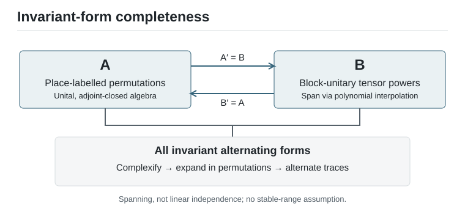

Consequently every invariant alternating form is a real linear combination of alternated real and imaginary parts of trace products. A permutation cycle contributes one trace factor, provided its place labels agree. This is a spanning result, not an assertion that the generators are independent or that the rank exceeds the degree.

## 30. Why invariant forms vanish on primitive cycles

The invariant form is smooth and closed without a separate regularity hypothesis. In local square coordinates $H=x^2$, invariance expresses the form using the inverse of the slot map $Y\mapsto xYx$. At the identity the square-map derivative is twice the identity. The inverse function theorem gives smoothness; differentiating the slot map introduces $XY+YX$, symmetric in the two arguments that exterior differentiation alternates. Every such contribution cancels. Transitivity and Stokes then give a closed simplex cochain.

For a product of $j$ traces, replication into $d$ diagonal blocks multiplies evaluation by $d^j$. Stabilization preserves evaluation. Primitivity in homology instead makes two-block replication equivalent to twice the original stabilized cycle. Therefore

$$
(2^j-2)a_j(z)=0.
$$

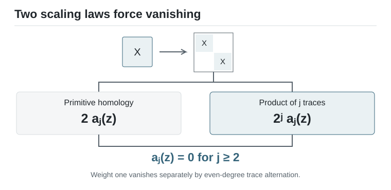

The exceptional weight $j=1$ is absent in even degree: cyclic rotation preserves a single trace but reverses the sign of its alternation. Thus every remaining weight vanishes on primitive cycles. This is the invariant-form half of the analytical assembly; the mean-zero residual half still requires the Hecke and detection join.

## 31. Why contraction gives exact representation, not just approximation

SPrime uses the Hilbert class field: identity Frobenius corresponds to the principal ideal class, and Chebotarev gives positive density. Removing the finitely many prime ideals of norm at most 25 leaves an eligible principal prime. The imported formal dependencies still require audit.

For a totally complex field and degree $q=k+1<r_2(L)$, SSurj chooses rank $N$ before the cocycle as the maximum of the detection threshold, moment threshold, requested starting rank and 3. The height moment uses twice the growth exponent. Subtract the invariant mean: each tangent-tuple coordinate of the residual is continuous, invariant, square integrable and mean zero. Hecke iteration contracts its squared integral by $(9/25)^r$. Coordinate reconstruction and SLoc give a cycle bound $C_z(3/5)^r$.

Decay alone does not prove initial vanishing. A nonzero eigenvector of eigenvalue $3/5$ decays at this rate. The separate arithmetic detection theorem SHecke supplies the implication. Thus the residual has zero periods and the invariant form has exactly the original periods. This is SSurj, not universal vanishing.

## 32. Integral rank and the information it loses

In odd degree $q=k+1$, with $k$ even, successive block replication minus weighted stabilization eliminates weights 2 through $q$. In weight one, reversing a Hermitian trace word conjugates its value, and the reversal sign kills either its real or imaginary alternation. At most one detecting coordinate survives per infinite place. The real homology map factors through these coordinates. Integer independent vectors remain independent after tensoring with the reals by flatness. Hence the integral rank of the filtered image is at most $r_2(L)$, conditional on stability and the previous inputs.

Tensoring with the reals destroys torsion. The groups $\mathbb Z^2\oplus\mathbb Z/M\mathbb Z$ give the same real vector space for every $M$. A rank bound is not a bound on finite arithmetic information.

## 33. Two torsion costs in modular counting

Write $Q=\ell^\nu$, $N_*=2(k+1)+4$ and $t_j$ for the integral torsion order in degree $j$ at stable rank $N_*$. SUpper bounds finite sets of primitive modular cycle values, after multiplication by $\ell^k$:

$$
|S|\le Q^{r_2(L)}t_{k+1}t_k.
$$

The first torsion cost is intrinsic: a subgroup of rank $r$ evaluated in a group killed by $Q$ has at most $Q^r$ free-coordinate combinations, multiplied by the possible torsion values. The second cost is a lifting obstruction. A modular cycle lifted to an integral chain $a$ satisfies $\partial a=Qw$; the class of $w$ in degree $k$ is killed by $Q$. If it vanishes, subtract a multiple of $Q$ from $a$ to get an integral cycle. Differences within any obstruction fiber lift, so counting fibers introduces the torsion factor in degree $k$.

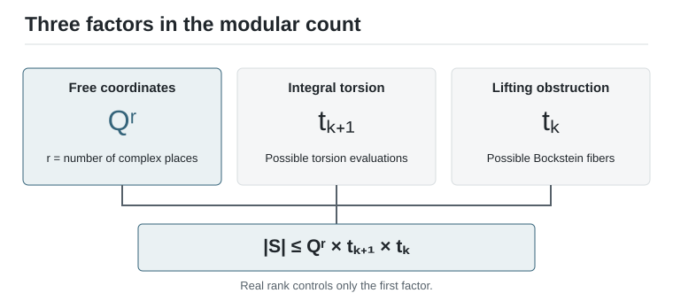

The filter's weight-one multiplier is $\ell^k\prod_{s=1}^k(1-\ell^s)$. The product is invertible modulo $Q$, but $\ell^k$ is not generally invertible. Retain that loss.

STors needs a uniform upper bound on the logarithm of torsion order. The proposed bound is $(2D)^{(2Ed)^{24}}$, where $d=[L:\mathbb Q]$, $D=|\mathrm{disc}(L)|$, $1\le N\le4E+6$, $m\le2E+1$, and $E\ge1$. Independent verification of equivariant face exactness, orbit counts, finite stabilizers, integral chain bounds and homological stability remains open. This is not certification of Lemma K.

## 34. Why geometry can constrain integral torsion

The earlier rank argument cannot see finite-order classes. Here the source changes tools. An exact augmented equivariant chain complex built from geometric simplices has permutation modules $P_p=\mathbb Z[X_p]$. Let $A$ bound their orbit counts, $s$ the stabilizer orders, and $b$ the final boundary column's integral one-norm. These are separate sources of arithmetic complexity.

Taking coinvariants identifies generators in each orbit. The final relations still have one-norm at most $b$. Choose independent relation columns and complete them by unit vectors. The index of the resulting full-rank lattice is the absolute determinant, at most $b^A$. The saturation quotient representing torsion is bounded by this index, even for a rank-deficient relation module.

For a transitive orbit with stabilizer $H$, Shapiro's lemma identifies its permutation-module homology with the homology of $H$. In positive degree $j$, the latter is killed by $|H|$ and is generated by at most $|H|^j$ elements. With at most $A$ orbits, its order is at most $s^{As^j}$. The long exact sequence of homology shifts one degree at a time, multiplying these costs. Thus

$$
|\mathrm{Tor}\, H_m(G,\mathbb Z)|\le b^A s^{A\sum_{j=1}^{m}s^j}\le b^A s^{mAs^m}.
$$

For ordinary face deletion $b=m+2$. This is the general theorem behind KH.mainFace. Exactness, finite orbit counts and finite stabilizers are indispensable; a mere quotient cell count would not suffice.

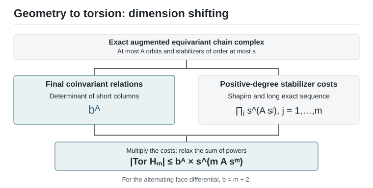

## 35. From number-field lattices to finite orbit counts

For totally complex $L$, let $d=[L:\mathbb Q]$, $D=|\mathrm{disc}(L)|$ and $v=dN$. Hermitian tuples $h=(H_w)$ define a quadratic function on the embedded lattice $\mathcal O_L^N$. The Ryshkov region imposes $q_h(y)\ge1$ for every nonzero integral vector. A real Gram determinant calculation and a lattice-volume bound imply positive definiteness and

$$
I_0\prod_w\det H_w\ge1,\qquad I_0=D^N v^v.
$$

Vertices are determined by finitely many active inequalities. The source builds simplices as ordered tuples of vertices with a common minimizing strictly positive functional. The positive dual cone is convex, and its normal-cone cover is locally finite on compact convex hulls of finite subsets. Finite supported cycles reduce to a finite convex nerve. The conventional proof uses sufficiently small open convex thickenings preserving the finite intersection pattern. The source implements a closed-convex separation and gluing proof instead; exact ordered-tuple formal correspondence still requires replay.

A simplex has common minimal vectors spanning $L^N$: otherwise a nonzero positive semidefinite perturbation vanishing on those vectors could lower its common objective without violating any constraint. Pick $N$ independent columns of a matrix $U$. Pullback by $U$ gives diagonal entries at most one, so Hadamard's inequality and the determinant lower bound give $|\mathrm{Norm}(\det U)|\le I_0$. Scaled inverses modulo this norm distinguish left integral matrix orbits. Minimal vectors in the resulting coordinates lie in a bounded conjugate box, and a vertex is identified by a bounded list of active constraints. This yields the source's orbit estimate

$$
A_m\le(2Dv)^{12(m+1)v^3N}.
$$

Stabilizers permute the finite set of minimal vectors and are determined by the images of independent ones. Reduction modulo 3 is injective on a finite subgroup of the units of the matrix ring, because the principal congruence kernel has no finite-order elements except the identity. Hence $s\le 3^{dN^2}$. No freeness of the original group action is assumed.

Substitution into the general torsion estimate and elementary exponent comparisons recover the proposed bound STors with constant 24:

$$
\log t_m(L,N)\le(2D)^{(2Ed)^{24}}
$$

for $E\ge1$, $1\le N\le4E+6$ and $m\le2E+1$. This is a conventional reconstruction using classical lattice, nerve and homology inputs. The original formal dependencies, exact chain correspondence and stable-range theorem remain open; it does not certify Lemma K.

## 36. Why stabilization does not enlarge the torsion budget

The proof uses two types of rank. The analytic representation may need a very large matrix rank, and block replication increases it further. The geometric torsion theorem must instead use a rank bounded explicitly in terms of degree. Integral homological stability reconciles them.

The source KStability asserts that the block inclusion $GL_n(R)\to GL_{n+1}(R)$ induces an integral homology isomorphism in degree $i$ for $n\ge2i+s+2$, where $s$ bounds Bass stable rank. The ring of integers has stable rank at most two: in a unimodular row choose a nonzero coordinate, use the Chinese remainder theorem over its finitely many maximal prime divisors to modify another coordinate by a multiple of the last, then delete the last. No maximal ideal contains the resulting row. The case with all earlier coordinates zero is immediate.

There is also independent classical support: van der Kallen, [Homology Stability for Linear Groups](https://webspace.science.uu.nl/~kalle101/homstab1980.pdf), Inventiones Mathematicae 60 (1980), pp. 269–295, convention 2.2 and Theorem 4.11 on p. 289, gives an even stronger range for integral constant coefficients. The source's mathematical stability contract is therefore established by classical literature, without asserting replay of the submitted proof.

The submitted implementation constructs split vector-covector sequences satisfying $\lambda_i(v_j)=\delta_{ij}$. Their stabilizers are smaller general linear groups acting on complementary coordinates. Shapiro identifies the first-page homology; alternating face maps reduce to stabilization or zero. The source uses syzygy exact sequences to obtain the same staircase conclusion as the homological spectral sequence. Its rank accounting is verified. The lower-level ordered-sequence link acyclicity and affine-translate induction remain original-source correspondence obligations.

Consequently, in the claimed stable range, the integral homology groups themselves are isomorphic, not merely their real scalar extensions. An additive isomorphism preserves torsion in both directions. This is exactly the information real differential forms alone could not retain.

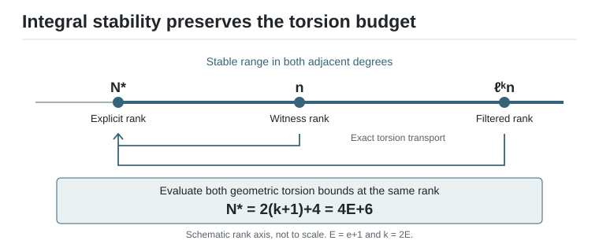

In SUpper, the witnesses occur at a common rank $n$ and the filtered classes at rank $\ell^kn$. Both may be much larger than $N_*=2(k+1)+4$. Their relevant torsion cardinalities agree exactly with those at $N_*$. In SFew take $k=2e+2$ and $E=e+1$. Then $N_*=4E+6$, and the two homological degrees are $2E$ and $2E+1$, precisely those covered by STors. No rank-dependent loss is introduced.

## 37. How a global divisor relation becomes a homology cycle

The source's starting point is not an arbitrary class. A cyclic Galois extension $F/L$ carries a primitive root of order $Q=\ell^\nu$ and a generator $\gamma$ acting on it by the power $\kappa=1+\ell^c$. Write $E=e+1$, $M=2e+3$. DivDel asserts

$$
\mathrm{ord}_P(\alpha)=\mathfrak d(\gamma P)-\kappa^E\mathfrak d(P).
$$

The weighted norm $\mathcal N(\alpha)=\prod_j\gamma^j(\alpha)^{\kappa^{Ej}}$ encodes the cyclotomic action; the product runs over the powers of the cyclic generator. It is not the ordinary field norm.

A second polynomial filter now acts on divisors, rather than trace weights. Let $P(X)=\prod_{j=0}^{M-1}(X-\kappa^j)$ and let $P_E$ omit the factor indexed by $E$. Applying $P_E$ through inverse Galois action to $\alpha$ produces an element whose divisor is the result of applying $P$ to $\mathfrak d$. The surviving evaluation factor is $P_E(\kappa^E)$, not generally a unit modulo $Q$.

The two cyclic-group periodic resolutions give $H_{2E}(C_Q^2,\mathbb Z/Q\mathbb Z)$ with $2E+1$ free generators over the coefficient ring. The $2E+2$ pushed-forward cyclic classes therefore have a relation with a unit coefficient (lift to an integer free module, find a dependence, divide the common integer gcd before reduction). The source constructs an integral group-ring element with zero pushforward along all projections $(x,y)\mapsto x+ty$ except the selected projection. In the selected projection it realizes the polynomial distribution.

Fractional-ideal lattices convert these projections to commuting block maps with prescribed determinants. The determinant-one maps on unselected blocks and the distinguished determinant on the selected block come from Steinitz classification. Relative compositions preserve the original lattice even if each transport map does not. Prism identities produce a genuine cycle in its stabilizer. A finite projective module embeds as a direct summand of a free module, with the complementary action trivial; there is no assumption that a ring of integers is a principal ideal domain.

On the residue side, a symmetric carry cocycle from a cyclic logarithm, its cup powers and a residue logarithm give a cocycle of degree $2E+1$. Projective-line transfer yields additivity under direct sums because the fiber sizes are one modulo $Q$. The evaluation of the resulting integral-group cycle is the residue logarithm of the weighted norm times $P_E(\kappa^E)$. The matrix rank and finite exceptional set are fixed before the residue field and evaluation are chosen. This is the mathematical content of SClass; exact formal reduction, chain and transfer correspondence remains an original-source replay obligation.

## 38. Why residue observations give a finite global count

SDetect is a Kummer separation statement. If a nonzero element of $F$ is not a power of exponent $Q$, adjoining a root gives a nontrivial finite Galois extension because $F$ contains the roots of unity. Chebotarev supplies a prime with nonidentity Frobenius outside the finite exceptional set. Primes of absolute residue degree greater than one have density zero, so a degree-one prime can be chosen. Its residue field is a prime field, and the base integer ring maps onto it. A residue power of exponent $Q$ would force Frobenius to fix the reduction of every root, contradicting faithful reduction of roots of unity away from the residue characteristics dividing $Q$. This is a conventional independent proof of the source contract; its formal Chebotarev dependencies still require replay.

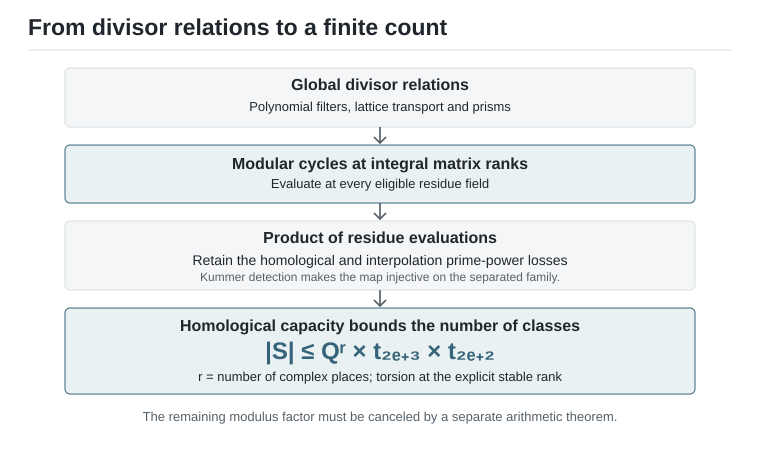

For a finite family $S$ satisfying Few's separation condition, take one product of the primitive evaluation maps over all eligible primes. The potentially infinite index set is harmless: the image of the finite family is finite. The weight filter contributes $\ell^{2E}$, while $P_E(\kappa^E)$ divides $\ell^{M(c+M)}$ modulo $Q$. One must retain both losses rather than cancel a nonunit. Equality of the product evaluations implies that the ratio of weighted norms raised to $\ell^{2E+M(c+M)}$ is a local power of exponent $Q$ at every eligible prime; SDetect makes this a global power. Few's separation condition makes the encoding injective.

The exact SFew bound is therefore

$$
|S|\le Q^{r_2(L)}t_{2E+1}(L,4E+6)t_{2E}(L,4E+6).
$$

It holds under the source's Lay hypotheses, the divisor and separation conditions, $M<\ell^c$, and $M<r_2(L)$. It is not a count of every class group or Selmer group. The next theorem SCount must remove the factor $Q^{r_2(L)}$ using a separate arithmetic counting identity, before the uniform Selmer bound can be inferred. No Lemma K or RH/GRH certification follows at this stage.

## 39. The arithmetic cancellation: two ways to count one group

The preceding bound grows with the modulus $Q=\ell^\nu$. The source SCount removes that growth by counting an intermediate finite group of divisor relations in two different ways.

Use additive notation $Y=F^\times$, $I=\mathrm{Div}(F)$, $d_F=\mathrm{div}$, and $T=\mu(F)$. Let $a=(1+\ell^c)^E$, $n=\ell^{\nu-c}$, and $\delta=g-a$, $\delta_I=g_I-a$ for the compatible inverse Galois actions on elements and divisors. Since $g_I^n=1$ and the divisor group is torsion-free, $\delta_I$ is injective. Put $U=d_F^{-1}(\delta_I I)$, $W=U/(\delta Y+T)$, $EQ=\ker d_F/(\delta\ker d_F+T)$ and $ClQ=I/(d_F Y+\delta_I I)$.

The unique divisor solving $\delta_I D=d_F y$ for $y\in U$ gives a map from $W$ to the kernel of the twisted endomorphism of the ideal class group. Its kernel is precisely $EQ$. The class group is finite and an endomorphism of a finite group has equal kernel and cokernel orders. Hence $|W|=|EQ||ClQ|$. The desired equivariant characters are homomorphisms from $ClQ$ to the residue coefficient ring, so their number is bounded by the order of its primary part.

The equivariant Dirichlet logarithmic lattice identifies the free unit group with a full lattice in the sum-zero hyperplane of the infinite-place coordinates. The Galois permutation consists of $r=r_2(L)$ cycles of length $n$. The full determinant of $g-a$ has absolute value $(a^n-1)^r$. Remove the constant coordinate line, on which the operator acts by $1-a$. The lattice index is exactly

$$
|EQ|(a-1)=(a^n-1)^r.
$$

Writing $v=v_\ell(E)$, lifting the exponent gives $v_\ell(a-1)=c+v$ and $v_\ell(a^n-1)=\nu+v$. Thus $v_\ell(|EQ|)=r(\nu+v)-c-v$. The unit determinant supplies precisely the layer-dependent factor needed in the count.

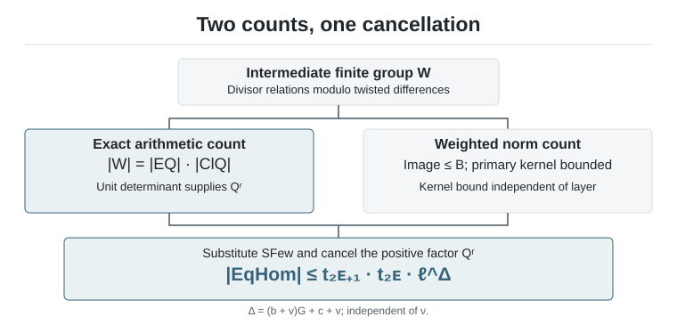

For the second count use the weighted norm operator $\mathcal N=\sum_{j=0}^{n-1}a^j g^{n-j}$. Telescoping gives $\mathcal N\delta=\delta\mathcal N=(1-a^n)g$. Consequently $f([y])=[\ell^b\mathcal N y]$ defines a map from $W$ to $Y/(QY+T)$. Its image has cardinality at most the Few bound $B$. If $a^n-1=Q\ell^v m$ with $\ell\nmid m$, the identity shows that the primary kernel is killed by $\ell^{b+v}$, without canceling a nonunit modulo $Q$.

The number of primary generators is bounded separately. From $\ell y=\delta z+t$ with torsion $t$, the class of $z$ is invariant modulo powers and roots of unity and has divisor divisible by $\ell$. This gives an injection of $W[\ell]$ into SelInv. Hilbert 90 shows that invariant representatives with the same root-of-unity exponent and norm of the power correction differ by a base-field SelL class. There are at most $\ell^2$ such pairs. Faithful cyclotomic action implies unramifiedness away from $\ell$, so the descended valuations have the required divisibility. The base-field unit rank, class group and primes above $\ell$ give

$$
|W[\ell]|\le \ell^G,\qquad G=2[L:\mathbb Q]+\lfloor\log_2 h_L\rfloor+2.
$$

It follows that the primary order of the kernel is at most $\ell^{(b+v)G}$. Combining the two counts and the exact unit determinant recovers SCount:

$$
|\mathrm{EqHom}|Q^r\le B\ell^{(b+v)G+c+v}.
$$

Substitute SFew and divide by the positive integer $Q^r$. The resulting bound is independent of the layer $\nu$:

$$
|\mathrm{EqHom}|\le t_{2E+1}(L,4E+6)t_{2E}(L,4E+6)\ell^{(b+v)G+c+v}.
$$

Here $b=2E+(2E+1)(c+2E+1)$. This is a conventional reconstruction conditional on the previously reconstructed SFew and the stated classical arithmetic inputs. It is not yet the global Sha bound: SSha must compare the finite-layer character groups with the intended global cohomology, and SLayer, SNum and SFinal must finish the quantitative assembly. Exact original formal replay and foundational obligations remain open.

## 40. Why a uniform finite-layer bound controls global cohomology

The actual invariant shaInv is the module length of a subgroup of continuous first Galois cohomology with coefficients $\mathbb Q_\ell/\mathbb Z_\ell(-E)$. The negative twist means that the action is multiplication by the inverse cyclotomic character to the power $E$. The local conditions require vanishing on decomposition groups above $\ell$ and on inertia groups elsewhere. It is not the unrestricted first cohomology group.

Let $L_\nu=L(\mu_{\ell^\nu})$ and let $U_\nu$ be its absolute Galois subgroup inside the absolute Galois group of $L$. Their intersection is $U_\infty$, the kernel of the full cyclotomic character. Under TopRoot, the cyclotomic image is the principal group $1+\ell^c\mathbb Z_\ell$: it is closed, lies in this group and not in its next principal subgroup. The principal group is topologically cyclic (with the additional source condition $c\ge2$ at the prime two).

Restriction to $U_\infty$ is injective on first cohomology. Indeed, a cocycle vanishing there descends to the procyclic quotient. Multiplication by the nonzero scalar $\chi(\gamma)^{-E}-1$ on $\mathbb Q_\ell/\mathbb Z_\ell$ is surjective, so subtract a coboundary making the cocycle zero at a topological generator. The cocycle identity and continuity make it zero everywhere. On the cyclotomic kernel the action is trivial, so the restricted cocycle is an additive character, independent of the representative of its cohomology class. The local coboundary conditions imply vanishing on the relevant intersections, and the cocycle identity gives equivariance under conjugation.

The subtle step is not restriction but extension. An infinite-layer character need not automatically be a finite-layer character. Its open kernel permits extension to $U_\infty N$ for a sufficiently small open normal subgroup $N$ of the ambient Galois group, by assigning the same value to $hn$ as to $h$. Compactness of the descending closed subgroups gives a layer contained in this neighborhood. The extension might fail local vanishing or equivariance there. The bad loci are closed and avoid the infinite-layer intersection. The union of decomposition groups above $\ell$ is compact by finite base primes and compact conjugation images; away from $\ell$, inertia is already in the cyclotomic kernel. The equivariance defect is locally constant on a compact product. Shrinking to a deeper layer removes both defects uniformly. The finite image of a locally constant character on a compact group has bounded exponent; a further depth ensures annihilation by $\ell^\nu$.

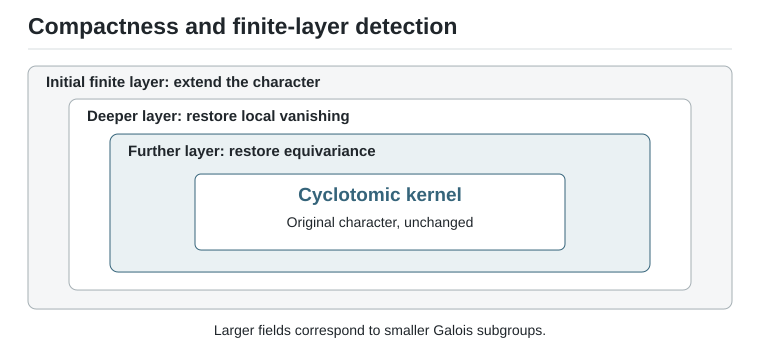

At depth at least two, the cyclotomic field is totally complex. Class field theory identifies its unramified abelian characters with characters of the ordinary ideal class group; the decomposition condition above $\ell$ kills the corresponding prime classes. Artin reciprocity is surjective and natural under conjugation. Identifying the subgroup annihilated by $\ell^\nu$ of $\mathbb Q_\ell/\mathbb Z_\ell$ with $\mathbb Z/\ell^\nu\mathbb Z$ gives exactly the source ClInj injection. On prime classes its sign is important: the negative twist implies $f(\gamma^{-1}P)=(1+\ell^c)^E f(P)$. Principal divisor relations vanish, and prime classes generate the class group. The target EqHom may contain more characters than the locally admissible source; only injectivity is claimed.

Now take any finite collection of distinct global classes. Their restrictions are distinct. Choose one common cyclotomic depth beyond all their individual extension thresholds. Each extends at this depth and maps to a distinct member of the same EqHom group, since equality of extensions would imply equality of restrictions. The uniform count $B$ bounds the size of every finite collection. If the global group were infinite, a collection of size $B+1$ would contradict this. Thus it is finite, and its order is $\ell^s$, where $s$ is its length as a module over the local ring $\mathbb Z_\ell$. This is SSha. No uniform threshold for an a priori infinite family is assumed.

This conventional reconstruction uses classical class field theory, profinite compactness and the exact negative twist. It retains original formal Artin transport, source correspondence and kernel replay as distinct obligations. SLayer must still remove the restrictions on base-field size and roots of unity; SNum and SFinal must finish the quantitative and duality joins.

## 41. Reproducibility and technical references

The numerical illustrations and exact finite examples are independently reproducible. Readers do not need any mathematical software to follow the explanation.

For specialists who wish to repeat the calculations, the [computational source](../assets/wolfram/rh_a26_audit_exhibits.wl) and [figure source](../assets/wolfram/rh_a26_visuals.wl) are retained in Wolfram Language format. The original 14 checks passed, and all five figures were generated from the retained source. The arithmetic audit additionally supplies an independent exact rational program. None of these computations constitutes a replay of the original Lean proof.

The computational companion independently checks four cyclic-cohomology examples, two local-kernel examples, two Bernoulli values, two denominator products, both character parities, and two introductory prime-counting facts. The last two are orientation only. For instance, at $X=1000$:

$$
\pi(1000)=168,\qquad R(1000)\approx168.359446.
$$

The approximation's closeness to the exact prime count is a finite observation, not a theorem about all primes.

To inspect the research evidence rather than the illustrations, follow the protected PRs below. Their source-locked dossiers and tests form the durable audit trail.

## The evidence a reader can open

| Admitted MATHFORGE evidence | What it establishes within its boundary |
| --- | --- |
| [PR #587](https://github.com/grandchallenge/MATHFORGE/pull/587) | Initial independent source audit and bounded analytic / arithmetic checks |
| [PR #591](https://github.com/grandchallenge/MATHFORGE/pull/591) | Prime-to-index group cohomology transfer and excluded-index counterexample |
| [PR #592](https://github.com/grandchallenge/MATHFORGE/pull/592) | Local Selmer restriction, source identification of `shaModel`, and 7,448 finite comparisons |
| [PR #594](https://github.com/grandchallenge/MATHFORGE/pull/594) | Independent `InfUnram` / `shaInfl` reconstruction and 72 noncommutative local checks |
| [PR #604](https://github.com/grandchallenge/MATHFORGE/pull/604) | General denominator and conductor-change argument, with exact arithmetic tests |
| [PR #605](https://github.com/grandchallenge/MATHFORGE/pull/605) | Full torsion-layer transfer, conditional counting and reciprocity reconstruction |
| [PR #606](https://github.com/grandchallenge/MATHFORGE/pull/606) | Genuine auxiliary-system construction from Jacobi sums, including local compatibility and initial value |
| [PR #607](https://github.com/grandchallenge/MATHFORGE/pull/607) | Exact Bernoulli valuation bridge and uniform divisibility witnesses |
| [PR #608](https://github.com/grandchallenge/MATHFORGE/pull/608) | Primitive ramification, exceptional Kummer vanishing and assembled conditional character inequality |
| [PR #609](https://github.com/grandchallenge/MATHFORGE/pull/609) | Finite-Galois eigenspace transport and good-prime aggregate budget |
| [PR #610](https://github.com/grandchallenge/MATHFORGE/pull/610) | Integral Stickelberger annihilator, generator and length bounds, and uniform bad-prime estimate |
| [PR #612](https://github.com/grandchallenge/MATHFORGE/pull/612) | Composite-field degree restriction, combined minus-length bound and conditional exponential domination |
| [PR #613](https://github.com/grandchallenge/MATHFORGE/pull/613) | Conditional simultaneous-window selection, exceptional-order control and exact arithmetic dependency map |
| [PR #614](https://github.com/grandchallenge/MATHFORGE/pull/614) | Actual tower descent, arithmetic centers and growth under the stated generator and limiting duality inputs |
| [PR #615](https://github.com/grandchallenge/MATHFORGE/pull/615) | Finite-to-limit Poitou–Tate length identities and genuine localization kernel compatibility |
| [PR #619](https://github.com/grandchallenge/MATHFORGE/pull/619) | Uniform generator bound, tame ramification, quadratic transfer and conditional window assembly |
| [PR #620](https://github.com/grandchallenge/MATHFORGE/pull/620) | Parallel conditional Lemma K reduction, kernel loss estimate and numerical conversion |
| [PR #621](https://github.com/grandchallenge/MATHFORGE/pull/621) | Active Lemma K dependency correction, conditional finite-layer assembly and local length estimate |
| [PR #622](https://github.com/grandchallenge/MATHFORGE/pull/622) | Odd homology weight elimination, trace parity and conditional rank detection |
| [PR #623](https://github.com/grandchallenge/MATHFORGE/pull/623) | Finite residue-field geometry, Hilbert-space contraction and actual Hecke averaging |
| [PR #624](https://github.com/grandchallenge/MATHFORGE/pull/624) | Affine homology vanishing, exact coset transfer and conditional Hecke detection |
| [PR #625](https://github.com/grandchallenge/MATHFORGE/pull/625) | Probability averaging, simplex density and compact-local cycle evaluation |
| [PR #626](https://github.com/grandchallenge/MATHFORGE/pull/626) | Height, smooth minimum, rank-one retraction, thick part and uniform partition exponent |
| [PR #627](https://github.com/grandchallenge/MATHFORGE/pull/627) | Adelic reduction, rational height estimates, Haar packing and finite height moments |
| [PR #628](https://github.com/grandchallenge/MATHFORGE/pull/628) | Whitney representing form, signed comparison, cycle equality and overlap growth |
| [PR #629](https://github.com/grandchallenge/MATHFORGE/pull/629) | Central scalar averaging, unit directions, cycle and growth preservation |
| [PR #630](https://github.com/grandchallenge/MATHFORGE/pull/630) | Invariant mean, exhaustive trace spanning, closedness and primitive-cycle vanishing |
| [PR #631](https://github.com/grandchallenge/MATHFORGE/pull/631) | Principal prime and actual analytic surjectivity assembly |
| [PR #632](https://github.com/grandchallenge/MATHFORGE/pull/632) | Integral rank transfer, modular counting, Bockstein lifting and exact torsion frontier |
| [PR #633](https://github.com/grandchallenge/MATHFORGE/pull/633) | Equivariant integral torsion, arithmetic orbit geometry and conventional STors estimate |
| [PR #634](https://github.com/grandchallenge/MATHFORGE/pull/634) | Classical integral stability, source induction and exact torsion transport |
| [PR #635](https://github.com/grandchallenge/MATHFORGE/pull/635) | Class-to-cycle construction, Kummer separation and exact SFew bound |
| [PR #636](https://github.com/grandchallenge/MATHFORGE/pull/636) | SCount exact unit determinant, primary kernel descent and layer cancellation |
| [PR #637](https://github.com/grandchallenge/MATHFORGE/pull/637) | SSha global restriction, compact finite-layer extension and class field comparison |

**What protected merge means:** the evidence and bounded conclusions were admitted to the repository's reviewed documentary record. It does **not** mean that MATHCERT, an independent external referee, or the original Lean kernel has certified RH.

## 42. What the investigation taught us about checking extraordinary mathematical claims

**Inspect the exact theorem before its headline.** A theorem with an explicit hypothesis can be perfectly correct without resolving the unconditional problem.

**Test the failure conditions, not only the successes.** The $C_3/\mathbb F_3$ example shows why a transfer assumption matters. The $S_3/A_3$ test shows why a local inertia condition matters. A negative control gives a method the ability to catch certain kinds of error.

**Separate the mathematical object from its representation.** A length equality about a transformed module helps only if the source has justified the equivalence with the intended arithmetic module, including the local conditions and character action.

**Distinguish finite computation, mathematical proof, and machine formalization.** Exact arithmetic demonstrates individual calculations; an independent conventional argument covers a stated conditional theorem; kernel replay checks an exact formal declaration and its dependencies. None can silently stand in for the others.

**Make counterexamples and open obligations public.** A useful audit tells the reader not merely *what works*, but precisely *where it stops working* and what evidence would change that conclusion.

## 43. The next executable mathematical step

**Target:** SLayer field enlargement, Sha monotonicity, degree and discriminant bounds; then SNum and SFinal.

**Work:** SSha is conventionally reconstructed in [MATHFORGE PR #637](https://github.com/grandchallenge/MATHFORGE/pull/637). The finite-layer count bounds the global invariant under the TopRoot and size hypotheses. Original formal dependencies and foundations remain open.

**Completion test:** verify the exact active source contracts, retaining foundational correspondence and original Lean replay obligations. No RH/GRH certification.

**Present boundary:** `RH-A26-D05_SSHA_CONVENTIONAL_RECONSTRUCTION__SLAYER_SNUM_SFINAL_SOURCE_CORRESPONDENCE_FOUNDATIONS_ORIGINAL_REPLAY_OPEN`.

The live [RH-A26 tracker](https://github.com/grandchallenge/MATHFORGE/issues/577) carries new execution status. This page explains protected audit evidence, not certification of RH or GRH.
