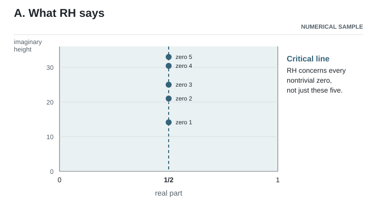

# Auditing the 2026 Riemann Hypothesis claim: what the mathematics actually says

A public, reproducible account of the mathematical mechanisms we have reconstructed, the assumptions that make them work, and the reconstructed character inequality and the remaining proof obligations.

!!! warning "Research status · 26 November 2026"
    **Result:** independent conventional-mathematics reconstructions of *conditional* group-cohomology and local-Selmer transfer statements, with exact finite computational checks. The admitted evidence includes the denominator and conductor-change reconstruction and the new torsion-layer, counting and reciprocity reconstruction. The conditional character inequality `ML.vChar` has now been independently reconstructed, including the auxiliary-system construction, exact Bernoulli comparison, primitive ramification and exceptional vanishing. The finite-Galois character transport, aggregate good-prime bound and separate bad-prime Stickelberger estimate have also been reconstructed under their stated classical inputs. The composite-field degree restriction and combined conditional odd-prime bound are now reconstructed, as is their deterministic conversion to a downstream exponential budget under the required numerical hypotheses. The simultaneous-window selection has also been reconstructed conditional on the source's arithmetic tower estimates and Lemma K. The actual arithmetic tower descent, determinant centers and linear growth estimates have now also been reconstructed conditional on the generator bound and limiting Poitou–Tate identity. The finite-to-limit Poitou–Tate length identities have also been reconstructed under the stated finite-level classical hypotheses. The uniform arithmetic rank bound and quadratic transfer have now been reconstructed under the source's classical inputs, completing the conditional simultaneous-window spine through Lemma K. The parallel finite-module reduction behind Lemma K has been reconstructed under KBridge and the homology torsion input. The exact headline dependency has also been corrected: it uses the alternative finite class-counting route, whose conditional numerical assembly and final local contribution have now been reconstructed. The counting and reciprocity arguments retain their stated classical-duality inputs.

    **Not established:** a new proof of the Riemann Hypothesis (RH) or Dirichlet Generalized Riemann Hypothesis (GRH); mathematical correctness of every definition in the submitted Lean source; complete independent Lean kernel replay; exact formal correspondence of all foundational hypotheses and downstream mathematical bridges; MATHCERT certification.

    **Evidence classes:** source audit, conventional conditional mathematical proof, exact finite verification, and regression tests. Repository merge, finite computations, and public exposition are **not** proof certification.

    **Authority:** [RH-001 live programme tracker](https://github.com/grandchallenge/MATH-PROGRAMME/issues/163) · [RH-A26 audit tracker](https://github.com/grandchallenge/MATHFORGE/issues/577) · [original claim verification guide](riemann_hypothesis_2026_lean_announcement.md) · [MATHFORGE protected audit PRs](#the-evidence-a-reader-can-open).

## 1. The question

The Riemann Hypothesis concerns the hidden regularity of prime numbers. It asserts that every *nontrivial* zero of the analytically continued Riemann zeta function has real part one-half:

$$
\zeta(s)=0,\quad 0<\Re(s)<1
\quad\Longrightarrow\quad
\Re(s)=\frac12.
$$

In November 2026, an external submission by Alpöge and Claude claimed a formal Lean proof of RH and certain generalized statements. Our task is to establish **what the actual formal source says**, **which mathematical bridges can be reconstructed independently**, and **which evidence would warrant accepting the whole claim**. See the separate [source-critical announcement guide](riemann_hypothesis_2026_lean_announcement.md) for the submission, external replay reports, original sources, and historical context.

### Why anyone studies this question

Counting primes is easy for a small range: list the numbers, eliminate those that are not prime, and count what remains. Predicting the count across arbitrarily large ranges is much harder. The striking fact is that a smooth mathematical function predicts this irregular staircase remarkably well. RH would give strong control over the error in suitable prime-counting estimates.

*Figure A. What RH says.* The horizontal position of a zero is its real part. The five dots show known zeros; their vertical positions are calculated from known zero heights. RH says **every** nontrivial zero is on the middle line, including those beyond the plotted range. The figure does not show that there are no other zeros elsewhere.

*Figure B. Why the zeros matter.* The black staircase counts actual primes; it rises by one each time another prime appears. The blue curve is a smooth approximation called Riemann's prime-counting approximation, sampled at integer arguments. Their closeness illustrates the kind of regularity number theory seeks to explain. It does not prove an error bound or RH.

### How to read this investigation

The authors' claimed proof is not a calculation of more zeta zeros. It proceeds through a long sequence of arithmetic statements. Our investigation works backward from the final claim, identifying the statements it needs and testing whether their hypotheses really justify the next step. The mathematical tools introduced below are examples of that work.

The underlying problem is infinite. Testing many primes, evaluating many zeta zeros, or compiling many files can inform an investigation; none of those facts alone proves the intended mathematical statement.

**A useful distinction:** the arithmetic object called `Sha` in this source is a specifically defined kernel of first-cohomology restriction maps with selected local conditions. It must not silently be identified with every classical use of the notation “Tate–Shafarevich group”. Its meaning comes from the *definition in the source*.

## 2. The obstruction: a change of viewpoint can discard information

Much of the proposed argument replaces a difficult arithmetic object by another description in which its structure is easier to study. The first question is whether that replacement preserves the information one needs.

For example, let $C_3$ be a cyclic group of order three, acting trivially on the field $\mathbb F_3$. A first-cohomology class here is essentially an additive homomorphism from $C_3$ to $\mathbb F_3$. There are three:

$$
H^1(C_3,\mathbb F_3)\cong\mathbb F_3.
$$

But the trivial subgroup has no nonzero first-cohomology classes:

$$
H^1(\{1\},\mathbb F_3)=0.
$$

*Figure C. A concrete information-loss test.* Imagine three genuinely distinct answers to a mathematical question. After restricting the question to a smaller setting, all three answers look the same. In this exact example, the two nonzero classes become zero, and the zero class stays zero. The labels are literal class representatives; their placement is only for readability.

Why does the collapse occur? The subgroup index is three, and three is zero in the coefficient field. Averaging by dividing by three is impossible. We need to know when a proof's change of viewpoint preserves the distinctions that matter.

This is not a counterexample to RH. It is a precise counterexample to a *careless version of a technique* that the submitted proof must use correctly.

### A closer look: what is a cohomology class?

For this example, think of a group as a set of operations that can be composed, and a cocycle as a consistent rule recording how those operations change a quantity. Two such rules are treated as equivalent if they differ only by a change of reference value. A cohomology class records the distinction that survives those changes of reference. In the example above the action is trivial, so this reduces to the very concrete question of which additive values the generator may take.

### Worked example A · exact loss of information

The exact calculation enumerates all cyclic one-cocycles and their coboundaries:

| Group and coefficients | Action | Number of distinct $H^1$ classes | Meaning |
| --- | --- | ---: | --- |
| $C_3$ on $\mathbb F_3$ | trivial | 3 | index divisible by characteristic; information survives in the large group |
| $C_2$ on $\mathbb F_3$ | trivial | 1 | prime-to-index case; no nonzero class |
| $C_4$ on $\mathbb F_5$ | multiplication by 2 | 1 | nontrivial scalar action; cocycles are all coboundaries |
| $C_2$ on $\mathbb F_2$ | trivial | 2 | another excluded-index case |

For a generator acting by a scalar $a$ on $\mathbb F_p$, the calculation is entirely explicit:

$$
Z^1=\{z:(1+a+\cdots+a^{m-1})z=0\},
\qquad
B^1=\{(a-1)b:b\in\mathbb F_p\}.
$$

Here $a^m=1$ in $\mathbb F_p$. The first set contains possible cocycles; the second contains those representing the zero cohomology class. The quotient $Z^1/B^1$ is what the test computes.

## 3. A rule for when information is preserved

Let $U'$ be a normal subgroup of $U$ with finite index $m$. Suppose $m$ is invertible in the coefficient ring and the usual continuous cohomology hypotheses hold.

Then restriction identifies the first cohomology of $U$ with the invariant part, under $U/U'$, of the first cohomology of $U'$:

$$
H^1(U,M)\;\cong\;H^1(U',M)^{U/U'}.
$$

The reason is an averaging argument. When division by $m$ is available, the finite quotient's higher cohomology vanishes, making restriction reversible onto the invariant classes.

But arithmetic imposes **additional local tests**. At each prescribed local subgroup $D$, an allowed class must become zero after restricting to $U\cap D$. Denote the set of such classes by $S(U)$.

The same argument extends to these *local-kernel* classes:

$$
S(U)\;\cong\;S(U')^{U/U'}.
$$

Crucially, the local index

$$
[U\cap D:U'\cap D]
$$

divides $m$. The ability to divide by the global index therefore applies to every local comparison. Without that divisibility argument, the local conclusion would not follow from the global one.

**What we learned:** it is not enough for a transformation to preserve the ambient cohomology. It must preserve the exact restrictions that define the arithmetic object.

## 4. The second transformation: forgetting ramification without forgetting the mathematics

A Galois group encodes ways of permuting algebraic numbers while preserving the base field. Some of these symmetries are grouped into *inertia groups* associated with primes. At a prime, inertia records how a field extension is ramified.

To see how one can deliberately forget certain distinctions without losing a particular answer, start with six permutations of three objects. We can group them into two types: those that are even and those that are odd. Any function taking the same value on all permutations of each type can be described by only two values.

*Figure D. A small model of a quotient.* The six permutations and their grouping into two cosets are exact; box sizes and arrow placement carry no mathematical scale. If a function cannot distinguish the three members of each group, the two-class description contains all the information that function uses. This is a finite analogy to the Galois quotient, not a picture of the actual infinite Galois group.

In the arithmetic argument we need more than an arbitrary function: we need a continuous cocycle, a function satisfying a special compatibility rule under composition. Fix a finite set of primes $S$. Let $G$ be the relevant absolute Galois group, and let $N$ be the **closed normal subgroup generated by all inertia groups outside $S$**. The quotient $G/N$ deliberately forgets those ramification symmetries. The point of the proof is to establish that the cocycle truly cannot distinguish elements within a coset, not to assume that the discarded information is irrelevant.

The source's `InfUnram` mechanism states that, if the coefficient representation already factors through $G/N$, a continuous class in $H^1(G,M)$ comes from the quotient exactly when it restricts to zero on all inertia groups outside $S$.

The central argument is short enough to understand:

1. Because the representation factors through $G/N$, elements of $N$ act trivially on the coefficients.
2. If a cocycle's class is zero on a specified inertia group, its restricted cocycle is a coboundary; here such a coboundary is literally zero because that inertia group acts trivially.
3. The cocycle-zero elements inside $N$ form a **closed normal subgroup**. They contain all the specified inertia groups, and thus contain the closed normal subgroup generated by them: all of $N$.
4. The cocycle is constant on cosets of $N$, so it descends to a continuous cocycle on $G/N$. Conversely, any inflated quotient cocycle vanishes on $N$.

This proves the mathematical descent principle **under its stated continuity, Hausdorffness, normal-closure, and representation hypotheses**. Removing those assumptions would change the statement.

The associated `shaInfl` comparison makes an additional step: local vanishing on one chosen decomposition group over a prime must represent the same condition at **all** places over that prime. This uses the standard Galois-theoretic transitivity of places and the conjugation behavior of cocycles. The original source contains explicit constructions for these comparisons.

### Worked example B · the local condition is not decorative

We tested local restriction kernels in exact finite cyclic groups, including both prime-to-index and excluded-index cases. The separate MATHFORGE fixture passed **7,448** prime-to-index comparisons and recorded **1,306** excluded-index failures.

A stronger noncommutative test used $G=S_3$, its normal subgroup $N=A_3$, and quotient $G/N=C_2$, with six possible local subgroups and finite-field coefficients. All **72** tested local-Selmer comparisons matched. In one nontrivial coefficient setting, dropping the inertia condition outside $S$ admitted **two additional cohomology classes** that could not have come from quotient inflation.

Separate exact programs perform the full noncommutative enumeration and representative cyclic local-kernel calculations. Neither bounded test replaces the general argument or independently checks the original Lean kernel.

## 5. Where these results belong in the submitted proof

These objects are not isolated puzzles. They form a *dependency structure* whose links need individual verification. The following map is a reading guide to the audit as recorded on this page, not the entire original proof or a measurement of percentage complete.

*Figure E. Earlier audit snapshot, 24 November 2026.* We have reconstructed rules for moving information between mathematical descriptions. The diagram records the earlier boundary; sections 8 and 9 explain the subsequent auxiliary-system and Bernoulli valuation advances. Section 10 records the subsequent complete conditional character inequality; source replay and downstream proof obligations remain open. The arrows give a reading order, not a complete theorem-dependency graph. Neither a successful transfer nor this map establishes RH.

For readers who want to see the precise source statements, the following table identifies the named components:

| Source component | Role | Current audit boundary |
| --- | --- | --- |
| `InfUnram` | Recover classes on the unramified quotient from specified inertia-vanishing conditions | Conditional mathematical argument independently reconstructed; full source replay open |
| `shaInfl` | Match quotient-local `Sha1` with full-group `ShaAbs` | Conditional mathematical argument reconstructed, assuming standard Galois place-transitivity foundations |
| `shaModel`, `shaLenEq` | Connect the original arithmetic `Sha` module and its Galois eigenspaces to the transported Selmer model | Genuine source-level constructions located and dependency-traced; exact implementation not independently verified |
| `eigV`, `selUnit` | Transfer eigenspace lengths across a finite-index subgroup under an invertibility condition | Abstract and local-kernel mechanisms independently reconstructed |
| `shaToShT` | Pass from uniformly bounded torsion layers to the full group | Independent mathematical proof under the source unit and ramification hypotheses |
| `ML.recip`, `ML.count` | Derive local cancellation and count by a finite valuation budget | Reconstructed using classical duality and the auxiliary-system contract; construction of the latter now independently reconstructed |
| `NuSysEx` | Construct the compatible auxiliary arithmetic system | Independently reconstructed using stated classical number-theoretic results |
| `zEval` | Connect the auxiliary sum to normalized generalized Bernoulli values | Exact valuation equality and both divisibilities reconstructed on the nonexceptional branch |
| `primRam`, `exc` | Establish primitive ramification and exceptional vanishing | Reconstructed using stated classical cyclotomic and local-field facts |
| **`ML.vChar`** | Relate generalized Bernoulli quantities to the lengths of these arithmetic eigenspaces | **Full conditional inequality reconstructed**; source `Rec` and the stated classical foundations retained |

The word **conditional** matters. In the source, the valuation theorem begins with a hypothesis `Rec → ...`. To obtain an unconditional consequence one must establish that hypothesis, discharge all other assumptions, and verify that the formal statements describe the claimed classical problem.

We have reconstructed important pieces of the *transfer machinery*. We have **not** turned a conditional source theorem into an unconditional RH proof.

## 6. Why Bernoulli numbers appear

Ordinary Bernoulli numbers arise in formulas linking sums of powers, special values of the zeta function, and other arithmetic identities. *Generalized* Bernoulli numbers incorporate a Dirichlet character: a multiplicative rule that assigns numbers to residue classes.

For conductor $N$, a character $\chi$, and positive integer $k$, the source uses a normalization of the form

$$
B_{k,\chi}
=N^{k-1}\sum_{a=1}^{N}
\chi(a)B_k\!\left(\frac aN\right),
$$

where $B_k(x)$ is the Bernoulli polynomial of order $k$. This is an **exact algebraic expression**, not an approximation to a zeta zero.

### Worked example C · exact Bernoulli arithmetic

The following examples use exact fractions rather than decimal approximations:

| Character and index | Generalized Bernoulli value | Sufficient denominator multiplier | Exact product |
| --- | ---: | ---: | ---: |
| Odd primitive character modulo $4$, $k=1$ | $-1/2$ | $8$ | $-4$ |
| Quadratic even character modulo $5$, $k=2$ | $4/5$ | $30$ | $24$ |

The source defines the conservative bound

$$
d(N,k)=N\prod_{p\le k+1,\;p\text{ prime}}p.
$$

The two computations demonstrate *how* a denominator multiplier can turn a rational generalized Bernoulli value into an integer. They do **not** establish the source's general integrality lemma, its valuation estimates at the prime $p$, or the desired inequality on genuine cohomology groups.

A divisibility measurement asks how many times a prime divides a number. For example, 24 is divisible by 2 three times, but 25 is not divisible by 2 at all. The source uses a more general version of this measurement, a valuation, and compares it with the length of an arithmetic module. That length measures its algebraic complexity in a precise sense; it is not the physical size of an object.

The character inequality `ML.vChar` requires a quantitative comparison between the divisibility of such arithmetic values and a cohomological length. The routine conductor reduction and denominator divisibility lemmas support this step, but they are not the step itself.

### What changes when we use a larger modulus?

A periodic arithmetic rule can be described using a longer period than it really needs. The shortest modulus supporting the character is its *conductor*. For example, a character with conductor 5 can also be represented modulo 10, by pulling back its values on invertible residues and assigning zero on the nonunits.

But there are two different calculations one might perform. The primitive Bernoulli value uses the original conductor. The ordinary generalized sum at the larger modulus includes the additional nonunit exclusions. They need not agree.

| Calculation | Exact value |
| --- | ---: |
| Primitive Bernoulli value at conductor 5, order 2 | 4/5 |
| Same primitive value represented at modulus 10 | 4/5 |
| Ordinary generalized sum at modulus 10 | 12/5 |
| Primitive value multiplied by the denominator bound at level 5 | 24 |
| Primitive value multiplied by the denominator bound at level 10 | 48 |

The last number doubles for a simple reason: the source's denominator multiplier doubles, while its primitive value stays fixed. Computing the ordinary sum instead would produce 144, an incorrect substitute for the quantity required by the proof.

Our independent reconstruction explains why the multiplier clears denominators in general, using the classical von Staudt–Clausen theorem for Bernoulli numbers. It also establishes the exact cost of raising the modulus: when the larger modulus is a multiple of the conductor, the scaled primitive quantity is multiplied by their ratio. At a prime not dividing that ratio, the divisibility measurement does not change.

For example, 24 and 48 are each divisible by 3 once. The extra factor of 2 makes no difference at prime 3. This is a precise way to prevent a change of mathematical description from silently increasing the arithmetic bound.

**Evidence:** the independent [arithmetic audit PR #604](https://github.com/grandchallenge/MATHFORGE/pull/604) records the argument and exact tests: 5,100 coefficient calculations, 192 conductor cases, and 576 nonzero valuation comparisons. The proof uses standard classical Bernoulli and finite-character results; the examples are supporting checks, not a proof of the cohomology inequality. The primitive-character estimate requires a genuine compatible auxiliary system and its connection to the Bernoulli value. The following section explains the independently reconstructed counting and reciprocity mechanisms.

## 7. How a bound on finite pieces controls the whole group

A torsion element is one that becomes zero when multiplied by some nonzero integer. In this investigation we work with successive powers of a prime, and more generally of a uniformizer in the coefficient ring. Each layer contains the elements killed at that level.

Imagine that a mathematical structure has an unknown size. Every part of it can eventually be captured in a growing sequence of layers. If **each layer has the same upper bound**, the whole structure must obey that bound. Otherwise we could choose finitely many elements witnessing a violation and find one layer containing all of them.

There is an important distinction: each layer being finite is not enough. The sequence of cyclic groups of orders $3,9,27,81,\ldots$ can be nested in an infinite group. Their lengths are $1,2,3,4,\ldots$; there is no common upper bound.

The original arithmetic proof has an extra difficulty. A cohomology class is represented by a cocycle, and the local restrictions must survive when we put it into a torsion layer. We reconstructed the required normalization: a certain invertible difference makes one representative unique; compactness then bounds its values, and the ramification hypotheses give a common bound on its local witnesses.

This proves the source's full-group transfer under its actual hypotheses. It does not assume in advance that the full group is finite.

### Counting by eliminating possibilities

The next argument compares two quantities: the length of the module of still-allowed cocycles and the divisibility of a number associated with an auxiliary arithmetic system. Each chosen auxiliary prime imposes another local test. If any nonzero cocycle remains, a carefully chosen prime detects one.

The proof measures its progress with an integer budget:

The remaining module length plus the divisibility measurement is at most the fixed budget. In symbols, $\ell(S_L)+j(L)\le J$.

Here $L$ is a list of auxiliary primes, $S_L$ is the module satisfying the resulting local tests, $j(L)$ is a divisibility measurement of an annihilator, and $J$ is a fixed upper bound. At every nonzero stage the next prime strictly increases $j$, while the length lost from $S_L$ is no greater than the increase in $j$. After finitely many steps there must be no nonzero cocycles left. Running that comparison backward bounds the starting length.

For an illustration, suppose $J=5$ and the starting divisibility measurement is 2. The remaining length can be at most 3. A step increasing the measurement by one can remove at most one unit of length. It cannot keep increasing beyond 5. These numbers illustrate the logic, not measured values of the actual arithmetic module.

**Why reciprocity is needed:** local data at distinct primes are not independent. The proof pairs two arithmetic cocycles, obtaining a degree-two class whose local contributions must cancel globally. If every contribution except one is zero, the remaining contribution is zero too. The local duality property then converts that vanishing into the product-zero relation needed in the counting step.

We independently reconstructed the pairing argument from the stated classical global and local duality properties, the auxiliary-prime selection using Chebotarev, and the counting inequality using the actual auxiliary-system contract. The construction of the compatible auxiliary system has since been independently reconstructed, as explained in the next section. The Bernoulli divisibility witnesses and exceptional case have since been reconstructed, as explained in sections 9 and 10.

The [technical audit PR #605](https://github.com/grandchallenge/MATHFORGE/pull/605) supplies the mathematical arguments and exact finite checks, with the imported theorems identified. Those checks exercise the algebra, not the global arithmetic duality theorem.

## 8. Building arithmetic objects that agree at different primes

The counting argument above needs a family of compatible arithmetic objects. We have now independently reconstructed its construction from classical number theory, rather than assuming the family exists.

The starting point is a *Jacobi sum*. To form one, assign a root of unity to every nonzero residue modulo a prime, using a rule that respects multiplication. Multiply the value at each residue by a suitable power of the value at its complement, then add these products over the residue field. The result is an exact algebraic number. Products and ratios of these sums have prime-ideal factorizations that can be controlled by integer arithmetic.

### A worked example of compatibility

A small calculation illustrates the arithmetic behind that control. Use level 3 and an auxiliary prime 7, giving the larger level 21. With the integer parameter 2, the source's exponent at a residue is the difference between two rounded-down fractions: twice the residue divided by the level, minus twice the opposite residue divided by the level.

At level 3, the residue 1 has exponent −1. At level 21, its invertible lifts are as follows.

| Residue at level 21 | Exponent |
| ---: | ---: |
| 1 | −1 |
| 4 | −1 |
| 10 | −1 |
| 13 | 1 |
| 16 | 1 |
| 19 | 1 |
| **Sum** | **0** |

The other lift, 7, is excluded because it is not invertible modulo 21. The six retained exponents cancel exactly. This is not a coincidence: the general floor-distribution identity says that their sum equals the difference of two level-3 exponents. Here both are −1 because 7 acts as 1 modulo 3. The calculation shows one small part of how a prime-ideal factorization at a larger level relates to the smaller one; it is not itself a construction of the entire auxiliary system.

### From exact arithmetic to the counting argument

The construction proceeds through three mathematical stages.

1. **Build the starting elements.** The Jacobi sums determine the needed prime-ideal factors. A classical ideal-class argument extends the construction from suitable split primes to the particular ideals required by the proof.
2. **Make the elements agree across levels.** The norm and congruence relations initially hold up to roots of unity, which are numbers whose positive integer powers equal 1. A carefully chosen transformation removes these factors, producing exact relations and leaving the arithmetic values that the proof needs.
3. **Extract compatible classes.** A derivative construction and an extraction of roots give the arithmetic cocycles used in the counting argument. We established the required vanishing away from the specified primes, the exact relation between consecutive levels, and the correct initial value.

The central achievement is not another finite computation. It is the conventional mathematical reconstruction of the auxiliary system for every admissible finite prime list, using stated classical cyclotomic, class-field and local-field theorems. Its transitions multiply by a unit, so the information used to detect a surviving cocycle is not lost.

The [technical audit PR #606](https://github.com/grandchallenge/MATHFORGE/pull/606) records the construction and the precise imported foundations. Supporting tests checked 49,560 exponent-distribution identities, 3,256 finite-field Jacobi reductions, and further derivative and character-sum identities. These are checks on the arithmetic ingredients, not a verification of the complete submitted formal proof.

The precise divisibility comparison with the generalized Bernoulli value has now been reconstructed, as explained in the next section. The character-ramification bridge and exceptional case have since been reconstructed. We have also not independently replayed the original Lean proof or verified the exact correspondence of all its foundational imports.

## 9. Connecting the auxiliary system to Bernoulli values

The previous sections explain how to construct a system of arithmetic objects and use it to bound the length of a cohomology group. One connection was still missing: the number governing that bound had to be related to the generalized Bernoulli value appearing in the submitted proof.

We have independently reconstructed that connection, under the original nonexceptional character hypothesis. The argument compares the auxiliary integer-weighted sum with a Bernoulli polynomial expression, retaining the denominator that is necessary to control the error.

### Why divisibility can be stable even when numbers differ

Suppose we are measuring divisibility by 3. The numbers 24 and 51 differ by 27. Both are divisible by 3 exactly once. Adding a multiple of 27 cannot change that first nonzero level of divisibility.

More generally, if two nonzero quantities agree to a precision exceeding the divisibility measurement of one of them, their measurements agree exactly. This is the decisive property of the prime-adic valuation. It replaces a familiar real-number error estimate with a different kind of precision: agreement modulo increasingly high powers of a prime.

### The genuine arithmetic comparison

The source uses a finite weighted sum at a modulus that grows by powers of a prime. Its weights approximate the prescribed character values at that precision. A Bernoulli polynomial expansion gives a congruence linking that sum to the normalized generalized Bernoulli value. The proof explicitly clears denominators before estimating the error.

The nonexceptional hypothesis supplies a multiplier that is invertible at the chosen prime. This ensures that the comparison does not silently erase the divisibility information. Once the modulus is large enough, the error lies beyond the first nonzero valuation of the target, so the auxiliary value and normalized Bernoulli value have exactly the same valuation.

For the quadratic character of conductor 5, the generalized Bernoulli value at order 2 is $4/5$, and the normalized value is $2/5$. At prime 3, the following exact integer sums occur:

| Auxiliary modulus | Integer-weighted sum | Divisibility by 3 |
| ---: | ---: | ---: |
| 15 | 8 | 0 |
| 45 | 8 | 0 |
| 135 | 8 | 0 |
| 405 | 8 | 0 |

These are finite representative sums, not explicit computations of absolute Galois automorphisms. The general proof establishes that the actual auxiliary value agrees with the representative sum at the required precision. Both have valuation zero at prime 3 in this example. The conservative denominator-cleared Bernoulli quantity is 24, with valuation one. The new argument accounts for that extra factor rather than treating it as an unknown loss.

A second example shows that the equality is not limited to units: for the quadratic character of conductor 8 at order 4, the normalized value is −11, with valuation one at prime 11. The high-precision finite representatives have that same valuation.

**The exceptional condition is necessary.** For the trivial character at order 2 and prime 3, the normalized value is $1/12$. Its valuation is negative, whereas the auxiliary sum is integral. The invertible multiplier required by the proof does not exist in this case. The nonexceptional comparison cannot be extended to it by the same argument.

The [technical audit PR #607](https://github.com/grandchallenge/MATHFORGE/pull/607) reconstructs both divisibility witnesses for every nonzero input and proves the exact valuation identity. It also identifies the precise precision threshold and the loss from the conservative denominator multiplier. The exact regression checked 18,261 pointwise identities, including 6,342 requiring the denominator, 173 level-change identities, 146 weighted congruences, 315 stable representative valuations and 528 divisibility comparisons. These are checks on the arithmetic, not a replacement for the general argument.

Section 10 explains the subsequent reconstruction of character ramification and exceptional vanishing, completing the conditional primitive estimate. The foundational correspondence and original Lean replay remain open.

## 10. Completing the character inequality: two routes to the bound

The last part of this arithmetic argument divides into two cases. We have now independently reconstructed both, using the stated classical arithmetic foundations, and assembled the full conditional character inequality.

In the ordinary case, a suitable arithmetic multiplier is invertible at the prime under consideration. The preceding auxiliary-system construction, counting argument and Bernoulli comparison then give a bound on the length of the cohomology group. A primitive character cannot discard a prime that actually divides its conductor: otherwise it would be describable at a smaller modulus. When its order is prime to the measuring prime, its nonidentity values differ from 1 by a unit. This supplies the precise ramification condition needed to transfer the bound to the full group.

In the exceptional case, the multiplier is not invertible. Instead of using that comparison anyway, the proof establishes that the cohomology group itself is zero.

### Why a rational power can resolve an exceptional case

Consider the rational number −8/125. Its prime exponents are 3 at the prime 2 and −3 at the prime 5, with zero at every other prime. Every exponent is divisible by 3, so the number is exactly the cube of −2/5.

This observation is general: if every prime exponent of a nonzero rational number is divisible by an odd prime, the rational number is a power of that order. The sign causes no additional obstruction for odd powers.

The exceptional-case proof translates a residual cohomology class into an algebraic root of a rational number. Its vanishing on inertia means that at each rational prime the root lies in an unramified local extension, where its normalized valuation is integral. Consequently the rational number has a prime exponent divisible by the chosen odd prime at every place. It must already have the required rational root.

The class therefore represents a coboundary, a change of reference rather than new arithmetic information. Normalization makes this coboundary zero. Repeating this reasoning through the torsion layers proves that the full locally constrained cohomology group vanishes.

### What has actually been established

| Branch | Result of the reconstruction |
| --- | --- |
| Nonexceptional | The cohomology length is bounded by the valuation of the generalized Bernoulli value divided by its order. |
| Exceptional | The entire relevant cohomology group vanishes. |
| Character represented at a larger modulus | The underlying Galois character is unchanged, and the source's denominator-cleared quantity is multiplied by the ratio of moduli. |

Combining these cases gives the exact conditional statement `ML.vChar` in the submitted source. The nonexceptional estimate is actually sharper than its conservative denominator-cleared bound. This sharper estimate must not be applied in the exceptional case, where the normalized Bernoulli value can have negative valuation.

The [technical reconstruction PR #608](https://github.com/grandchallenge/MATHFORGE/pull/608) records the primitive ramification proof, exceptional Kummer argument and assembled inequality. Supporting exact computations enumerate 490 characters at levels up to 40, check 348 primitive ramification kernels, 3,357 unramified kernels, 28 exceptional and 3,158 nonexceptional comparisons, and 3,750 signed rational-power examples. These are finite controls, not a computation of the full cohomology groups.

This is a substantive advance in understanding the submitted arithmetic argument, not a proof of RH. The inequality explicitly retains the source reciprocity hypothesis, which has been reconstructed from specified classical duality properties. The exact formal correspondence of those foundations, the subsequent use of the inequality in the larger proof and independent replay of the original Lean declarations remain to be established.

## 11. How separate character bounds become one shared arithmetic budget

The preceding character inequality bounds one part of a larger arithmetic object. To apply it to the number field itself, we must first separate the object into character components, and then bring their bounds back together. This is a change of mathematical viewpoint that needs the same care as the earlier restriction arguments.

The field's finite group of symmetries acts on the arithmetic cohomology group. Characters describe the possible scalar responses to those symmetries. At an odd prime that does not divide the field degree, the group order is invertible in the coefficient ring. Averaging with the character weights therefore gives projections onto separate components. Their sum is the identity, so no information is lost. Complex conjugation selects precisely half the characters of a CM field for either prescribed sign. The relevant sign here is determined by the order of the Bernoulli value; it is not always minus one.

The reconstructed character inequality controls each of these components. Their lengths can be added, with the precise correction for the coefficient ring's valuation normalization.

### One integer, many local bounds

There is a further simplification. The denominator-cleared Bernoulli values for the full selected character set are algebraic integers. Although individual values may be complex, the collection is preserved by algebraic conjugation. Their product is consequently a rational algebraic integer, hence an ordinary integer. It is nonzero by the previously reconstructed Bernoulli nonvanishing argument.

For example, take the field generated by a fifth root of unity, with Bernoulli order 3. Two character values contribute the following denominator-cleared numbers.

| Contribution | Exact value |
| --- | ---: |
| First character | 72 + 36i |
| Conjugate character | 72 − 36i |
| Product | 6480 |
| Prime factorization | 2⁴ × 3⁴ × 5 |

The prime factorization of 6480 bounds the total divisibility available across the selected characters. At prime 5, for example, the product contains just one factor of 5. The corresponding arithmetic length is therefore at most 1. At a good prime not dividing 6480, that length must be zero. These are consequences of the conditional theorem, not computations of the actual cohomology groups.

In general the product of all selected character contributions serves as a common budget. The sum of the local lengths weighted by the logarithms of their primes is bounded by the logarithm of the absolute value of that one integer. A classical bound on Bernoulli polynomials controls its ordinary size. We have reconstructed this argument with the exact constant in the submitted source and obtained a factor-of-two improvement by using the precise parity count.

The [technical reconstruction PR #609](https://github.com/grandchallenge/MATHFORGE/pull/609) records the field-action transport, the sign and coefficient-ring identifications, and the good-prime aggregate bound. Exact finite controls checked 1,056 projection products, 68 sign decompositions, 36 parity-selected integer products and 360 local valuation sums. The proof uses the stated classical Galois, local-field and reciprocity inputs.

**Why this does not finish the proof:** the projection argument requires division by the group order. It cannot be carried over automatically to primes dividing the field degree, or to the prime 2. The submitted proof has a separate bound for those cases, reconstructed in the following section.

## 12. Controlling the primes where character projections fail

At a prime dividing the field degree, the previous averaging argument cannot be used: the order of the symmetry group is no longer invertible. This is a mathematical obstruction, not merely a computational inconvenience. The submitted proof has a separate route that we have now independently reconstructed under its stated classical foundations.

The alternative is to construct an arithmetic annihilator. An annihilator is a scalar or operator that sends every element of a given module to zero. In this setting, its existence establishes a limit on the number of successive torsion layers that the module can possess.

### Depth and width

Imagine four successive layers of arithmetic information, of lengths 5, 4, 3 and 2. Each successive layer injects into the first. If we only know that the first has length at most 5 and that there are at most 4 layers, the total length is at most 20. The actual illustrative total is 14. The same reasoning works for the true arithmetic module without assuming its finiteness beforehand.

There are three steps in the genuine proof.

| Step | What it establishes |
| --- | --- |
| `killPow` | A single power of the prime annihilates the specified sign component; this bounds the number of layers. |
| `gen` | The first layer of the ambient cohomology group injects, through radical extraction, into a finite group controlled by units and the ideal class group of a cyclotomic extension. |
| `lenPow` | Every subsequent layer injects into the first, so the two bounds multiply. |

### Why a determinant replaces division by the group order

The proof starts with the classical Stickelberger annihilation theorem, which concerns ideal classes in cyclotomic fields. It transports the annihilation relation through the class field correspondence and compares the resulting finite-level expressions with a single prime-adically integral operator. The Bernoulli distribution and congruence identities make that operator independent of the level used in the approximation.

Complex conjugation pairs group elements. Imposing the prescribed sign identifies one member of each pair with either the other member or its negative. The resulting module has one basis element per pair, even when division by 2 or by the full group order is impossible.

Multiplication by the annihilating operator on this signed quotient has an integral matrix. Its determinant is a scalar that also annihilates the original sign component. Over the complex numbers, the determinant is a product of character evaluations involving ordinary generalized Bernoulli values, which are nonzero at the matching parity and order. Here the complex character calculation establishes nonvanishing and an upper bound on size; it does not assert a decomposition of the original arithmetic module at a bad prime.

The ordinary size of the determinant bounds how many factors of the measuring prime it can contain. Together with a finite-index correction and the first-layer estimate, this bounds the full cohomology length.

### The quantitative result

For a CM field of degree $d$ contained in a cyclotomic field of modulus $N$, the reconstructed annihilating-power estimate has constant 5, rather than the source proof's constant 30. The first-layer estimate retains the source constant 8. Multiplying gives a uniform constant 40 in the source's `StickBound` inequality, compared with 240 obtainable from the submitted intermediate estimates.

The improvement uses the exact half-rank of the signed determinant and a direct bound on the factorial and denominator factors. It is not an assertion that 40 is optimal. The proof requires the source's procyclic cyclotomic-image condition, which is automatic at odd primes; at prime 2 the additional condition must hold.

The [technical reconstruction PR #610](https://github.com/grandchallenge/MATHFORGE/pull/610) records the full conventional argument. Exact computational controls passed 1,212 twisted congruences, 1,572 distribution identities, 126 signed determinants, 180 bad-prime comparisons, 2,500 length bounds and 1,200 constant inequalities. These are finite checks, not a direct computation of the full arithmetic cohomology.

The classical Stickelberger theorem, Hilbert class field reciprocity, S-unit theorem, conductor-discriminant formula and Minkowski theorem are explicit inputs, as is compatibility of the source's arithmetic Galois data. Their exact formal correspondence and original Lean replay remain open. The following section checks which primes divide the composite-field degree and assembles both estimates.

## 13. Combining the two prime estimates without losing uniformity

We have now checked how the submitted proof combines its separate good-prime and bad-prime bounds. It matters which field is being measured. The composite field used by the proof is generally much smaller than the cyclotomic field in which it is represented.

### The extra field symmetries do not introduce odd bad primes

A number field's degree counts its independent coordinates over the rational numbers. For the abelian fields here, it also counts the distinct field automorphisms. The actual composite-field definition describes these automorphisms through four tests: a condition at a power of two, a condition inherited from the original abelian field, and two tests taking values plus or minus one.

The first test permits only a power-of-two number of distinct responses. The last two are binary. Only the original abelian field can supply an odd prime factor of the number of responses. The original responses are still all represented in the composite field, so its odd prime divisors are exactly those of the original degree. This follows from the genuine fixing-subgroup criterion, not an assumption that the four tests are independent.

| Exact example | Degree | Prime factorization |
| --- | ---: | --- |
| Original abelian field | 3 | 3 |
| Actual composite field | 48 | 2⁴ × 3 |
| Cyclotomic ambient field | 10,560 | 2⁶ × 3 × 5 × 11 |

In this example the starting modulus is 7, with the subgroup consisting of the residues 1 and −1. The auxiliary primes are 11 and 23, and the power-of-two modulus is 16. The actual bad-prime set contains only 3, not 5 or 11. The exact subgroup enumeration checks this example as well as overlapping moduli, where naive multiplication of the degrees would give the wrong answer.

### A shared budget for all odd primes and all required orders

Every odd prime belongs to exactly one of two categories. If it does not divide the field degree, the character argument of section 11 applies. If it does, the integral annihilator of section 12 applies. Both estimates first establish that the relevant length is finite.

We can therefore add their bounds, for any finite collection of odd primes and for all integer orders in the required range. The good-prime part is controlled by the size of a common integer for each order. The bad-prime part is controlled by the fixed finite list of odd divisors of the original field degree. The resulting bound is uniform even when the two auxiliary primes vary.

This is the exact mathematical role of the theorem named `thmBcFree_of` in the submitted source. It concerns only the sign component designated by the source as minus; the other sign component and the prime 2 need separate treatment.

The [technical reconstruction PR #612](https://github.com/grandchallenge/MATHFORGE/pull/612) gives the precise degree divisibility and the complete finite-set inequality with the original good-prime term and the previously reconstructed bad-prime constant 40. Exact controls checked 55 fixing-group cases, 57,216 unit actions, 5,460 Bernoulli size inequalities, 273 sums over orders and 360 polynomial domination inequalities.

### Why the bound has the right growth rate

The next part of the proof uses a scale parameter tending to infinity. It needs to show that its arithmetic error budget grows more slowly than an exponential threshold. Our reconstruction checks the relevant deterministic comparison, not the existence of the necessary window.

The field degree is no larger than its least cyclotomic modulus. Multiplying that modulus by the height cutoff and calling the product the scale, the combined odd-prime bound is at most a fixed constant times the fourth power of the scale. The constant depends on the original field's degree, not on the varying auxiliary primes.

The source's conductor and height assumptions bound the logarithm of that scale. This yields a controlled exponential bound for the minus contribution. If the separate other-sign and prime-2 estimates hold on the required interval, the three budgets together are eventually below the submitted threshold. The reason is that exponentials with strictly smaller powers of the same large variable are eventually dominated by the exponential with the larger power.

The exact inequalities and their assumptions are retained in the technical proof. We have not established the required simultaneous interval of validity by this calculation. Establishing a bound under its window assumptions and establishing that such a window exists are different mathematical tasks. The following section reconstructs the selection procedure under its precise arithmetic inputs.

## 14. Finding one interval where the arithmetic estimates agree

The submitted proof needs several bounds to hold simultaneously on a whole interval of scales. Establishing that each bound holds somewhere, or at a separate collection of scales, would not suffice. We have now reconstructed the interval-selection argument, conditional on its precise arithmetic inputs.

### Why there are exceptional orders

The source's arithmetic tower estimate describes a finite collection of centers in a prime-adic number field. An integer order can be unusually close to a center, making the usual length estimate ineffective. Here closeness means agreement modulo high powers of the prime, not closeness on the ordinary number line.

Among integers from 1 to a fixed cutoff, at most one can lie sufficiently close to any one center. Indeed, if two did, the difference between them would have to be divisible by a prime power larger than the entire integer range. The difference must then be zero. Consequently a bound on the number of centers gives a bound on the number of exceptional orders. This uses a strict distance threshold; replacing it with a non-strict one can invalidate the argument.

The source does not assume these exceptional orders are harmless. It supplies a second estimate, using a fixed-degree reference layer of the arithmetic tower. That estimate is effective when an exceptional order is sufficiently small relative to the current scale.

### Choosing the interval

At any scale, an exceptional order must either exceed the calculation's cutoff or be small enough for the second estimate. An order lying between those two thresholds is inconvenient. On taking logarithms, each inconvenient order forbids a definite interval of scales.

The submitted selection argument starts with the full logarithmic search range. If an exceptional threshold is too high to accommodate safely near the top of that range, the argument lowers the upper endpoint enough to exclude it, and removes that threshold from the remaining list. Each such reduction removes at least one threshold. With only finitely many thresholds, the process terminates, leaving an interval on which all the implications hold.

For illustration, use base-two logarithms and three exceptional orders: 2 raised to 80, 2 raised to 20, and 4. Let the maximum permitted order at scale $x$ be $x^2$, and let the second estimate apply to orders at most $x$.

| Step | Upper end of logarithmic search range |
| --- | ---: |
| Start | 128 |
| Exclude the first large exceptional order | 32 |
| Exclude the second large exceptional order | 8 |
| Retain the interval from 4 to 8 | 8 |

Returning to the ordinary scale gives the entire interval from 16 to 256. Throughout that interval the first two exceptional orders exceed the cutoff, and 4 is small enough for the alternative estimate. This is a worked example of the mechanism, not an exceptional set computed for one of the submitted proof's number fields.

The proof combines the exceptional sets for the prime 2 and all the specified auxiliary odd primes **before** choosing the interval. The size of their union is bounded by the sum of the individual size bounds. This is what makes the selection simultaneous.

### What this verifies, and what it does not

On the selected interval, every required order is either governed by the ordinary tower estimate or by the smaller-order estimate at a fixed reference layer. The latter uses the source's Lemma K, a quantitative bound on a second cohomology group. The exponents in the estimates are arranged so that summing over all required orders stays below the target exponential budget. We have reconstructed that quantitative comparison with the original constants.

The [technical reconstruction PR #613](https://github.com/grandchallenge/MATHFORGE/pull/613) verifies this interval and arithmetic-budget argument under the actual stated tower and Lemma K inputs. Exact finite controls checked 5,240 whole-interval implications, 10,944 strict-neighborhood cases and 259 logarithmic and exponent comparisons. These checks verify finite cases of the selection mechanism, not the existence of the source's arithmetic centers.

The remaining issue is precisely where those centers and their uniform number come from. The source uses the Ferrero–Washington theorem, arithmetic tower descent, a twisted linear operator and a separate argument controlling the two varying auxiliary primes. In particular, a rank bound for each fixed field does not automatically supply a bound uniform across a family of varying fields. The following section reconstructs the actual tower length estimates under their precise inputs; the varying-field rank passage and Lemma K require further independent scrutiny. The other-sign estimate remains separate.

This is the difference between verifying the selection procedure and verifying that the arithmetic supplies every input to that procedure. Both are needed for the larger proof.

## 15. Where the exceptional arithmetic centers come from

The preceding section explains how a finite list of exceptional orders permits the selection of a common interval. We have now reconstructed the mechanism that gives the list its finite size, subject to the precise generation and duality assumptions used by the submitted proof.

### One operator for an entire tower

A cyclotomic tower is a nested sequence of number fields obtained by adjoining roots of unity of successively higher prime-power orders. Rather than construct a new unrelated cohomology group at every level, the source identifies its locally constrained classes with certain invariant homomorphisms on the common cyclotomic kernel. The homomorphisms vanish on the required inertia groups and on the decomposition groups over the measuring prime.

Taking the dual transforms invariants into a quotient by the image of a linear operator minus the identity. The operator is twisted by the arithmetic order and raised to a power determined by the tower level. The dual action uses the inverse Galois generator; the change from the negative twist on the homomorphisms to the positive twist on their dual is essential. This verifies the actual locally constrained module, not an analogy based on a different vector space.

### Why there are only finitely many centers

Suppose the dual module is generated by a fixed number of elements. It need not be free: a matrix on a free module of that rank can lift the operator on the original module. Its determinant bounds the length of the original quotient.

The determinant factors into one factor for each eigenvalue, counted with multiplicity. As the arithmetic order changes, a factor can become very small in the prime-adic metric, and its valuation can become large. A compactness argument associates one prime-adic center with each factor, giving a distance bound that holds for every integer order. The center is a point of the prime-adic integers, even if the eigenvalue belongs to a larger field. It need not be an exact zero of the factor.

For a simple illustration, take prime 3 and a scalar operator whose twisted value at order $e$ is 4 raised to the power $e-2$. At level $m$, the operator-minus-identity is 4 raised to the power $(e-2)3^m$, minus 1. The center is the integer 2. Moving the order from 2 to another integer whose difference from 2 is divisible by a higher power of 3 increases the valuation, which increases the quotient length. At the exact center the illustrative quotient has infinite length; away from it the length is finite. This example is a scalar model of the calculation, not a computed number-field cohomology group.

The general proof does not assume that the module decomposes into independent eigenvectors. It uses the matrix only to obtain a determinant bound. The number of centers is therefore at most the number of generators, rather than the size of the tower.

### Growth between levels

Modulo the measuring prime, the cyclotomic generator acts unipotently: subtracting the identity produces a nilpotent operator. The source obtains this property from the continuous action on the actual discrete arithmetic characters. A sufficiently high prime power of the operator is then congruent to the identity modulo the square of the prime.

The geometric-sum factor linking consecutive tower levels has a quotient of length no greater than the number of generators. This proves the source's linear growth bound beyond its fixed reference level, even for modules with torsion. Thus the proof can treat ordinary orders using the determinant and treat exceptional orders by returning to a fixed-degree reference field.

The [technical reconstruction PR #614](https://github.com/grandchallenge/MATHFORGE/pull/614) establishes the descent, duality of invariant kernels and quotients, unipotence, growth and determinant-center arguments under the stated arithmetic inputs. Exact finite controls checked 3,300 valuation identities, 387 ball-intersection cases and 4,617 mixed-module quotient and determinant comparisons. The excluded prime-2 distance condition and a singular matrix lift were also tested.

### Remaining arithmetic dependencies

The number of generators must still be proved uniformly bounded for the actual family of varying base fields. A fixed-field rank bound alone is insufficient. The source uses the Ferrero–Washington theorem and additional ramification arguments for the varying fields.

In addition, the reference-layer comparison uses the limiting Poitou–Tate identity that equates the length of the first locally trivial cohomology group with the length of the corresponding locally trivial submodule of the second group. This identity implies the required inequality by submodule inclusion. The following section reconstructs its precise passage from finite-level duality and local finiteness to the source's limiting groups.

We have thus explained and reconstructed the mechanism that produces the centers and their two associated length bounds, conditional on the source's generator and limiting duality inputs. We have not assumed that those inputs follow automatically, or that the full simultaneous arithmetic window is already verified without them.

## 16. Why finite-level duality controls the full arithmetic groups

The tower argument requires a comparison between two different cohomology groups. One has prime-adic integral coefficients; the other has torsion coefficients. Poitou–Tate duality, one of the classical inputs in the submitted proof, supplies a comparison for finite coefficients. The source must show that this comparison survives when the coefficient precision grows without bound.

We have now reconstructed that passage under the precise finite-level duality and finiteness hypotheses.

### Two ways of increasing precision

The integral coefficients are reduced modulo successively larger powers of the measuring prime. The complementary torsion coefficients are included in successively larger torsion groups. These operations run in opposite directions. The source's cyclotomic twists are also complementary: the integral twist has order $e+1$, while the torsion twist has order $-e$.

Finite-level duality gives equality of the sizes of the two locally trivial groups. The argument does not simply take a limit of those equalities. It must first ensure that the groups being counted are genuine approximations of the intended full groups.

On the integral side, a cocycle can be lifted to higher precision because the relevant third cohomology group with residual coefficients vanishes. Conversely, a cocycle that is a coboundary at every finite precision is a genuine integral coboundary: the finite first cohomology groups allow compatible choices of primitives. Together these results identify the finite reductions of the full second cohomology group and establish finite generation.

### A trap in comparing kernels

Even when every finite reduction is correct, taking a kernel need not commute with reduction.

Consider multiplication by 3 on the 3-adic integers. Its integral kernel is zero. But modulo 9, the residues 0, 3 and 6 all map to zero. Modulo 27, the residues 0, 9 and 18 all map to zero. The finite kernels are nontrivial at every precision, although none of these nonzero residues gives a genuine nonzero element of the integral kernel.

| Precision | Kernel of multiplication by 3 |
| --- | --- |
| Modulo 9 | 0, 3, 6 |
| Modulo 27 | 0, 9, 18 |
| Integral 3-adic coefficients | Only 0 |

The source therefore checks a specific compatibility condition for its actual localization map. At nonzero arithmetic order, the local second cohomology groups have finite length and are annihilated by one sufficiently large prime power. Beyond that precision, the condition holds. At order zero, a different argument uses the finite-level cokernel sizes to establish that the integral cokernel is torsion-free. This also establishes the required compatibility. The zero-order case cannot simply be inferred from the nonzero case.

On the torsion side, each actual locally trivial class has a cocycle and finitely many local coboundary witnesses. They all lie in some finite torsion layer. The source also proves that, at sufficiently large precision, distinct finite-level classes cannot become identified merely by enlarging the coefficient module.

### The resulting length identity

The two finite counts now describe the right objects. On one side, the finite quotients of the integral locally trivial group recover its length. On the other, an increasing sequence of finite subgroups exhausts the torsion locally trivial group. Taking the supremum of the lengths gives the equality required by the source, including the possibility that both lengths are infinite.

This verifies the conditional limiting identity named `PTShaAt`, together with the local second-cohomology length identity and the global localization cokernel identity. The locally trivial second cohomology group is a submodule of the entire second cohomology group. Its length therefore supplies the inequality needed in the reference-layer argument of section 15.

The [technical reconstruction PR #615](https://github.com/grandchallenge/MATHFORGE/pull/615) records the full continuous-cochain and module argument. Exact controls checked 828 kernel and cokernel comparisons, 591 stabilized cases, 135 cases where spurious finite kernels occur, 7,110 complementary-twist and coefficient-inclusion identities and 144 zero-twist cardinal-growth comparisons. The finite controls illustrate the algebra; they do not compute the cohomology of an actual number field.

The classical finite-level Poitou–Tate theorem, local finiteness, local Tate duality and the identification of the source decomposition groups with local Galois groups remain explicit inputs. This is a length argument, not a new construction of compatible limiting perfect pairings. Original formal correspondence and Lean replay remain separate obligations.

The following section reconstructs the uniform bound on the number of generators for the actual family of base fields.

## 17. Why the arithmetic rank stays bounded as the auxiliary primes vary

The earlier tower argument produces at most one exceptional center per generator of an arithmetic module. This gives a useful common interval only if the number of generators is bounded independently of the auxiliary primes.

The classical Ferrero–Washington input supplies a uniform bound for the class-group ranks along the cyclotomic tower of a fixed abelian field. It does not, simply by being applied to different fields, give a bound uniform over those fields. The submitted proof handles this distinction explicitly.

### Start with one fixed field

Begin with the original abelian field, of degree $D$, and adjoin a fourth root of unity. The field is fixed before choosing the auxiliary primes. The finite class-group rank bound gives an upper bound $g$ for the number of independent binary characters of the infinite cyclotomic kernel that are unramified everywhere.

Why does the passage to the infinite kernel preserve the bound? A continuous character into a finite group extends to some sufficiently deep finite cyclotomic level. Compactness and the finite number of relevant local conjugacy families ensure the required inertia conditions are preserved. Any finite collection of such characters appears together at a sufficiently deep level. If there were more independent characters than the finite-level bound allows, that would contradict the bound at that level.

### Let the two primes introduce controlled ramification

The auxiliary primes are required to be congruent to 3 modulo 8 and 7 modulo 16, respectively. These are not arbitrary choices. In the cyclotomic tower at prime 2, their Frobenius actions have tightly controlled indices. The congruences imply that the square of the first prime differs from 1 by exactly three factors of 2; the square of the second differs from 1 by exactly four factors of 2.

The resulting bounds on the numbers of orbits of places are $2D$ and $4D$. At an odd prime, a binary character on inertia is determined by at most one tame-generator value. Wild inertia cannot supply an additional binary character, since its finite quotients have odd prime-power order. Therefore allowing ramification at the first prime can add at most $2D$ independent binary parameters, and the second at most $4D$.

The calculation is carried out on the same fixed subgroup before adjoining the quadratic fields.

| Step | Upper bound on binary character dimension |
| --- | ---: |
| Fixed-field bound | g |
| Permit ramification at the first prime | g + 2D |
| Permit ramification at the second prime | g + 6D |
| First quadratic extension | 2(g + 6D) |
| Second quadratic extension | 4(g + 6D) |

### Why a quadratic extension can at most double the bound

At prime 2, one cannot split a vector space into plus and minus components by dividing by 2. The source instead uses the operator formed by subtracting the identity from an involution. Its square is zero in characteristic two. The image of this operator lies in its kernel, so the dimension of the whole space is at most twice the dimension of the invariant subspace.

One must also check which invariant characters extend across the quadratic extension. An invariant character extends exactly when it vanishes on the square of a coset representative outside the subgroup. That condition has codimension at most one; the binary character detecting the two cosets supplies the matching dimension in the larger group. Hence the invariant subspace is no larger than the old character space. This proves the doubling bound without using a false semisimplicity assumption.

The two extensions give exactly the source's generator bound, four times the sum of the fixed-field rank and six times the original field degree. The dual arithmetic module can be generated by that many elements because its first torsion layer has the corresponding dimension bound. The argument uses divisibility of the torsion coefficient group to extend coordinate maps and then dualizes. It does not assume the module is free.

### Transfer to the field the proof actually uses

The actual composite field differs from a layer over this constructed base by an extension of degree at most two: the cyclotomic fixing condition allows either plus one or minus one instead of just plus one. Restriction of the first locally trivial cohomology to the larger field can have a kernel at prime 2, but its length is at most one. The source therefore retains an explicit extra unit of length in the comparison. It does not pretend that restriction is injective.

The [technical reconstruction PR #619](https://github.com/grandchallenge/MATHFORGE/pull/619) verifies these arguments, preserving the source constants. Exact finite controls checked 456 dyadic Frobenius indices, 27 characteristic-two involutions, 35 character-extension cases and 20 composite-field index comparisons. These are controls for the algebraic and cyclotomic calculations, not computations of the actual infinite class-group towers.

Combined with the previous tower and interval arguments, this reconstructs the source's simultaneous-window theorem under its stated finite-level duality, local finiteness, Ferrero–Washington and Lemma K inputs. The classical tame-inertia, local-place and class-field identifications remain explicit. The following sections distinguish the parallel reduction from the active class-counting route and reconstruct their conditional quantitative estimates; the active counting and homology inputs, opposite-sign and joint height/count arguments remain open.

## 18. How Lemma K compares cohomology with arithmetic group homology

The common-window argument requires a quantitative bound on the entire second Galois cohomology group, not just its locally trivial subgroup. The source calls this Lemma K. There are two routes in the source. One uses a comparison module with a direct map into arithmetic group homology. The route actually invoked by the headline proof instead counts finite cyclotomic-layer classes through homology evaluations and then uses Poitou–Tate duality to control the whole group.

The parallel comparison route has three separate tasks: construct the comparison module, bound the amount of information lost by its maps, and bound the torsion of the arithmetic matrix group's homology. We have now reconstructed the middle task and the conversion of its estimate into the required exponential budget.

### Measuring information that is lost in the comparison

The source postulates, in its precise intermediate statement called KBridge, a finite prime-adic module with two maps. One is a surjection onto the second Galois cohomology group. The other takes values in arithmetic group homology after extending the coefficients to the prime-adic integers. The kernel of the second map must be annihilated by a specified prime power, with exponent $e(2e+5)$ for arithmetic order $e$.

Consider the image of that kernel in the cohomology group. Its depth is bounded by the annihilating power, and its width is bounded by the cohomology group modulo the prime. The quotient by this image is itself a quotient of the image in arithmetic group homology. Counting the two pieces proves that the cohomology size is no greater than the residual cohomology size raised to the prescribed exponent, multiplied by the size of the homology torsion.

Why only torsion? Every element in the image of a finite module has finite order. Extending coefficients to the prime-adic integers does not create finite-order elements from the torsion-free quotient of an abelian group. The finite image is therefore accounted for by the original torsion subgroup. This argument does not require the full arithmetic homology group to be finite.

For example, take the product of two cyclic groups of order 9 as the comparison and target modules, with the identity as the surjection. Reduce both coordinates modulo 3 for the homology map. The kernel is killed by 3, the residual group has 9 elements, and the homology image has 9 elements. The bound is exactly 81, the size of the target. In contrast, the zero map from a cyclic group of order 27 does not have a kernel killed by 3. Dropping the annihilation condition would incorrectly bound 27 by 3.

### Controlling the residual contribution

The previously reconstructed finite-level cohomology reduction and Poitou–Tate argument identify the residual group. The field contains the relevant roots of unity, so the residual cyclotomic action is trivial. Class-field reciprocity bounds the locally trivial residual characters by the class number; each prime above the measuring prime contributes at most one residual dimension. There are no more such places than the field degree.

The resulting bound on the residual cardinality is the class number multiplied by the measuring prime raised to the field degree. Classical ideal counting bounds the class number in terms of the discriminant, and the root-of-unity condition bounds the measuring prime by one more than the field degree. Combining these with the kernel estimate produces the exact source's quantitative reduction. We have also verified the source's subsequent elementary exponential comparison, retaining its constants.

### The parallel route and its limitation

The actual KBridge construction is not established by this calculation. Its contract includes the existence of a finite comparison module, which already implies finiteness of the target cohomology group. A rational K-theory comparison alone would not prove that contract. The source's K-theoretic inputs include plus construction, homological stability, finite generation, Borel rank, the Hurewicz map and Dwyer–Friedlander comparison. The exact supplying theorem and its prime-power kernel estimate require independent verification.

Both routes use the source's actual torsion bound for the homology of integral matrix groups. Its proof uses a geometric tuple complex, orbit and stabilizer estimates, and a homological torsion inequality. Those geometric and homological arguments have not yet been independently reconstructed.

The [technical reconstruction PR #620](https://github.com/grandchallenge/MATHFORGE/pull/620) records the exact conditional reduction and the numerical conversion. Finite controls checked 32,536 admissible module comparisons, rejected 44,252 cases failing the kernel condition, and checked 2,500 exponent inequalities. They are finite algebraic controls, not computations of the full number-field cohomology or arithmetic homology.

During this audit the authenticated source workstation was unavailable. Source access was recovered using a pinned public mirror whose declared archive digest matches the original intake; the exact file identities are recorded in the technical dossier. The full original archive was not independently rehashed during this recovery.

## 19. The route actually invoked by the headline proof

An important source distinction emerged when we traced the final theorem's exact dependency chain. The parallel comparison-module reduction in section 18 is a genuine mathematical argument, but it is not the supplying theorem used by the headline. The active route invokes the source's alternative class-counting construction, rather than assuming KBridge. We have corrected the dependency map accordingly.

### Counting over a growing cyclotomic layer

The active argument counts equivariant classes in a finite layer after adjoining roots of unity. The number of potential homology evaluations contains a factor growing with the order of those roots. A second inequality in the source contains exactly the same positive factor on the other side. Cancelling it leaves a bound that depends only on the reference field, the arithmetic order and two fixed-degree homology torsion groups, not on the level of the cyclotomic tower.

This cancellation has now been reconstructed under the source's exact finite counting hypotheses. It is an important distinction: it would be meaningless merely to bound the number of classes by something growing without limit as the layer grows. The required finite counting and detection constructions themselves remain to be verified.

### From locally trivial classes to the entire cohomology group

The limiting Poitou–Tate length identities in section 16 express the length of the second cohomology group in terms of the locally trivial first cohomology and the local contributions. The latter can be bounded explicitly. For each local field the cyclotomic image has index no greater than the number field degree. Raising one plus the square of the measuring prime to that index gives an element of the image. The exact prime-adic valuation of its arithmetic power minus one bounds the invariant torsion group.

This gives a uniform bound for the local contributions. Adding them to the conditional bound on the locally trivial classes proves the source's actual final step. In particular it does not assume finiteness of the whole group before obtaining a finite upper bound on its length.

The source next enlarges the field by a controlled cyclotomic extension. Its degree and discriminant inequalities permit the bound to be transferred back to the original field. We have reconstructed the numerical comparison, not yet the arithmetic construction of that extension. All original exponent choices have been retained.

### The remaining load-bearing inputs

The active route requires a rank estimate called BOdd: the rank of the image of an iterated difference operator on odd-degree arithmetic group homology is at most the number of complex places. This is a particular homology-image bound, not an assertion about the rank of the whole homology group. The finite class constructions, their detection by residue-field evaluations, their transfer to actual locally trivial cohomology, the cyclotomic extension and the shared geometric homology torsion bound also require independent scrutiny.

The [active-route technical reconstruction PR #621](https://github.com/grandchallenge/MATHFORGE/pull/621) records the corrected dependency chain and the conditional counting assembly and final local estimates. Exact controls checked 1,600 valuation identities, 2,500 descent/local/exponent cases, and 495 polynomial inequalities. No inference that an unresolved KBridge hypothesis invalidates the headline is warranted: the active path does not invoke it. The mathematical obligations of that active path remain open.

## 20. Reproducibility and technical references

The numerical illustrations and exact finite examples are independently reproducible. Readers do not need any mathematical software to follow the explanation.

For specialists who wish to repeat the calculations, the [computational source](../assets/wolfram/rh_a26_audit_exhibits.wl) and [figure source](../assets/wolfram/rh_a26_visuals.wl) are retained in Wolfram Language format. The original 14 checks passed, and all five figures were generated from the retained source. The arithmetic audit additionally supplies an independent exact rational program. None of these computations constitutes a replay of the original Lean proof.

The computational companion independently checks four cyclic-cohomology examples, two local-kernel examples, two Bernoulli values, two denominator products, both character parities, and two introductory prime-counting facts. The last two are orientation only. For instance, at $X=1000$:

$$
\pi(1000)=168,\qquad R(1000)\approx168.359446.
$$

The approximation's closeness to the exact prime count is a finite observation, not a theorem about all primes.

To inspect the research evidence rather than the illustrations, follow the protected PRs below. Their source-locked dossiers and tests form the durable audit trail.

## The evidence a reader can open

| Admitted MATHFORGE evidence | What it establishes within its boundary |
| --- | --- |
| [PR #587](https://github.com/grandchallenge/MATHFORGE/pull/587) | Initial independent source audit and bounded analytic / arithmetic checks |
| [PR #591](https://github.com/grandchallenge/MATHFORGE/pull/591) | Prime-to-index group cohomology transfer and excluded-index counterexample |
| [PR #592](https://github.com/grandchallenge/MATHFORGE/pull/592) | Local Selmer restriction, source identification of `shaModel`, and 7,448 finite comparisons |
| [PR #594](https://github.com/grandchallenge/MATHFORGE/pull/594) | Independent `InfUnram` / `shaInfl` reconstruction and 72 noncommutative local checks |
| [PR #604](https://github.com/grandchallenge/MATHFORGE/pull/604) | General denominator and conductor-change argument, with exact arithmetic tests |
| [PR #605](https://github.com/grandchallenge/MATHFORGE/pull/605) | Full torsion-layer transfer, conditional counting and reciprocity reconstruction |
| [PR #606](https://github.com/grandchallenge/MATHFORGE/pull/606) | Genuine auxiliary-system construction from Jacobi sums, including local compatibility and initial value |
| [PR #607](https://github.com/grandchallenge/MATHFORGE/pull/607) | Exact Bernoulli valuation bridge and uniform divisibility witnesses |
| [PR #608](https://github.com/grandchallenge/MATHFORGE/pull/608) | Primitive ramification, exceptional Kummer vanishing and assembled conditional character inequality |
| [PR #609](https://github.com/grandchallenge/MATHFORGE/pull/609) | Finite-Galois eigenspace transport and good-prime aggregate budget |
| [PR #610](https://github.com/grandchallenge/MATHFORGE/pull/610) | Integral Stickelberger annihilator, generator and length bounds, and uniform bad-prime estimate |
| [PR #612](https://github.com/grandchallenge/MATHFORGE/pull/612) | Composite-field degree restriction, combined minus-length bound and conditional exponential domination |
| [PR #613](https://github.com/grandchallenge/MATHFORGE/pull/613) | Conditional simultaneous-window selection, exceptional-order control and exact arithmetic dependency map |
| [PR #614](https://github.com/grandchallenge/MATHFORGE/pull/614) | Actual tower descent, arithmetic centers and growth under the stated generator and limiting duality inputs |
| [PR #615](https://github.com/grandchallenge/MATHFORGE/pull/615) | Finite-to-limit Poitou–Tate length identities and genuine localization kernel compatibility |
| [PR #619](https://github.com/grandchallenge/MATHFORGE/pull/619) | Uniform generator bound, tame ramification, quadratic transfer and conditional window assembly |
| [PR #620](https://github.com/grandchallenge/MATHFORGE/pull/620) | Parallel conditional Lemma K reduction, kernel loss estimate and numerical conversion |
| [PR #621](https://github.com/grandchallenge/MATHFORGE/pull/621) | Active Lemma K dependency correction, conditional finite-layer assembly and local length estimate |

**What protected merge means:** the evidence and bounded conclusions were admitted to the repository's reviewed documentary record. It does **not** mean that MATHCERT, an independent external referee, or the original Lean kernel has certified RH.

## 21. What the investigation taught us about checking extraordinary mathematical claims

**Inspect the exact theorem before its headline.** A theorem with an explicit hypothesis can be perfectly correct without resolving the unconditional problem.

**Test the failure conditions, not only the successes.** The $C_3/\mathbb F_3$ example shows why a transfer assumption matters. The $S_3/A_3$ test shows why a local inertia condition matters. A negative control gives a method the ability to catch certain kinds of error.

**Separate the mathematical object from its representation.** A length equality about a transformed module helps only if the source has justified the equivalence with the intended arithmetic module, including the local conditions and character action.

**Distinguish finite computation, mathematical proof, and machine formalization.** Exact arithmetic demonstrates individual calculations; an independent conventional argument covers a stated conditional theorem; kernel replay checks an exact formal declaration and its dependencies. None can silently stand in for the others.

**Make counterexamples and open obligations public.** A useful audit tells the reader not merely *what works*, but precisely *where it stops working* and what evidence would change that conclusion.

## 22. The next executable mathematical step

**Target:** the active `ZK.lemmaK_of_steps` argument, including the actual BOdd odd-homology image-rank bound, finite cyclotomic class construction and counting, and shared geometric torsion theorem.

**Work:** reconstruct the source's finite homology evaluations and arithmetic detection steps, the actual class-counting and cyclotomic-layer transfer, and the orbit/stabilizer/exactness estimates for the shared homology torsion bound. The parallel KBridge route is documented but is not the active dependency; the active numerical assembly and final local estimates have been reconstructed conditionally.

**Completion test:** establish the genuine active source contracts, retaining classical and formal correspondence obligations and original Lean replay. Opposite-sign and joint-window arguments remain separate. No RH/GRH certification.

**Present boundary:** `RH-A26-D05_ACTIVE_LEMMAK_ROUTE_CORRECTED__CONDITIONAL_SNUM_SFINAL_RECONSTRUCTED__BODD_CYCLOTOMIC_COUNTING_GEOMETRIC_TORSION_FOUNDATIONS_ORIGINAL_REPLAY_OPEN`.

The live [RH-A26 tracker](https://github.com/grandchallenge/MATHFORGE/issues/577) carries new execution status. This page explains protected audit evidence, not certification of RH or GRH.
