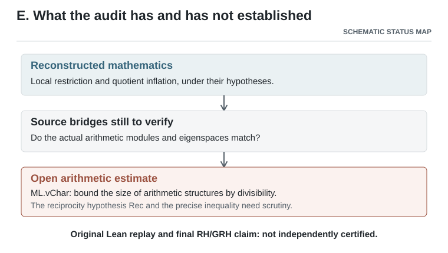

# Auditing the 2026 Riemann Hypothesis claim: what the mathematics actually says

A public, reproducible account of the mathematical mechanisms we have reconstructed, the assumptions that make them work, and the decisive arithmetic argument still under examination.

!!! warning "Research status · 24 November 2026"
    **Result:** independent conventional-mathematics reconstructions of *conditional* group-cohomology and local-Selmer transfer statements, with exact finite computational checks. These results, and the independent denominator and conductor-change reconstruction described below, have been documented and admitted as bounded **MATHFORGE audit evidence**.

    **Not established:** a new proof of the Riemann Hypothesis (RH) or Dirichlet Generalized Riemann Hypothesis (GRH); mathematical correctness of every definition in the submitted Lean source; complete independent Lean kernel replay; the Bernoulli/cohomological valuation inequality `ML.vChar` under its needed assumptions; MATHCERT certification.

    **Evidence classes:** source audit, conventional conditional mathematical proof, exact finite verification, and regression tests. Repository merge, finite computations, and public exposition are **not** proof certification.

    **Authority:** [RH-001 live programme tracker](https://github.com/grandchallenge/MATH-PROGRAMME/issues/163) · [RH-A26 audit tracker](https://github.com/grandchallenge/MATHFORGE/issues/577) · [original claim verification guide](riemann_hypothesis_2026_lean_announcement.md) · [MATHFORGE protected audit PRs](#the-evidence-a-reader-can-open).

## 1. The question

The Riemann Hypothesis concerns the hidden regularity of prime numbers. It asserts that every *nontrivial* zero of the analytically continued Riemann zeta function has real part one-half:

$$
\zeta(s)=0,\quad 0<\Re(s)<1
\quad\Longrightarrow\quad
\Re(s)=\frac12.
$$

In November 2026, an external submission by Alpöge and Claude claimed a formal Lean proof of RH and certain generalized statements. Our task is to establish **what the actual formal source says**, **which mathematical bridges can be reconstructed independently**, and **which evidence would warrant accepting the whole claim**. See the separate [source-critical announcement guide](riemann_hypothesis_2026_lean_announcement.md) for the submission, external replay reports, original sources, and historical context.

### Why anyone studies this question

Counting primes is easy for a small range: list the numbers, eliminate those that are not prime, and count what remains. Predicting the count across arbitrarily large ranges is much harder. The striking fact is that a smooth mathematical function predicts this irregular staircase remarkably well. RH would give strong control over the error in suitable prime-counting estimates.

*Figure A. What RH says.* The horizontal position of a zero is its real part. The five dots show known zeros; their vertical positions are calculated from known zero heights. RH says **every** nontrivial zero is on the middle line, including those beyond the plotted range. The figure does not show that there are no other zeros elsewhere.

*Figure B. Why the zeros matter.* The black staircase counts actual primes; it rises by one each time another prime appears. The blue curve is a smooth approximation called Riemann's prime-counting approximation, sampled at integer arguments. Their closeness illustrates the kind of regularity number theory seeks to explain. It does not prove an error bound or RH.

### How to read this investigation

The authors' claimed proof is not a calculation of more zeta zeros. It proceeds through a long sequence of arithmetic statements. Our investigation works backward from the final claim, identifying the statements it needs and testing whether their hypotheses really justify the next step. The mathematical tools introduced below are examples of that work.

The underlying problem is infinite. Testing many primes, evaluating many zeta zeros, or compiling many files can inform an investigation; none of those facts alone proves the intended mathematical statement.

**A useful distinction:** the arithmetic object called `Sha` in this source is a specifically defined kernel of first-cohomology restriction maps with selected local conditions. It must not silently be identified with every classical use of the notation “Tate–Shafarevich group”. Its meaning comes from the *definition in the source*.

## 2. The obstruction: a change of viewpoint can discard information

Much of the proposed argument replaces a difficult arithmetic object by another description in which its structure is easier to study. The first question is whether that replacement preserves the information one needs.

For example, let $C_3$ be a cyclic group of order three, acting trivially on the field $\mathbb F_3$. A first-cohomology class here is essentially an additive homomorphism from $C_3$ to $\mathbb F_3$. There are three:

$$
H^1(C_3,\mathbb F_3)\cong\mathbb F_3.
$$

But the trivial subgroup has no nonzero first-cohomology classes:

$$
H^1(\{1\},\mathbb F_3)=0.
$$

*Figure C. A concrete information-loss test.* Imagine three genuinely distinct answers to a mathematical question. After restricting the question to a smaller setting, all three answers look the same. In this exact example, the two nonzero classes become zero, and the zero class stays zero. The labels are literal class representatives; their placement is only for readability.

Why does the collapse occur? The subgroup index is three, and three is zero in the coefficient field. Averaging by dividing by three is impossible. We need to know when a proof's change of viewpoint preserves the distinctions that matter.

This is not a counterexample to RH. It is a precise counterexample to a *careless version of a technique* that the submitted proof must use correctly.

### A closer look: what is a cohomology class?

For this example, think of a group as a set of operations that can be composed, and a cocycle as a consistent rule recording how those operations change a quantity. Two such rules are treated as equivalent if they differ only by a change of reference value. A cohomology class records the distinction that survives those changes of reference. In the example above the action is trivial, so this reduces to the very concrete question of which additive values the generator may take.

### Worked example A · exact loss of information

The exact calculation enumerates all cyclic one-cocycles and their coboundaries:

| Group and coefficients | Action | Number of distinct $H^1$ classes | Meaning |
| --- | --- | ---: | --- |
| $C_3$ on $\mathbb F_3$ | trivial | 3 | index divisible by characteristic; information survives in the large group |
| $C_2$ on $\mathbb F_3$ | trivial | 1 | prime-to-index case; no nonzero class |
| $C_4$ on $\mathbb F_5$ | multiplication by 2 | 1 | nontrivial scalar action; cocycles are all coboundaries |
| $C_2$ on $\mathbb F_2$ | trivial | 2 | another excluded-index case |

For a generator acting by a scalar $a$ on $\mathbb F_p$, the calculation is entirely explicit:

$$
Z^1=\{z:(1+a+\cdots+a^{m-1})z=0\},
\qquad
B^1=\{(a-1)b:b\in\mathbb F_p\}.
$$

Here $a^m=1$ in $\mathbb F_p$. The first set contains possible cocycles; the second contains those representing the zero cohomology class. The quotient $Z^1/B^1$ is what the test computes.

## 3. A rule for when information is preserved

Let $U'$ be a normal subgroup of $U$ with finite index $m$. Suppose $m$ is invertible in the coefficient ring and the usual continuous cohomology hypotheses hold.

Then restriction identifies the first cohomology of $U$ with the invariant part, under $U/U'$, of the first cohomology of $U'$:

$$
H^1(U,M)\;\cong\;H^1(U',M)^{U/U'}.
$$

The reason is an averaging argument. When division by $m$ is available, the finite quotient's higher cohomology vanishes, making restriction reversible onto the invariant classes.

But arithmetic imposes **additional local tests**. At each prescribed local subgroup $D$, an allowed class must become zero after restricting to $U\cap D$. Denote the set of such classes by $S(U)$.

The same argument extends to these *local-kernel* classes:

$$
S(U)\;\cong\;S(U')^{U/U'}.
$$

Crucially, the local index

$$
[U\cap D:U'\cap D]
$$

divides $m$. The ability to divide by the global index therefore applies to every local comparison. Without that divisibility argument, the local conclusion would not follow from the global one.

**What we learned:** it is not enough for a transformation to preserve the ambient cohomology. It must preserve the exact restrictions that define the arithmetic object.

## 4. The second transformation: forgetting ramification without forgetting the mathematics

A Galois group encodes ways of permuting algebraic numbers while preserving the base field. Some of these symmetries are grouped into *inertia groups* associated with primes. At a prime, inertia records how a field extension is ramified.

To see how one can deliberately forget certain distinctions without losing a particular answer, start with six permutations of three objects. We can group them into two types: those that are even and those that are odd. Any function taking the same value on all permutations of each type can be described by only two values.

*Figure D. A small model of a quotient.* The six permutations and their grouping into two cosets are exact; box sizes and arrow placement carry no mathematical scale. If a function cannot distinguish the three members of each group, the two-class description contains all the information that function uses. This is a finite analogy to the Galois quotient, not a picture of the actual infinite Galois group.

In the arithmetic argument we need more than an arbitrary function: we need a continuous cocycle, a function satisfying a special compatibility rule under composition. Fix a finite set of primes $S$. Let $G$ be the relevant absolute Galois group, and let $N$ be the **closed normal subgroup generated by all inertia groups outside $S$**. The quotient $G/N$ deliberately forgets those ramification symmetries. The point of the proof is to establish that the cocycle truly cannot distinguish elements within a coset, not to assume that the discarded information is irrelevant.

The source's `InfUnram` mechanism states that, if the coefficient representation already factors through $G/N$, a continuous class in $H^1(G,M)$ comes from the quotient exactly when it restricts to zero on all inertia groups outside $S$.

The central argument is short enough to understand:

1. Because the representation factors through $G/N$, elements of $N$ act trivially on the coefficients.
2. If a cocycle's class is zero on a specified inertia group, its restricted cocycle is a coboundary; here such a coboundary is literally zero because that inertia group acts trivially.
3. The cocycle-zero elements inside $N$ form a **closed normal subgroup**. They contain all the specified inertia groups, and thus contain the closed normal subgroup generated by them: all of $N$.
4. The cocycle is constant on cosets of $N$, so it descends to a continuous cocycle on $G/N$. Conversely, any inflated quotient cocycle vanishes on $N$.

This proves the mathematical descent principle **under its stated continuity, Hausdorffness, normal-closure, and representation hypotheses**. Removing those assumptions would change the statement.

The associated `shaInfl` comparison makes an additional step: local vanishing on one chosen decomposition group over a prime must represent the same condition at **all** places over that prime. This uses the standard Galois-theoretic transitivity of places and the conjugation behavior of cocycles. The original source contains explicit constructions for these comparisons.

### Worked example B · the local condition is not decorative

We tested local restriction kernels in exact finite cyclic groups, including both prime-to-index and excluded-index cases. The separate MATHFORGE fixture passed **7,448** prime-to-index comparisons and recorded **1,306** excluded-index failures.

A stronger noncommutative test used $G=S_3$, its normal subgroup $N=A_3$, and quotient $G/N=C_2$, with six possible local subgroups and finite-field coefficients. All **72** tested local-Selmer comparisons matched. In one nontrivial coefficient setting, dropping the inertia condition outside $S$ admitted **two additional cohomology classes** that could not have come from quotient inflation.

Separate exact programs perform the full noncommutative enumeration and representative cyclic local-kernel calculations. Neither bounded test replaces the general argument or independently checks the original Lean kernel.

## 5. Where these results belong in the submitted proof

These objects are not isolated puzzles. They form a *dependency structure* whose links need individual verification. The following map is a reading guide to the audit as recorded on this page, not the entire original proof or a measurement of percentage complete.

*Figure E. Where scrutiny is concentrated.* We have reconstructed rules for moving information between mathematical descriptions. We still need to verify that the source's actual arithmetic objects are faithfully represented and that the resulting numerical bound holds. The arrows give a reading order, not a complete theorem-dependency graph. Neither a successful transfer nor this map establishes RH.

For readers who want to see the precise source statements, the following table identifies the named components:

| Source component | Role | Current audit boundary |
| --- | --- | --- |
| `InfUnram` | Recover classes on the unramified quotient from specified inertia-vanishing conditions | Conditional mathematical argument independently reconstructed; full source replay open |
| `shaInfl` | Match quotient-local `Sha1` with full-group `ShaAbs` | Conditional mathematical argument reconstructed, assuming standard Galois place-transitivity foundations |
| `shaModel`, `shaLenEq` | Connect the original arithmetic `Sha` module and its Galois eigenspaces to the transported Selmer model | Genuine source-level constructions located and dependency-traced; exact implementation not independently verified |
| `eigV`, `selUnit` | Transfer eigenspace lengths across a finite-index subgroup under an invertibility condition | Abstract and local-kernel mechanisms independently reconstructed |
| **`ML.vChar`** | Relate generalized Bernoulli quantities to the lengths of these arithmetic eigenspaces | **Decisive arithmetic inequality not independently established**; its source statement explicitly assumes `Rec` |

The word **conditional** matters. In the source, the valuation theorem begins with a hypothesis `Rec → ...`. To obtain an unconditional consequence one must establish that hypothesis, discharge all other assumptions, and verify that the formal statements describe the claimed classical problem.

We have reconstructed important pieces of the *transfer machinery*. We have **not** turned a conditional source theorem into an unconditional RH proof.

## 6. Why Bernoulli numbers appear

Ordinary Bernoulli numbers arise in formulas linking sums of powers, special values of the zeta function, and other arithmetic identities. *Generalized* Bernoulli numbers incorporate a Dirichlet character: a multiplicative rule that assigns numbers to residue classes.

For conductor $N$, a character $\chi$, and positive integer $k$, the source uses a normalization of the form

$$
B_{k,\chi}
=N^{k-1}\sum_{a=1}^{N}
\chi(a)B_k\!\left(\frac aN\right),
$$

where $B_k(x)$ is the Bernoulli polynomial of order $k$. This is an **exact algebraic expression**, not an approximation to a zeta zero.

### Worked example C · exact Bernoulli arithmetic

The following examples use exact fractions rather than decimal approximations:

| Character and index | Generalized Bernoulli value | Sufficient denominator multiplier | Exact product |
| --- | ---: | ---: | ---: |
| Odd primitive character modulo $4$, $k=1$ | $-1/2$ | $8$ | $-4$ |
| Quadratic even character modulo $5$, $k=2$ | $4/5$ | $30$ | $24$ |

The source defines the conservative bound

$$
d(N,k)=N\prod_{p\le k+1,\;p\text{ prime}}p.
$$

The two computations demonstrate *how* a denominator multiplier can turn a rational generalized Bernoulli value into an integer. They do **not** establish the source's general integrality lemma, its valuation estimates at the prime $p$, or the desired inequality on genuine cohomology groups.

A divisibility measurement asks how many times a prime divides a number. For example, 24 is divisible by 2 three times, but 25 is not divisible by 2 at all. The source uses a more general version of this measurement, a valuation, and compares it with the length of an arithmetic module. That length measures its algebraic complexity in a precise sense; it is not the physical size of an object.

The important unresolved step, `ML.vChar`, needs a quantitative comparison between the divisibility of such arithmetic values and a cohomological length. The routine conductor reduction and denominator divisibility lemmas support this step, but they are not the step itself.

### What changes when we use a larger modulus?

A periodic arithmetic rule can be described using a longer period than it really needs. The shortest modulus supporting the character is its *conductor*. For example, a character with conductor 5 can also be represented modulo 10, by pulling back its values on invertible residues and assigning zero on the nonunits.

But there are two different calculations one might perform. The primitive Bernoulli value uses the original conductor. The ordinary generalized sum at the larger modulus includes the additional nonunit exclusions. They need not agree.

| Calculation | Exact value |
| --- | ---: |
| Primitive Bernoulli value at conductor 5, order 2 | 4/5 |
| Same primitive value represented at modulus 10 | 4/5 |
| Ordinary generalized sum at modulus 10 | 12/5 |
| Primitive value multiplied by the denominator bound at level 5 | 24 |
| Primitive value multiplied by the denominator bound at level 10 | 48 |

The last number doubles for a simple reason: the source's denominator multiplier doubles, while its primitive value stays fixed. Computing the ordinary sum instead would produce 144, an incorrect substitute for the quantity required by the proof.

Our independent reconstruction explains why the multiplier clears denominators in general, using the classical von Staudt–Clausen theorem for Bernoulli numbers. It also establishes the exact cost of raising the modulus: when the larger modulus is a multiple of the conductor, the scaled primitive quantity is multiplied by their ratio. At a prime not dividing that ratio, the divisibility measurement does not change.

For example, 24 and 48 are each divisible by 3 once. The extra factor of 2 makes no difference at prime 3. This is a precise way to prevent a change of mathematical description from silently increasing the arithmetic bound.

**Evidence:** the independent [arithmetic audit PR #604](https://github.com/grandchallenge/MATHFORGE/pull/604) records the argument and exact tests: 5,100 coefficient calculations, 192 conductor cases, and 576 nonzero valuation comparisons. The proof uses standard classical Bernoulli and finite-character results; the examples are supporting checks, not a proof of the cohomology inequality. The primitive-character estimate itself still needs its reciprocity and counting argument.

## 7. Reproducibility and technical references

The numerical illustrations and exact finite examples are independently reproducible. Readers do not need any mathematical software to follow the explanation.

For specialists who wish to repeat the calculations, the [computational source](../assets/wolfram/rh_a26_audit_exhibits.wl) and [figure source](../assets/wolfram/rh_a26_visuals.wl) are retained in Wolfram Language format. The original 14 checks passed, and all five figures were generated from the retained source. The arithmetic audit additionally supplies an independent exact rational program. None of these computations constitutes a replay of the original Lean proof.

It independently checks four cyclic-cohomology examples, two local-kernel examples, two Bernoulli values, two denominator products, both character parities, and two introductory prime-counting facts. The last two are orientation only. For instance, at $X=1000$:

$$
\pi(1000)=168,\qquad R(1000)\approx168.359446.
$$

The approximation's closeness to the exact prime count is a finite observation, not a theorem about all primes.

To inspect the research evidence rather than the illustrations, follow the protected PRs below. Their source-locked dossiers and tests form the durable audit trail.

## The evidence a reader can open

| Admitted MATHFORGE evidence | What it establishes within its boundary |
| --- | --- |
| [PR #587](https://github.com/grandchallenge/MATHFORGE/pull/587) | Initial independent source audit and bounded analytic / arithmetic checks |
| [PR #591](https://github.com/grandchallenge/MATHFORGE/pull/591) | Prime-to-index group cohomology transfer and excluded-index counterexample |
| [PR #592](https://github.com/grandchallenge/MATHFORGE/pull/592) | Local Selmer restriction, source identification of `shaModel`, and 7,448 finite comparisons |
| [PR #594](https://github.com/grandchallenge/MATHFORGE/pull/594) | Independent `InfUnram` / `shaInfl` reconstruction and 72 noncommutative local checks |

**What protected merge means:** the evidence and bounded conclusions were admitted to the repository's reviewed documentary record. It does **not** mean that MATHCERT, an independent external referee, or the original Lean kernel has certified RH.

## 8. What the investigation taught us about checking extraordinary mathematical claims

**Inspect the exact theorem before its headline.** A theorem with an explicit hypothesis can be perfectly correct without resolving the unconditional problem.

**Test the failure conditions, not only the successes.** The $C_3/\mathbb F_3$ example shows why a transfer assumption matters. The $S_3/A_3$ test shows why a local inertia condition matters. A negative control gives a method the ability to catch certain kinds of error.

**Separate the mathematical object from its representation.** A length equality about a transformed module helps only if the source has justified the equivalence with the intended arithmetic module, including the local conditions and character action.

**Distinguish finite computation, mathematical proof, and machine formalization.** Exact arithmetic demonstrates individual calculations; an independent conventional argument covers a stated conditional theorem; kernel replay checks an exact formal declaration and its dependencies. None can silently stand in for the others.

**Make counterexamples and open obligations public.** A useful audit tells the reader not merely *what works*, but precisely *where it stops working* and what evidence would change that conclusion.

## 9. The next executable mathematical step

**Target:** `UpperTheory.V.ML.vChar` in the original `PrimitiveFrobeniusFixed/PrimCase.lean`.

**Input:** the source-locked definitions of `Rec`, `prim_case`, `lev_case`, `Bern.b_primmem`, `Bern.den_dvd`, and `Bern.b_primeq`; the actual coefficient-ring and character-conductor hypotheses.

**Work:** independently reconstruct the primitive-character estimate. Separate the assumed reciprocity/counting statement from independently proved Bernoulli integrality. Validate the exact valuation and Sha-length inequality, using the now-reconstructed denominator and conductor calculation. First establish the transfer from bounded torsion layers to the full cohomology group, then check the counting and reciprocity inputs.

**Completion test:** a proof or counterexample for the precise conditional inequality, with every genuine arithmetic hypothesis accounted for; a separately recorded disposition for original pinned Lean replay and semantic correspondence. Small computational examples must remain supporting exhibits, never the substitute for this proof.

**Present boundary:** `RH-A26-D05_PRIMITIVE_BERNOULLI_DENOMINATOR_AND_CONDUCTOR_COST_RECONSTRUCTED__PRIMITIVE_SHA_COUNT_ZEVAL_REC_AND_ORIGINAL_LEAN_REPLAY_OPEN`.

The live [RH-A26 tracker](https://github.com/grandchallenge/MATHFORGE/issues/577) carries new execution status. This page explains the protected evidence, not a certification of RH or GRH.
